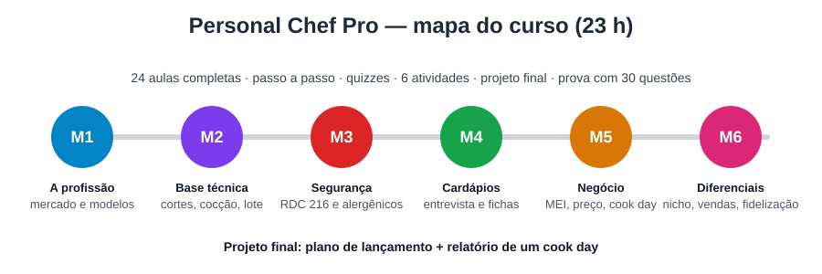

# Personal Chef Pro — Da cozinha ao negócio

> Torne-se um personal chef profissional no Brasil: cozinhe com padrão de restaurante na
> casa do cliente, cumpra as normas sanitárias, cobre o preço certo e construa uma carteira
> de clientes recorrentes.

## Ficha técnica
- **Público-alvo:** pessoas que cozinham bem (cozinheiros, egressos de gastronomia,
  confeiteiros, cozinheiros de restaurante, entusiastas avançados) e querem trabalhar como
  personal chef autônomo.
- **Nível:** iniciante na profissão → intermediário. Pressupõe cozinhar com segurança no
  dia a dia; a base técnica profissional é revisada no Módulo 2.
- **Pré-requisitos:** saber preparar refeições completas; acesso a uma cozinha para praticar.
- **Formato:** online gravado (videoaulas + materiais + exercícios práticos).
- **Carga horária total:** 23 h
  - 5 h 05 min de videoaulas (24 aulas)
  - 8 h de práticas das aulas (24 × 20 min)
  - 3 h de atividades avaliativas dos módulos (6 × 30 min)
  - 6 h de projeto final
  - 1 h de prova final
- **Módulos / aulas:** 6 / 24
- **Certificado:** sim, com aproveitamento ≥ 70% na prova final e projeto entregue
  (modelo em `extras/certificado.md`).

## Posicionamento
Os cursos estruturados de personal chef são norte-americanos (APPCA, USPCA, ACF, GRCC) e
usam leis e preços dos EUA. Os cursos brasileiros ensinam cozinha, mas não a profissão.
Este curso preenche essa lacuna: técnica essencial + RDC 216/RDC 26 + MEI + precificação em
reais + método de operação, com modelos prontos. Detalhes em `pesquisa/benchmark.md`.

## Competências finais
Ao concluir, o aluno será capaz de:
1. **Diferenciar** os modelos de atuação (personal, private chef, eventos, meal prep) e
   **escolher** um nicho viável com base no mercado local.
2. **Executar** um cook day completo (compras, produção em lote, porcionamento, rotulagem,
   limpeza) na cozinha de um cliente, em até 5 h, seguindo as boas práticas da RDC 216.
3. **Elaborar** cardápios personalizados a partir de uma entrevista estruturada, respeitando
   restrições, alergias (RDC 26) e os limites de atuação em relação ao nutricionista.
4. **Calcular** o preço de um serviço (pacote semanal e evento) que cubra custos, impostos e
   margem, e **formalizar** o negócio como MEI.
5. **Criar** uma proposta de valor, presença digital e processo de venda que gerem clientes
   recorrentes.

## Projeto final
**Plano de lançamento do seu serviço de personal chef**: nicho, cardápio semanal de um
cliente fictício com fichas técnicas, precificação, contrato, checklist do cook day e
vídeo curto de um cook day simulado. Ver `projeto-final.md`.

## Grade curricular

| Módulo | Objetivo | Aulas | Vídeo | Entregável | Avaliação |
|---|---|---|---|---|---|
| 1. A profissão | Decidir o modelo de atuação e o plano de transição | 4 | 44 min | Autodiagnóstico + plano de 90 dias | Quiz + atividade |
| 2. Base técnica | Produzir em lote com padrão profissional fora da própria cozinha | 4 | 54 min | Kit do chef + teste de produção | Quiz + atividade |
| 3. Segurança dos alimentos | Aplicar a RDC 216 e o protocolo de alergênicos no serviço | 4 | 51 min | Manual de Boas Práticas simplificado | Quiz + atividade |
| 4. Cardápios e nutrição | Montar cardápios personalizados com fichas técnicas | 4 | 51 min | Cardápio semanal + 3 fichas técnicas | Quiz + atividade |
| 5. Negócio e operação | Formalizar, precificar, contratar e operar | 4 | 54 min | Planilha de preço + contrato | Quiz + atividade |
| 6. Diferenciais e marketing | Posicionar, vender e fidelizar | 4 | 51 min | Proposta de valor + funil de vendas | Quiz + atividade |

### Módulo 1 — A profissão de personal chef
1. Aula 1.1 — O que faz (e o que não faz) um personal chef (10 min)
2. Aula 1.2 — Mercado e modelos de serviço no Brasil (12 min)
3. Aula 1.3 — Formação, cursos e certificações (12 min)
4. Aula 1.4 — Autodiagnóstico e plano de transição (10 min)

### Módulo 2 — Base técnica para o personal chef
1. Aula 2.1 — Mise en place e o kit do chef itinerante (12 min)
2. Aula 2.2 — Facas e cortes clássicos (15 min)
3. Aula 2.3 — Métodos de cocção e preparações-base (15 min)
4. Aula 2.4 — Produção em lote, porcionamento e reaquecimento (12 min)

### Módulo 3 — Segurança dos alimentos
1. Aula 3.1 — Perigos, zona de perigo e controle de temperatura (12 min)
2. Aula 3.2 — Higiene pessoal, contaminação cruzada e a cozinha do cliente (12 min)
3. Aula 3.3 — Alergênicos, intolerâncias e restrições (15 min)
4. Aula 3.4 — Armazenamento, rotulagem, transporte e Manual de Boas Práticas (12 min)

### Módulo 4 — Cardápios personalizados e nutrição
1. Aula 4.1 — A entrevista com o cliente (15 min)
2. Aula 4.2 — Alimentação saudável e os limites da sua atuação (12 min)
3. Aula 4.3 — Engenharia de cardápio, ficha técnica e lista de compras (12 min)
4. Aula 4.4 — Dietas especiais e públicos específicos (12 min)

### Módulo 5 — Negócio, formalização e operação
1. Aula 5.1 — Formalização: MEI, CNAE e licenças (12 min)
2. Aula 5.2 — Precificação: quanto cobrar (15 min)
3. Aula 5.3 — Contrato, políticas e proteção de dados (12 min)
4. Aula 5.4 — O cook day de ponta a ponta (15 min)

### Módulo 6 — Diferenciais, marketing e fidelização
1. Aula 6.1 — Nicho e proposta de valor (12 min)
2. Aula 6.2 — Marca pessoal, portfólio e canais (12 min)
3. Aula 6.3 — Da consulta ao fechamento (15 min)
4. Aula 6.4 — Experiência, qualidade e crescimento (12 min)

## Mapa de alinhamento

| Competência | Módulos que ensinam | Como é avaliada |
|---|---|---|
| C1 Modelos e nicho | M1, M6 | Quizzes 1.1, 1.2, 6.1; atividade M1; projeto (critério 1); prova (Q1–Q5, Q26) |
| C2 Cook day seguro | M2, M3, M5 (5.4) | Atividades M2 e M3; projeto (critérios 2 e 5); prova (Q6–Q16) |
| C3 Cardápios personalizados | M3 (3.3), M4 | Atividade M4; projeto (critério 3); prova (Q17–Q21) |
| C4 Preço e formalização | M5 | Atividade M5; projeto (critério 4); prova (Q22–Q25) |
| C5 Posicionamento e vendas | M6 | Atividade M6; projeto (critério 1); prova (Q26–Q30) |

## Arquivos do curso
- `pesquisa/` — 33 fontes (64 links) e benchmark de 10 cursos/certificações
- `modulos/` — 24 aulas com roteiro de vídeo, imagens, prática, quiz e referências
- `imagens/` — infográficos (SVG) usados nas aulas
- `projeto-final.md`, `avaliacao-final.md` (prova com 30 questões), `glossario.md`, `recursos.md`
- `extras/` — modelos (entrevista, ficha técnica, contrato, checklist), página de vendas e certificado

## Aviso
Este curso tem caráter educativo. Normas sanitárias, regras do MEI e tributos mudam e variam
por município: confirme sempre na Vigilância Sanitária local, no Portal do Empreendedor e com
um contador. Prescrição de dietas é atividade privativa do nutricionista.
