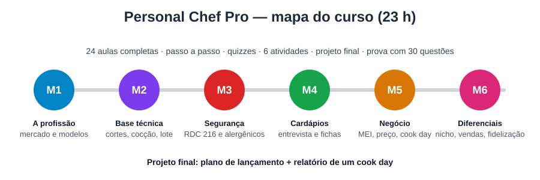
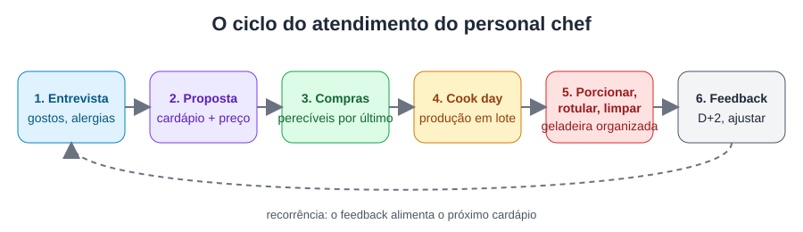
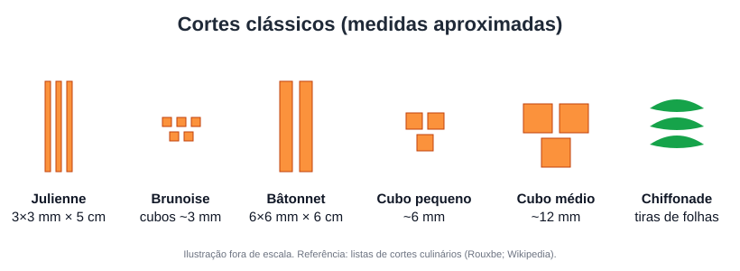
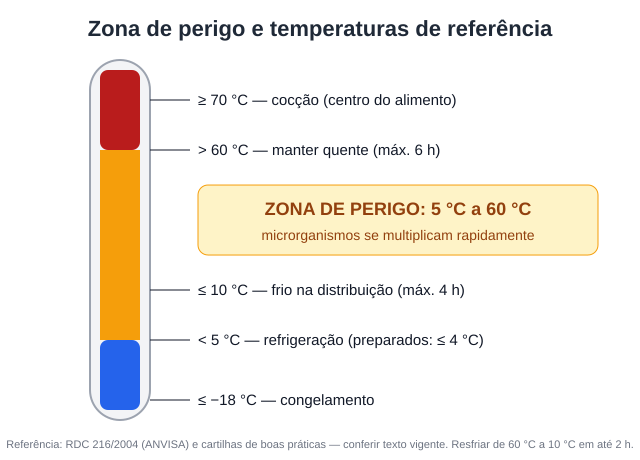
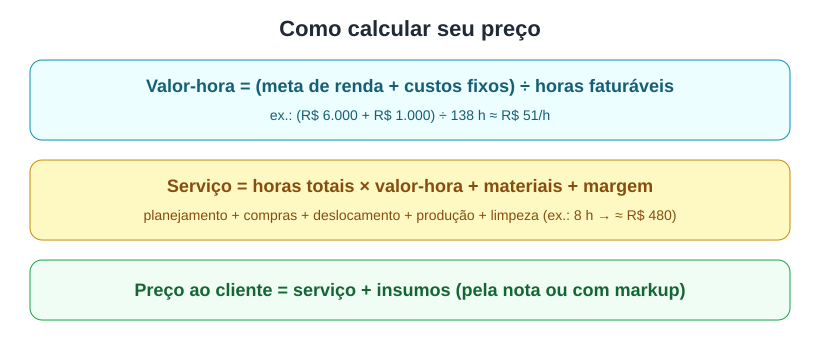

# Personal Chef Pro — Curso completo

> Arquivo único gerado a partir das pastas do curso. Ordem: visão geral, módulos e aulas, avaliação, modelos, consulta.


---

<a id="inicio"></a>

## Personal Chef Pro — Da cozinha ao negócio

> Torne-se um personal chef profissional no Brasil: cozinhe com padrão de restaurante na
> casa do cliente, cumpra as normas sanitárias, cobre o preço certo e construa uma carteira
> de clientes recorrentes.



### Ficha técnica
- **Público-alvo:** pessoas que cozinham bem (cozinheiros, egressos de gastronomia,
  confeiteiros, cozinheiros de restaurante, entusiastas avançados) e querem trabalhar como
  personal chef autônomo.
- **Nível:** iniciante na profissão → intermediário. Pressupõe cozinhar com segurança no
  dia a dia; a base técnica profissional é revisada no Módulo 2.
- **Pré-requisitos:** saber preparar refeições completas; acesso a uma cozinha para praticar.
- **Formato:** curso completo em texto (aulas para leitura + exercícios práticos + modelos prontos). Não depende de vídeos.
- **Carga horária total:** 23 h
  - 5 h 05 min de leitura das aulas (24 aulas)
  - 8 h de práticas das aulas (24 × 20 min)
  - 3 h de atividades avaliativas dos módulos (6 × 30 min)
  - 6 h de projeto final
  - 1 h de prova final
- **Módulos / aulas:** 6 / 24
- **Certificado:** sim, com aproveitamento ≥ 70% na prova final e projeto entregue
  (modelo em `extras/certificado.md`).

### Posicionamento
Os cursos estruturados de personal chef são norte-americanos (APPCA, USPCA, ACF, GRCC) e
usam leis e preços dos EUA. Os cursos brasileiros ensinam cozinha, mas não a profissão.
Este curso preenche essa lacuna: técnica essencial + RDC 216/RDC 26 + MEI + precificação em
reais + método de operação, com modelos prontos. Detalhes em `pesquisa/benchmark.md`.

### Competências finais
Ao concluir, o aluno será capaz de:
1. **Diferenciar** os modelos de atuação (personal, private chef, eventos, meal prep) e
   **escolher** um nicho viável com base no mercado local.
2. **Executar** um cook day completo (compras, produção em lote, porcionamento, rotulagem,
   limpeza) na cozinha de um cliente, em até 5 h, seguindo as boas práticas da RDC 216.
3. **Elaborar** cardápios personalizados a partir de uma entrevista estruturada, respeitando
   restrições, alergias (RDC 26) e os limites de atuação em relação ao nutricionista.
4. **Calcular** o preço de um serviço (pacote semanal e evento) que cubra custos, impostos e
   margem, e **formalizar** o negócio como MEI.
5. **Criar** uma proposta de valor, presença digital e processo de venda que gerem clientes
   recorrentes.

### Projeto final
**Plano de lançamento do seu serviço de personal chef**: nicho, cardápio semanal de um
cliente fictício com fichas técnicas, precificação, contrato, checklist do cook day e
relatório fotográfico de um cook day. Ver `projeto-final.md`.

### Grade curricular

| Módulo | Objetivo | Aulas | Leitura | Entregável | Avaliação |
|---|---|---|---|---|---|
| 1. A profissão | Decidir o modelo de atuação e o plano de transição | 4 | 44 min | Autodiagnóstico + plano de 90 dias | Quiz + atividade |
| 2. Base técnica | Produzir em lote com padrão profissional fora da própria cozinha | 4 | 54 min | Kit do chef + teste de produção | Quiz + atividade |
| 3. Segurança dos alimentos | Aplicar a RDC 216 e o protocolo de alergênicos no serviço | 4 | 51 min | Manual de Boas Práticas simplificado | Quiz + atividade |
| 4. Cardápios e nutrição | Montar cardápios personalizados com fichas técnicas | 4 | 51 min | Cardápio semanal + 3 fichas técnicas | Quiz + atividade |
| 5. Negócio e operação | Formalizar, precificar, contratar e operar | 4 | 54 min | Planilha de preço + contrato | Quiz + atividade |
| 6. Diferenciais e marketing | Posicionar, vender e fidelizar | 4 | 51 min | Proposta de valor + funil de vendas | Quiz + atividade |

#### Módulo 1 — A profissão de personal chef
1. Aula 1.1 — O que faz (e o que não faz) um personal chef (10 min)
2. Aula 1.2 — Mercado e modelos de serviço no Brasil (12 min)
3. Aula 1.3 — Formação, cursos e certificações (12 min)
4. Aula 1.4 — Autodiagnóstico e plano de transição (10 min)

#### Módulo 2 — Base técnica para o personal chef
1. Aula 2.1 — Mise en place e o kit do chef itinerante (12 min)
2. Aula 2.2 — Facas e cortes clássicos (15 min)
3. Aula 2.3 — Métodos de cocção e preparações-base (15 min)
4. Aula 2.4 — Produção em lote, porcionamento e reaquecimento (12 min)

#### Módulo 3 — Segurança dos alimentos
1. Aula 3.1 — Perigos, zona de perigo e controle de temperatura (12 min)
2. Aula 3.2 — Higiene pessoal, contaminação cruzada e a cozinha do cliente (12 min)
3. Aula 3.3 — Alergênicos, intolerâncias e restrições (15 min)
4. Aula 3.4 — Armazenamento, rotulagem, transporte e Manual de Boas Práticas (12 min)

#### Módulo 4 — Cardápios personalizados e nutrição
1. Aula 4.1 — A entrevista com o cliente (15 min)
2. Aula 4.2 — Alimentação saudável e os limites da sua atuação (12 min)
3. Aula 4.3 — Engenharia de cardápio, ficha técnica e lista de compras (12 min)
4. Aula 4.4 — Dietas especiais e públicos específicos (12 min)

#### Módulo 5 — Negócio, formalização e operação
1. Aula 5.1 — Formalização: MEI, CNAE e licenças (12 min)
2. Aula 5.2 — Precificação: quanto cobrar (15 min)
3. Aula 5.3 — Contrato, políticas e proteção de dados (12 min)
4. Aula 5.4 — O cook day de ponta a ponta (15 min)

#### Módulo 6 — Diferenciais, marketing e fidelização
1. Aula 6.1 — Nicho e proposta de valor (12 min)
2. Aula 6.2 — Marca pessoal, portfólio e canais (12 min)
3. Aula 6.3 — Da consulta ao fechamento (15 min)
4. Aula 6.4 — Experiência, qualidade e crescimento (12 min)

### Mapa de alinhamento

| Competência | Módulos que ensinam | Como é avaliada |
|---|---|---|
| C1 Modelos e nicho | M1, M6 | Quizzes 1.1, 1.2, 6.1; atividade M1; projeto (critério 1); prova (Q1–Q5, Q26) |
| C2 Cook day seguro | M2, M3, M5 (5.4) | Atividades M2 e M3; projeto (critérios 2 e 5); prova (Q6–Q16) |
| C3 Cardápios personalizados | M3 (3.3), M4 | Atividade M4; projeto (critério 3); prova (Q17–Q21) |
| C4 Preço e formalização | M5 | Atividade M5; projeto (critério 4); prova (Q22–Q25) |
| C5 Posicionamento e vendas | M6 | Atividade M6; projeto (critério 1); prova (Q26–Q30) |

### Arquivos do curso
- `pesquisa/` — 33 fontes (64 links) e benchmark de 10 cursos/certificações
- `modulos/` — 24 aulas com conteúdo completo, passo a passo, imagens, prática, quiz e referências
- `imagens/` — infográficos (SVG) usados nas aulas
- `projeto-final.md`, `avaliacao-final.md` (prova com 30 questões), `glossario.md`, `recursos.md`
- `extras/` — modelos (entrevista, ficha técnica, contrato, checklist), página de vendas e certificado

### Aviso
Este curso tem caráter educativo. Normas sanitárias, regras do MEI e tributos mudam e variam
por município: confirme sempre na Vigilância Sanitária local, no Portal do Empreendedor e com
um contador. Prescrição de dietas é atividade privativa do nutricionista.


---

<a id="modulo-1"></a>

## Módulo 1 — A profissão de personal chef

**Objetivo do módulo:** ao final, você será capaz de diferenciar os modelos de atuação,
estimar o potencial do mercado na sua cidade e montar um plano de transição de 90 dias.

**Por que este módulo vem primeiro:** quem começa sem saber *qual* serviço vai vender
costuma aceitar qualquer trabalho, cobrar errado e se cansar rápido. Aqui você decide o
formato antes de investir.

| Aula | Título | Duração |
|---|---|---|
| 1.1 | O que faz (e o que não faz) um personal chef | 10 min |
| 1.2 | Mercado e modelos de serviço no Brasil | 12 min |
| 1.3 | Formação, cursos e certificações | 12 min |
| 1.4 | Autodiagnóstico e plano de transição | 10 min |

**Entregável:** autodiagnóstico + plano de 90 dias (`atividade-avaliativa.md`).

### Checklist de conclusão do módulo
- [ ] Sei explicar a diferença entre personal chef, private chef, buffet e marmitaria
- [ ] Listei 3 modelos de serviço possíveis para mim e escolhi 1 principal
- [ ] Pesquisei preços de 3 concorrentes da minha cidade
- [ ] Defini quais formações preciso (e quais não preciso) agora
- [ ] Preenchi o autodiagnóstico e o plano de 90 dias

### Encerramento
Você agora sabe *o que* vai vender. No Módulo 2 garantimos que você consiga *entregar*
com padrão profissional em qualquer cozinha.


---

<a id="aula-1-1"></a>

## Aula 1.1 — O que faz (e o que não faz) um personal chef

**Tempo de leitura:** 10 min · **Formato:** leitura + prática

### Objetivos
Ao final desta aula, você será capaz de:
- **Diferenciar** personal chef, private chef, buffet/catering e marmitaria.
- **Descrever** as tarefas de um ciclo de atendimento de personal chef.

### Gancho de abertura
"Você cozinha muito bem. Seus amigos dizem que você deveria 'vender comida'. Mas vender
marmita, abrir um buffet e ser personal chef são negócios completamente diferentes — com
clientes, preços e riscos diferentes. Hoje você vai descobrir qual deles é o seu."

### Conteúdo

#### 1. Definição
O personal chef é um profissional **autônomo** que atende **vários clientes**, planejando
cardápios personalizados e cozinhando — geralmente na casa do cliente — refeições para a
semana ou para ocasiões específicas [F23]. A CIA (Culinary Institute of America) resume: o
personal chef **administra o próprio negócio**, personaliza cardápios e gerencia o
relacionamento com clientes [F08].

#### 2. Comparativo

| | Personal chef | Private chef | Buffet / catering | Marmitaria / delivery |
|---|---|---|---|---|
| Vínculo | Autônomo, vários clientes | Empregado de 1 família/pessoa | Empresa | Empresa/MEI |
| Onde cozinha | Casa do cliente (ou cozinha própria licenciada) | Casa do empregador | Cozinha industrial | Cozinha própria |
| Personalização | Alta (por cliente) | Total | Baixa/média (cardápio de evento) | Baixa (cardápio fixo) |
| Remuneração | Por serviço/pacote | Salário | Por evento/convidado | Por unidade |
| Exemplo | Refeições da semana de uma família | Chef fixo de uma residência | Casamento de 200 pessoas | 10 marmitas fitness |

Fontes: Take a Chef, Tasting Table, Zippia [F23]. Nos EUA, pesquisa citada pela Zippia
aponta média anual de US$ 51.657 para private chef e US$ 47.681 para personal chef.

#### 3. O ciclo de atendimento
1. **Contato e entrevista** (gostos, restrições, rotina, orçamento)
2. **Proposta** de cardápio e preço
3. **Compras** dos ingredientes
4. **Cook day**: produção na casa do cliente, porcionamento, rotulagem
5. **Limpeza** da cozinha
6. **Feedback** e ajuste do próximo cardápio



#### 4. O que o personal chef NÃO faz
- **Não prescreve dieta** — isso é atividade do nutricionista (Lei 8.234/1991
  **[a verificar]**). Você *executa* um plano alimentar prescrito ou faz cardápios saudáveis
  gerais (Aula 4.2).
- Não é empregado doméstico: tarefas fora do escopo (lavar roupa, cuidar de crianças)
  descaracterizam o serviço — deixe isso claro no contrato (Aula 5.3).
- Não é profissão regulamentada no Brasil: não há registro obrigatório [F22], mas as
  **normas sanitárias** valem para você (Módulo 3).

> **Erro comum:** chamar de "personal chef" o serviço de marmita congelada feito na
> própria casa e vendido a desconhecidos. Isso é comércio de alimentos e tem exigências
> sanitárias próprias de licenciamento (Aula 5.1).

### Imagem da aula
**Imagem sugerida (para gerar ou fotografar):** "chef de dólmã branco organizando potes
rotulados em geladeira de cozinha residencial, luz natural, estilo editorial".

### Prática (20 min)
**Exercício — Classifique os casos:** para cada situação, diga qual modelo é e por quê.
1. Ana cozinha às segundas na casa de 3 famílias diferentes, deixando 5 jantares em cada.
2. Bruno trabalha 6 dias por semana, com carteira assinada, na casa de um empresário.
3. Carla prepara 300 salgados por semana para festas.
4. Diego vende 60 marmitas por semana pelo Instagram, feitas na cozinha dele.

**Resultado esperado:** 1 = personal chef; 2 = private chef; 3 = catering/buffet;
4 = marmitaria/delivery (exige licenciamento de produção própria).

### Quiz de fixação
1. A principal diferença entre personal chef e private chef é:
   a) O tipo de culinária b) O vínculo: autônomo com vários clientes × empregado de um
   empregador c) O preço dos ingredientes d) O uso de dólmã
   **Gabarito: b** — a culinária e o uniforme podem ser iguais; o que muda é o vínculo e o
   número de clientes [F23]. O preço dos ingredientes não define o modelo.

2. Qual etapa vem imediatamente ANTES do cook day?
   a) Feedback b) Limpeza c) Compras d) Contrato de trabalho
   **Gabarito: c** — os ingredientes precisam ser comprados antes da produção. Feedback e
   limpeza vêm depois; contrato de trabalho (CLT) não se aplica ao autônomo.

3. Um cliente pede que você "monte a dieta para ele emagrecer 10 kg". O correto é:
   a) Montar a dieta b) Recusar o cliente c) Pedir o plano prescrito por um nutricionista e
   executá-lo d) Copiar uma dieta da internet
   **Gabarito: c** — prescrição dietética é atividade do nutricionista; você pode executar
   o plano e propor preparações. Recusar o cliente é desnecessário; (a) e (d) extrapolam sua
   atuação.

4. Verdadeiro ou falso: personal chef é profissão regulamentada no Brasil, com registro
   obrigatório em conselho.
   **Gabarito: Falso** — não há regulamentação nem registro obrigatório [F22]; porém as
   normas sanitárias e fiscais se aplicam.

### Resumo
- Personal chef = autônomo, vários clientes, cardápio personalizado, geralmente na casa do cliente.
- Private chef = empregado de uma família.
- Ciclo: entrevista → proposta → compras → cook day → limpeza → feedback.
- Você não prescreve dietas e não é empregado doméstico.

### Para ir além
- Take a Chef — diferenças entre private e personal chef: https://www.takeachef.com/blog/private-chef-vs-personal-chef-differences
- CIA — How to become a personal chef: https://www.ciachef.edu/blog/how-to-become-a-personal-chef/

### Referências
- [F08] Culinary Institute of America. How to become a personal chef. https://www.ciachef.edu/blog/how-to-become-a-personal-chef/
- [F22] Educa Mais Brasil. O que é um personal chef. https://www.educamaisbrasil.com.br/cursos-e-faculdades/gastronomia/noticias/o-que-e-um-personal-chef-e-o-que-faz-o-profissional
- [F23] Take a Chef; Tasting Table; Zippia (ver `pesquisa/fontes.md`).


---

<a id="aula-1-2"></a>

## Aula 1.2 — Mercado e modelos de serviço no Brasil

**Tempo de leitura:** 12 min · **Formato:** leitura + prática

### Objetivos
- **Comparar** os 4 principais modelos de serviço de personal chef quanto a preço,
  recorrência e esforço.
- **Levantar** preços de referência praticados na sua cidade.

### Gancho de abertura
"Em 2018 a Forbes Brasil já dizia que os chefs particulares estavam caindo no gosto do
brasileiro [F21]. Em 2026, a reportagem da Tribuna de Minas mostra que uma das áreas que
mais crescem é a das **refeições planejadas para a semana** [F20]. Onde está a sua
oportunidade?"

### Conteúdo

#### 1. Os 4 modelos de serviço

| Modelo | Como funciona | Faixa de preço observada (2026) | Recorrência |
|---|---|---|---|
| **Meal prep semanal** | Um dia por semana na casa do cliente, prepara refeições para vários dias | Cobrança por pacote/visita; valor-hora estimado R$ 28–108 conforme cidade [F16] | Alta (semanal) |
| **Jantar / experiência em casa** | Menu de 3 a 6 tempos para pequeno grupo | R$ 120–450 por pessoa [F17, F18]; R$ 800–3.000 por evento [F18] | Baixa/média |
| **Eventos maiores** | 30–80 convidados | R$ 140–280 por convidado [F19] | Baixa |
| **Diária / temporada** | Chef à disposição na casa de praia/campo | R$ 300–2.000 por dia, sem ingredientes [F18, F19] | Sazonal |

> As fontes divergem bastante — use como ponto de partida e **valide na sua cidade**.

#### 2. O que o cliente compra
Não é só comida: é **tempo**, **saúde** e **experiência**. A reportagem da Tribuna de
Minas destaca que o menu é definido por restrições alimentares, alergias, gostos pessoais
e perfil da ocasião [F20]. Exemplo brasileiro de menus semanais sob medida: reportagem do
Metrópoles [F32].

#### 3. Perfis de cliente mais comuns
- Famílias com rotina corrida (meal prep)
- Pessoas com restrições (diabetes, doença celíaca, alergias) — executando plano do nutricionista
- Praticantes de atividade física
- Idosos e quem está em recuperação
- Anfitriões que querem receber em casa (jantares)
- Turistas/temporada (diárias)

#### 4. Como pesquisar seu mercado (em 1 hora)
1. Busque "personal chef + sua cidade" no Google e no Instagram — anote 5 concorrentes.
2. Consulte plataformas: Take a Chef, GetNinjas, Cronoshare [F19, F27].
3. Anote: serviço, nicho, preço (se divulgado), diferenciais, nº de avaliações.
4. Faça 1 contato como cliente para ouvir a proposta (pesquisa de "cliente oculto").

### Imagem da aula
**Imagem sugerida:** "mesa de jantar posta em apartamento, chef servindo prato autoral a
casal, ambiente aconchegante".

### Prática (20 min)
**Exercício — Mapa de concorrentes:** preencha a tabela com 5 concorrentes da sua cidade.

| Nome/@ | Modelo | Nicho | Preço divulgado | Diferencial | Avaliações |
|---|---|---|---|---|---|

**Resultado esperado:** identificar ao menos 1 modelo/nicho pouco atendido na sua região.

### Quiz de fixação
1. Segundo reportagem de 2026, uma das áreas que mais crescem é:
   a) Buffet de casamento b) Refeições planejadas para a semana c) Food truck d) Confeitaria
   **Gabarito: b** [F20]. As demais não foram citadas como tendência na fonte.

2. Qual modelo tem maior recorrência?
   a) Jantar especial b) Evento de 80 pessoas c) Meal prep semanal d) Diária de temporada
   **Gabarito: c** — é contratado toda semana; os demais são pontuais ou sazonais.

3. Por que as faixas de preço desta aula devem ser validadas localmente?
   **Gabarito comentado:** porque as fontes divergem (ex.: diária de R$ 300–600 em uma e
   R$ 600–2.000 em outra [F18, F19]) e o preço varia por cidade, menu e experiência.

4. O que o cliente de personal chef compra, além da comida?
   **Gabarito:** tempo, saúde/segurança alimentar personalizada e experiência.

### Resumo
- 4 modelos: meal prep, jantar/experiência, eventos, diária/temporada.
- Meal prep = recorrência; jantares = ticket alto por pessoa.
- Faça pesquisa local antes de definir preço.

### Para ir além
- Catraca Livre (2026): https://catracalivre.com.br/noticias/quanto-custa-contratar-um-chef-de-cozinha-para-um-jantar-intimo-em-2026/
- Tribuna de Minas (2026): https://tribunademinas.com.br/?p=842985

### Referências
- [F16] FreelaSemCrise. https://www.freelasemcrise.com.br/quanto-cobra/personal-chef/sao-paulo
- [F17] Catraca Livre, 2026.
- [F18] Revista Oeste, fev. 2026.
- [F19] Cronoshare.
- [F20] Tribuna de Minas, jun. 2026.
- [F21] Forbes Brasil, 2018.
- [F27] Take a Chef / GetNinjas.
- [F32] Metrópoles.


---

<a id="aula-1-3"></a>

## Aula 1.3 — Formação, cursos e certificações

**Tempo de leitura:** 12 min · **Formato:** leitura + prática

### Objetivos
- **Identificar** os caminhos de formação (superior, técnico/livre, internacional, autodidata).
- **Selecionar** as formações complementares adequadas ao seu perfil e orçamento.

### Gancho de abertura
"Precisa de faculdade para ser personal chef? Não. Mas precisa de **base técnica** e
**segurança dos alimentos** — e o cliente vai perguntar onde você estudou."

### Conteúdo

#### 1. A profissão não é regulamentada
Não há capacitação obrigatória no Brasil [F22]. Mesmo assim, a formação gera **confiança**
(o cliente abre a casa para você) e **competência** (segurança e técnica).

#### 2. Caminhos de formação

| Caminho | Exemplos | Duração | Quando faz sentido |
|---|---|---|---|
| Superior em Gastronomia | Tecnólogo (~2 anos) ou bacharelado (~4 anos) | 2–4 anos | Carreira longa, docência, consultoria |
| Escolas de chef | Le Cordon Bleu (Diplôme de Cuisine: 9 meses, ou 6 intensivo) [F07] | Meses | Base técnica clássica forte |
| Cursos livres | Senac: Cozinheiro, Personal Diet, A&B para Eventos [F25] | Semanas | Base técnica acessível, certificado nacional |
| Online técnico | Rouxbe Professional Cook Certification (reconhecido pela ACF) [F10] | Autoritmo | Base técnica a distância (em inglês) |
| Específico de personal chef | APPCA Home-Study (US$ 600) [F01]; USPCA (~US$ 595) [F02]; GRCC e Tri-C (presenciais, EUA) [F04, F05] | Variável | Visão de negócio (contexto EUA) |
| Autodidata + prática | Livros, oficinas, trabalho em restaurante | Contínuo | Quem já cozinha muito bem |

#### 3. Certificações internacionais (para conhecer)
- **ACF Personal Certified Chef (PCC):** exame que cobre preparo de alimentos, nutrição
  culinária, segurança/sanitização e gestão do serviço de personal chef; o O*NET cita
  mínimo de 4 anos de experiência [F03].
- **USPCA Certified Personal Chef:** exige certificação em segurança de alimentos [F02].
- **ServSafe Food Handler** (EUA): validade típica de 3 anos, regras variam por
  jurisdição [F35].

#### 4. O mínimo recomendado no Brasil
1. **Curso de Boas Práticas de Manipulação de Alimentos** (a RDC 216 exige capacitação do
   responsável pela manipulação em serviços de alimentação [F11]) — há opções gratuitas
   (ex.: trilhas do Sebrae, cursos de vigilâncias municipais).
2. Base técnica comprovada (curso livre ou experiência em cozinha profissional).
3. Este curso, para o lado do negócio.

#### 5. O que as escolas dizem que importa
O Le Cordon Bleu lista: **criatividade, gestão do tempo, habilidade de negócios, técnica
atualizada, simpatia e versatilidade** [F07]. Experiência profissional é vantagem, mas não
pré-requisito [F07].

### Imagem da aula
**Imagem sugerida:** "certificado de curso de boas práticas pendurado ao lado de facas
organizadas em barra magnética".

### Prática (20 min)
Monte seu **plano de formação**: o que você já tem, o que falta, onde vai buscar, custo e prazo.

| Competência | Já tenho? (evidência) | Lacuna | Onde estudar | Custo | Prazo |
|---|---|---|---|---|---|
| Técnica de cozinha | | | | | |
| Boas práticas (RDC 216) | | | | | |
| Nutrição aplicada | | | | | |
| Gestão/negócio | | | | | |

### Quiz de fixação
1. Para atuar como personal chef no Brasil é obrigatório:
   a) Diploma de Gastronomia b) Registro em conselho c) Nenhuma formação específica é
   obrigatória, mas as normas sanitárias se aplicam d) Certificação ACF
   **Gabarito: c** [F22, F11]. (a), (b) e (d) não são exigências legais no Brasil.

2. A credencial ACF PCC avalia, entre outros temas:
   a) Gestão do serviço de personal chef b) Direito tributário brasileiro c) Marketing de
   influência d) Enologia avançada
   **Gabarito: a** [F03].

3. Qual formação é a mais urgente para quem já cozinha bem e vai começar amanhã?
   **Gabarito comentado:** Boas Práticas de Manipulação de Alimentos — protege o cliente e
   você, e é base da RDC 216 [F11].

4. Segundo o Le Cordon Bleu, experiência profissional prévia é:
   a) Obrigatória b) Uma vantagem, mas não pré-requisito c) Irrelevante d) Proibida
   **Gabarito: b** [F07].

### Resumo
- Não há exigência legal de diploma; há exigência de boas práticas.
- Combine base técnica + boas práticas + gestão.
- Certificações americanas são referência, não exigência no Brasil.

### Referências
- [F01] APPCA. https://personalchef.com/training-certification
- [F02] USPCA. https://uspca.memberclicks.net/education
- [F03] ACF PCC. https://www.acfchefs.org/ACF/Certify/Levels/PCC/default.aspx ; O*NET https://onetonline.org/link/certinfo/3419-A
- [F04] GRCC. https://www.grcc.edu/programs/personal-chef-certificate
- [F05] Tri-C.
- [F07] Le Cordon Bleu London. https://www.cordonbleu.edu/london/how-to-become-a-personal-chef/en
- [F10] Rouxbe. https://rouxbe.com/professional-cook-certification-course/
- [F11] RDC 216/2004.
- [F22] Educa Mais Brasil.
- [F25] Senac SP.
- [F35] 7shifts — ServSafe.


---

<a id="aula-1-4"></a>

## Aula 1.4 — Autodiagnóstico e plano de transição

**Tempo de leitura:** 10 min · **Formato:** leitura + prática

### Objetivos
- **Avaliar** seu perfil nas competências-chave do personal chef.
- **Planejar** uma transição de carreira em 90 dias com metas mensuráveis.

### Gancho de abertura
Um chef que trocou a alta gastronomia de Nova York por cozinhas residenciais contou que
levou **anos** até ganhar tração para viver só disso [F31]. Um chef brasileiro relatou:
"No começo foi difícil, ninguém quer abrir as portas da sua casa para desconhecidos" [F22].
A transição é possível — mas precisa de plano.

### Conteúdo

#### 1. Roda de competências (nota de 1 a 5)
1. Técnica culinária e versatilidade
2. Organização e gestão do tempo
3. Segurança dos alimentos
4. Relacionamento e comunicação
5. Gestão financeira
6. Marketing e vendas
7. Discrição e ética (trabalhar na intimidade da casa)
8. Condicionamento físico (horas em pé, carregar compras)

Baseado nas qualidades citadas por Le Cordon Bleu [F07] e Escoffier [F09].

#### 2. Modelos de transição
- **Gradual (recomendado):** mantém o emprego e atende 1–2 clientes no fim de semana.
- **Ponte:** trabalha meio período em cozinha profissional + clientes.
- **Total:** só com reserva financeira de 6+ meses.

#### 3. Plano de 90 dias
| Período | Foco | Meta mensurável |
|---|---|---|
| Dias 1–30 | Formação + estrutura | Curso de boas práticas concluído; kit montado; nicho definido |
| Dias 31–60 | Testes | 3 cook days para amigos/familiares (pagos ou com custo), com feedback escrito |
| Dias 61–90 | Lançamento | MEI aberto; perfil profissional; 2 clientes pagantes recorrentes |

### Imagem da aula
**Imagem sugerida:** gráfico radar com 8 eixos (pode ser gerado na planilha).

### Prática (20 min)
Preencha a roda de competências, escolha o modelo de transição e escreva seu plano de 90
dias (use a `atividade-avaliativa.md`).

### Quiz de fixação
1. Para quem não tem reserva financeira, o modelo mais prudente é:
   a) Total b) Gradual c) Nenhum d) Abrir um restaurante
   **Gabarito: b** — reduz o risco enquanto você valida o serviço.
2. Uma meta bem escrita para os dias 61–90 é:
   a) "Ficar conhecido" b) "Ter 2 clientes pagantes recorrentes" c) "Melhorar" d) "Postar mais"
   **Gabarito: b** — é específica e mensurável; as outras são vagas.
3. Por que fazer cook days de teste com pessoas próximas?
   **Gabarito:** para cronometrar a operação, ajustar cardápio e preço e coletar
   depoimentos antes de atender desconhecidos.

### Resumo
- Faça um diagnóstico honesto das 8 competências.
- Prefira a transição gradual.
- Plano de 90 dias com metas mensuráveis.

### Referências
- [F07] Le Cordon Bleu London.
- [F09] Escoffier. https://www.escoffier.edu/blog/culinary-arts/4-tips-for-how-to-become-a-personal-chef/
- [F22] O Imparcial (2017) / Educa Mais Brasil.
- [F31] Times Brasil. https://timesbrasil.com.br/mundo/chef-em-nova-york-troca-alta-gastronomia-por-trabalho-em-cozinhas-residenciais/


---

<a id="atividade-1"></a>

## Atividade avaliativa — Módulo 1 (30 min)

### Enunciado
Entregue um documento de 1 a 2 páginas com:
1. **Modelo escolhido** (meal prep, jantares, eventos ou diária) e justificativa baseada no
   seu mapa de concorrentes (Aula 1.2).
2. **Roda de competências** com notas de 1 a 5 e as 2 maiores lacunas.
3. **Plano de formação** (Aula 1.3).
4. **Plano de 90 dias** com 3 metas mensuráveis (Aula 1.4).

### Rubrica (10 pontos)

| Critério | Insuficiente (0–1) | Adequado (2) | Excelente (3) |
|---|---|---|---|
| Escolha do modelo justificada com dados locais | Sem dados | 1–2 concorrentes citados | 5 concorrentes e lacuna identificada |
| Autodiagnóstico honesto com plano para lacunas | Ausente | Notas sem ações | Notas + ações concretas |
| Metas do plano de 90 dias mensuráveis | Vagas | Parcialmente mensuráveis | Todas com número e prazo |
| Clareza (1 ponto) | — | — | Texto organizado |


---

<a id="modulo-2"></a>

## Módulo 2 — Base técnica para o personal chef

**Objetivo do módulo:** ao final, você será capaz de produzir refeições em lote, com padrão
profissional, numa cozinha que não é a sua, dentro do tempo planejado.

Os programas de referência (GRCC, Le Cordon Bleu, Rouxbe) dedicam a maior parte da carga à
técnica [F04, F07, F10]. Aqui focamos no que é **crítico para o personal chef**: organização
portátil, cortes eficientes, métodos de cocção confiáveis e produção que aguenta geladeira e
reaquecimento.

| Aula | Título | Duração |
|---|---|---|
| 2.1 | Mise en place e o kit do chef itinerante | 12 min |
| 2.2 | Facas e cortes clássicos | 15 min |
| 2.3 | Métodos de cocção e preparações-base | 15 min |
| 2.4 | Produção em lote, porcionamento e reaquecimento | 12 min |

**Entregável:** lista do seu kit + relatório de um teste de produção cronometrado.

### Checklist de conclusão
- [ ] Montei meu kit itinerante (lista + caixas)
- [ ] Executei os 6 cortes básicos com medidas corretas
- [ ] Domino ao menos 1 preparação de cada método (seco, úmido, misto)
- [ ] Produzi 10 porções em lote e testei o reaquecimento

### Encerramento
Técnica sem segurança é risco. No Módulo 3 você aprende a proteger o cliente.


---

<a id="aula-2-1"></a>

## Aula 2.1 — Mise en place e o kit do chef itinerante

**Tempo de leitura:** 12 min · **Formato:** leitura + prática

### Objetivos
- **Organizar** a mise en place de um cook day por ordem de tempo de preparo.
- **Montar** um kit itinerante que torne você independente da cozinha do cliente.

### Gancho de abertura
"Você chega à casa do cliente e descobre: a faca está cega, não há assadeira e o forno
esquenta só de um lado. O personal chef profissional nunca depende da cozinha do cliente."

### Conteúdo

#### 1. Mise en place ("tudo em seu lugar")
Preparar ingredientes, separar utensílios e organizar tudo **antes** de cozinhar [F26].
Para o personal chef, a mise en place começa **na véspera**:
1. Cardápio fechado e fichas técnicas impressas
2. Lista de compras por setor do mercado
3. **Cronograma reverso**: comece pelo item mais demorado (assados, grãos, caldos)
4. Kit conferido com checklist

#### 2. Cronograma reverso — exemplo (5 pratos)
| Horário | Ação |
|---|---|
| 0:00 | Higienizar bancada, pré-aquecer forno, colocar grãos no fogo |
| 0:15 | Carnes para o forno |
| 0:30 | Cortes de legumes (todos de uma vez, separados por receita) |
| 1:30 | Molhos e refogados |
| 2:30 | Finalizações, resfriamento rápido |
| 3:30 | Porcionar, rotular, guardar |
| 4:00 | Limpeza e conferência final |

#### 3. O kit itinerante

| Categoria | Itens |
|---|---|
| Corte | Faca do chef, faca de legumes, faca serrilhada, chaira/pedra, 2–3 tábuas por cor |
| Cocção | 1 frigideira antiaderente, 1 de aço, 1 panela média, assadeiras, papel-manteiga |
| Medição | Balança digital, **termômetro tipo espeto**, medidores, timer |
| Utensílios | Espátulas, pinças, fouet, conchas, peneira, ralador, descascador |
| Embalagem | Potes padronizados (vidro ou PP livre de BPA), etiquetas, caneta permanente, filme |
| Higiene | Toucas, aventais, panos descartáveis, álcool 70%, sabonete, luvas, sacos de lixo |
| Transporte | Caixas organizadoras, bolsa térmica, gelo reutilizável |
| Documentos | Fichas técnicas, checklist, contrato, maquininha de cartão |

> **Dica:** tábuas por cor ajudam a evitar contaminação cruzada (Aula 3.2).

### Imagem da aula
**Imagem sugerida:** "vista de cima de bancada com mise en place em bowls de inox,
legumes cortados, tábuas coloridas, etiquetas".

### Prática (20 min)
Monte seu kit com a tabela acima: marque o que tem, o que falta e o custo estimado.
Depois escreva o cronograma reverso de um cardápio de 4 pratos.

### Quiz de fixação
1. No cronograma reverso, o primeiro item a começar é:
   a) A salada b) O item mais demorado c) A sobremesa fria d) A limpeza
   **Gabarito: b** — o que demora mais define o tempo total.
2. Qual item do kit é essencial para a segurança dos alimentos?
   a) Ralador b) Termômetro tipo espeto c) Fouet d) Peneira
   **Gabarito: b** — permite checar cocção e resfriamento (Módulo 3).
3. Por que levar o próprio kit?
   **Gabarito:** independência, padronização do resultado e higiene sob seu controle.

### Resumo
- Mise en place começa na véspera.
- Cronograma reverso guiado pelo item mais demorado.
- Kit itinerante com termômetro, tábuas por cor e embalagens padronizadas.

### Referências
- [F26] Lista de cortes e mise en place (Wikipedia/material didático).
- [F04] GRCC — labs de catering e banquetes.


---

<a id="aula-2-2"></a>

## Aula 2.2 — Facas e cortes clássicos

**Tempo de leitura:** 15 min · **Formato:** leitura + prática

### Objetivos
- **Executar** os cortes clássicos com medidas padronizadas.
- **Aplicar** técnicas seguras de empunhadura e afiação.

### Gancho de abertura
"Cortes uniformes não são frescura: pedaços do mesmo tamanho cozinham no mesmo tempo. Num
cook day com 6 receitas, isso é a diferença entre terminar em 4 ou em 6 horas."

### Conteúdo

#### 1. Segurança e empunhadura
- Pegada "em pinça": polegar e indicador na lâmina, junto ao cabo.
- Mão-guia em "garra": pontas dos dedos dobradas, nós dos dedos guiando a lâmina.
- Tábua firme (pano úmido embaixo). Faca afiada é mais segura que faca cega.
- Chaira **alinha** o fio; pedra **afia**.

#### 2. Cortes clássicos

| Corte | Medidas aproximadas | Uso típico |
|---|---|---|
| Julienne | ~3 mm × 3 mm × 5 cm (fina: 2 × 2 mm × 3–5 cm) | Saladas, refogados rápidos |
| Brunoise | Cubos de ~3 mm (vem do julienne) | Molhos, guarnições |
| Bâtonnet | ~6 mm × 6 mm × 6 cm | Legumes salteados, palitos |
| Cubos pequenos | ~6 mm | Arroz, recheios |
| Cubos médios | ~12 mm | Ensopados |
| Chiffonade | Tiras finas de folhas enroladas | Ervas, folhas |

Medidas conforme listas de referência de cortes culinários [F26, F10]. **Brunoise:** junte
as tiras de julienne, gire 90° e corte em cubos de 3 mm [F26].



#### 3. Produtividade
- Corte **todos os legumes de uma vez**, separando por receita (Aula 2.1).
- Guarde aparas para caldos (aproveitamento integral reduz custo).

### Passo a passo: da cenoura à brunoise
1. Descasque a cenoura e corte um lado no comprimento para ela ficar apoiada sem rolar.
2. Corte em toras de 5 cm.
3. Fatie cada tora em lâminas de 3 mm de espessura.
4. Empilhe 3–4 lâminas e corte em tiras de 3 mm: isso é a **julienne**.
5. Junte as tiras, gire 90° e corte a cada 3 mm: isso é a **brunoise**.
6. Para o **bâtonnet**, repita com lâminas e tiras de 6 mm; corte o bâtonnet a cada 6 mm para obter **cubos pequenos**.
7. **Chiffonade:** empilhe folhas de manjericão, enrole como um charuto e fatie bem fino.

### Imagem da aula
**Imagem de referência:** foto de brunoise de cenoura no Wikimedia Commons (arquivo
"Karotten_brunoise.jpg" — confira a licença antes de usar) e o infográfico do curso.

### Prática (20 min)
Com 2 cenouras, 2 batatas e 1 cebola: faça julienne, brunoise, bâtonnet, cubos pequenos e
médios. Meça 5 peças de cada com régua e fotografe ao lado da régua.
**Resultado esperado:** variação máxima de ±1 mm nos cortes finos.

### Quiz de fixação
1. A brunoise é obtida a partir de:
   a) Bâtonnet b) Julienne c) Chiffonade d) Cubos médios
   **Gabarito: b** [F26].
2. A chaira serve para:
   a) Afiar a faca removendo metal b) Alinhar o fio c) Limpar a lâmina d) Cortar ossos
   **Gabarito: b** — quem afia (remove metal) é a pedra.
3. Por que cortes uniformes importam no cook day?
   **Gabarito:** cocção uniforme, padrão visual e previsibilidade do tempo.
4. Qual a posição correta da mão-guia?
   **Gabarito:** em garra, pontas dos dedos dobradas para dentro.

### Resumo
- Segurança: faca afiada, tábua firme, mão em garra.
- 6 cortes básicos com medidas padronizadas.
- Corte em bloco e aproveite aparas.

### Referências
- [F10] Rouxbe — Types of Knife Cuts. https://rouxbe.com/tips-techniques/495
- [F26] List of culinary knife cuts. https://en.wikipedia-on-ipfs.org/wiki/List_of_culinary_knife_cuts


---

<a id="aula-2-3"></a>

## Aula 2.3 — Métodos de cocção e preparações-base

**Tempo de leitura:** 15 min · **Formato:** leitura + prática

### Objetivos
- **Classificar** os métodos de cocção (calor seco, úmido e misto).
- **Selecionar** o método mais adequado para refeições que serão refrigeradas e reaquecidas.

### Gancho de abertura
"O frango grelhado perfeito na hora vira borracha no terceiro dia de geladeira. Já o frango
braseado fica *melhor*. Escolher o método certo é escolher como a comida vai chegar à mesa
do cliente na quinta-feira."

### Conteúdo

#### 1. Os três grupos

| Grupo | Métodos | Características | Comportamento após refrigerar |
|---|---|---|---|
| Calor seco | Assar, grelhar, saltear, fritar | Douramento (reação de Maillard), textura crocante | Perde crocância; tende a ressecar |
| Calor úmido | Cozinhar, escalfar, vapor | Suave, preserva umidade | Bom; cuidado com excesso de cocção |
| Misto | Brasear, ensopar | Dourar + cozinhar lento em líquido | **Excelente** — ganha sabor |

#### 2. Preparações-base que economizam horas
- **Caldos** (legumes, frango, carne) — base de sopas, risotos e molhos.
- **Molhos-mãe** da cozinha clássica: bechamel, velouté, espanhol, tomate e holandês — a
  partir deles derivam dezenas de molhos.
- **Refogado-base** (cebola, alho, salsão/pimentão).
- **Grãos cozidos** (arroz, quinoa, feijão) — porcione separado da proteína.

#### 3. Regras de ouro para meal prep
1. Prefira métodos úmidos e mistos para proteínas que serão reaquecidas.
2. Cozinhe legumes "al dente" — eles terminam no reaquecimento.
3. Molhos e crocantes (farofas, castanhas) **separados**.
4. Folhas e emulsões frágeis (holandês) não vão para meal prep; prepare na hora em jantares.
5. Cocção completa: centro do alimento a no mínimo 70 °C (Aula 3.1) [F11].

### Passo a passo: sobrecoxa braseada (receita-modelo de meal prep)
1. Seque bem 1,5 kg de sobrecoxa e tempere com sal e pimenta.
2. Doure em panela pesada com fio de azeite, pele para baixo, até ficar bem dourada (8–10 min). Retire.
3. Na mesma gordura, refogue cebola, alho e cenoura em cubos médios.
4. Deglaceie com 100 ml de vinho ou caldo, raspando o fundo.
5. Junte 500 g de tomate picado e ervas; volte o frango com a pele para cima, sem cobrir a pele com líquido.
6. Tampe e cozinhe em fogo baixo ou forno a 160 °C por 45–60 min.
7. Confira o centro com o termômetro (≥ 70 °C), acerte o sal e resfrie rápido antes de porcionar.

### Imagem da aula
**Imagem sugerida:** "panela de ferro com sobrecoxas braseadas em molho de tomate e ervas".

### Prática (20 min)
Prepare a mesma proteína por dois métodos (ex.: grelhado e braseado). Refrigere e
reaqueça após 48 h. Avalie sabor, textura e umidade numa escala de 1 a 5.

### Quiz de fixação
1. Qual método tende a melhorar após refrigeração?
   a) Fritura b) Grelhado c) Braseado d) Salteado
   **Gabarito: c** — o cozimento longo em líquido mantém umidade e desenvolve sabor.
2. Por que servir farofa separada no meal prep?
   **Gabarito:** para não absorver umidade e perder crocância.
3. Qual destes é um molho-mãe clássico?
   a) Pesto b) Bechamel c) Vinagrete d) Chimichurri
   **Gabarito: b**.
4. Temperatura mínima no centro do alimento na cocção, segundo a RDC 216:
   **Gabarito:** 70 °C (ou combinação tempo × temperatura equivalente) [F11 — conferir
   item 4.8 do texto].

### Resumo
- Calor seco = textura; úmido = umidade; misto = melhor para meal prep.
- Bases (caldos, molhos, refogados) economizam tempo.
- Separe crocantes e molhos.

### Referências
- [F11] RDC 216/2004 (cocção).
- [F10] Rouxbe — currículo técnico.
- [F04] GRCC — Classical & American regional cookery.


---

<a id="aula-2-4"></a>

## Aula 2.4 — Produção em lote, porcionamento e reaquecimento

**Tempo de leitura:** 12 min · **Formato:** leitura + prática

### Objetivos
- **Produzir** 4–6 receitas em lote em até 4 h.
- **Padronizar** porções por peso e redigir instruções de reaquecimento.

### Gancho de abertura
"Seu cliente abre a geladeira na quarta-feira: os potes são iguais, a etiqueta diz o que é,
até quando vale e como aquecer. Isso é profissionalismo — e é o que faz ele renovar."

### Conteúdo

#### 1. Lógica do lote
- Agrupe tarefas iguais: **todos os cortes**, depois **todos os fornos**, depois **todas as
  panelas**.
- Use o forno em capacidade máxima (2 assadeiras ao mesmo tempo).
- Uma base, várias receitas: o mesmo refogado vira molho de tomate e base de feijão.

#### 2. Porcionamento padronizado
- **Pese** cada porção (balança). Referências comuns em meal prep: proteína 100–150 g
  cozida, carboidrato 100–150 g, legumes 80–120 g — **ajuste ao plano do cliente ou do
  nutricionista dele**.
- Mesma embalagem, mesma posição dos itens = padrão visual.

#### 3. Resfriamento e guarda
Resfrie rápido (banho de gelo, porções rasas) antes de fechar e guardar — tempos e
temperaturas na Aula 3.1. Nunca coloque panela grande quente fechada na geladeira.

#### 4. Instruções de reaquecimento (no rótulo ou em cartão)
- Micro-ondas: tampa entreaberta, 2–3 min, mexer na metade.
- Forno: 180 °C por 10–15 min, coberto.
- Reaquecer até ficar bem quente no centro (no mínimo 70 °C é a referência de cocção da
  RDC 216 [F11]).


### Imagem da aula
**Imagem sugerida:** "potes de vidro idênticos com refeições porcionadas e etiquetas,
alinhados em geladeira".

### Prática (20 min + produção)
**Teste de produção cronometrado:** produza 3 receitas, 10 porções no total. Registre o
tempo de cada etapa, o peso de cada porção e as instruções de reaquecimento. Calcule seu
tempo total e onde perdeu tempo.

### Quiz de fixação
1. Num lote, a ordem mais eficiente é:
   a) Fazer receita por receita do início ao fim b) Agrupar tarefas semelhantes
   c) Começar pela limpeza d) Começar pela sobremesa
   **Gabarito: b** — agrupar reduz trocas de utensílio e tempo ocioso.
2. Por que pesar as porções?
   **Gabarito:** padrão, controle de custo e respeito ao plano alimentar do cliente.
3. O que nunca fazer no resfriamento?
   **Gabarito:** guardar panela grande quente e tampada na geladeira (resfriamento lento,
   risco microbiológico e aquecimento da geladeira).

### Resumo
- Agrupe tarefas; use o forno cheio; uma base, várias receitas.
- Pese porções e padronize embalagens.
- Resfrie rápido e entregue instruções de reaquecimento.

### Referências
- [F11] RDC 216/2004.
- [F30] Chef Shelley — cook days. https://chef-shelley.kit.com/posts/newsletter-3


---

<a id="atividade-2"></a>

## Atividade avaliativa — Módulo 2 (30 min)

### Enunciado
Entregue:
1. **Lista do kit itinerante** (tabela da Aula 2.1, com custo).
2. **Fotos** dos 6 cortes ao lado de uma régua.
3. **Relatório do teste de produção** (Aula 2.4): cardápio, cronograma reverso planejado ×
   real, peso das porções, foto final dos potes rotulados e 3 melhorias para o próximo.

### Rubrica (10 pontos)

| Critério | 0–1 | 2 | 3 |
|---|---|---|---|
| Kit completo (corte, cocção, medição, higiene, embalagem, transporte) | Faltam 3+ categorias | Falta 1 categoria | Completo com termômetro |
| Cortes dentro das medidas | < 3 corretos | 4–5 corretos | 6 corretos |
| Relatório de produção (planejado × real, porções, melhorias) | Incompleto | Parcial | Completo e com análise |
| Apresentação (1 ponto) | — | — | Fotos nítidas, organizado |


---

<a id="modulo-3"></a>

## Módulo 3 — Segurança dos alimentos

**Objetivo do módulo:** ao final, você será capaz de aplicar as boas práticas da RDC 216/2004
e um protocolo de alergênicos em todas as etapas do serviço, e de redigir um Manual de Boas
Práticas simplificado para o seu negócio.

> **Aviso:** este módulo é introdutório e não substitui um curso formal de Boas Práticas de
> Manipulação nem a orientação da Vigilância Sanitária do seu município. Os parâmetros citados
> devem ser conferidos no texto vigente da RDC 216/2004 (alterada pela RDC 52/2014) [F11].

| Aula | Título | Duração |
|---|---|---|
| 3.1 | Perigos, zona de perigo e controle de temperatura | 12 min |
| 3.2 | Higiene pessoal, contaminação cruzada e a cozinha do cliente | 12 min |
| 3.3 | Alergênicos, intolerâncias e restrições | 15 min |
| 3.4 | Armazenamento, rotulagem, transporte e Manual de Boas Práticas | 12 min |

**Entregável:** Manual de Boas Práticas simplificado (modelo em `extras/modelo-manual-boas-praticas.md`).

### Checklist de conclusão
- [ ] Sei de cor a zona de perigo e as temperaturas críticas
- [ ] Tenho um protocolo de chegada à cozinha do cliente
- [ ] Tenho um protocolo de alergênicos por escrito
- [ ] Meus rótulos têm nome, data de preparo e validade
- [ ] Redigi meu Manual de Boas Práticas


---

<a id="aula-3-1"></a>

## Aula 3.1 — Perigos, zona de perigo e controle de temperatura

**Tempo de leitura:** 12 min · **Formato:** leitura + prática

### Objetivos
- **Identificar** os perigos biológicos, químicos e físicos nos alimentos.
- **Aplicar** os limites de temperatura de cocção, manutenção, resfriamento e descongelamento.

### Gancho de abertura
"Uma intoxicação alimentar acaba com a reputação de um personal chef em uma semana. E quase
sempre ela nasce de um único erro: **temperatura**."

### Conteúdo

#### 1. Tipos de perigo
- **Biológicos:** bactérias, vírus, parasitas (o mais comum).
- **Químicos:** resíduos de produtos de limpeza, agrotóxicos, alergênicos.
- **Físicos:** cabelo, fragmentos de vidro, ossos, adornos.

#### 2. A zona de perigo
Entre **5 °C e 60 °C** os microrganismos se multiplicam rapidamente [F11, cartilha].



#### 3. Temperaturas de referência (conferir no texto da RDC 216)

| Etapa | Parâmetro | Fonte |
|---|---|---|
| Cocção | Centro do alimento ≥ 70 °C (ou combinação tempo/temperatura equivalente) | RDC 216, item 4.8 [F11] **[conferir]** |
| Manutenção quente | > 60 °C por no máximo 6 h | Materiais que citam a RDC 216 [F11] |
| Manutenção fria (distribuição) | ≤ 10 °C por no máximo 4 h | Idem |
| Resfriamento | De 60 °C para 10 °C em até 2 h; depois guardar < 5 °C ou congelar | Prática usual citada em materiais técnicos **[conferir redação exata]** |
| Guarda refrigerada de preparado | A 4 °C ou menos, consumo em até 5 dias | RDC 216 **[conferir item]** |
| Descongelamento | Sob refrigeração (< 5 °C) ou água corrente fria, embalado, máx. 4 h; **nunca** em temperatura ambiente | COVISA-SP, UDESC [F12] |

#### 4. Na prática do personal chef
- Use o **termômetro** (kit, Aula 2.1): meça o centro das carnes e o resfriamento.
- Confira a temperatura da geladeira do cliente na chegada (termômetro de geladeira).
- Se a geladeira do cliente estiver acima de 5 °C, **avise por escrito** e reduza a
  validade das refeições.

### Prática (20 min)
Com um termômetro: meça (1) o centro de uma carne assada, (2) a temperatura da sua
geladeira em 3 pontos, (3) cronometre o resfriamento de 1 litro de caldo em panela × em
recipiente raso com banho de gelo. Registre e compare.

### Quiz de fixação
1. A zona de perigo é aproximadamente:
   a) 0–20 °C b) 5–60 °C c) 60–100 °C d) −18–0 °C
   **Gabarito: b** [F11].
2. A forma correta de descongelar um frango é:
   a) Na pia, em temperatura ambiente b) Na geladeira c) Ao sol d) Em água morna
   **Gabarito: b** [F12] — temperatura ambiente e água morna deixam a superfície na zona de perigo.
3. Temperatura mínima de referência no centro do alimento na cocção:
   **Gabarito:** 70 °C [F11].
4. Um caldo de 10 litros precisa ser resfriado rápido. O que fazer?
   **Gabarito:** dividir em recipientes rasos, banho de gelo, mexer; só então refrigerar.

### Resumo
- Zona de perigo: 5–60 °C.
- Cocção ≥ 70 °C no centro; resfriamento rápido; descongelar na geladeira.
- Termômetro é obrigatório no seu kit.

### Referências
- [F11] RDC 216/2004 e Cartilha (Prefeitura do Rio). https://vigilanciasanitaria.prefeitura.rio/wp-content/uploads/sites/84/2023/06/CartilhaBoasPraticas_Livreto.pdf
- [F12] COVISA-SP. https://www.prefeitura.sp.gov.br/cidade/secretarias/upload/saude/cuidados_minimos_manipulacao_alimentos_covisa.pdf ; UDESC.


---

<a id="aula-3-2"></a>

## Aula 3.2 — Higiene pessoal, contaminação cruzada e a cozinha do cliente

**Tempo de leitura:** 12 min · **Formato:** leitura + prática

### Objetivos
- **Aplicar** as regras de higiene pessoal do manipulador.
- **Executar** um protocolo de chegada e saída na cozinha do cliente que previna
  contaminação cruzada.

### Gancho de abertura
"Na cozinha do restaurante você conhece cada pano. Na casa do cliente, o pano de prato pode
ter secado o cachorro. Você precisa de um protocolo."

### Conteúdo

#### 1. Higiene pessoal do manipulador (RDC 216 [F11])
- Uniforme limpo e de uso exclusivo; cabelos presos e cobertos (touca).
- Sem adornos (anéis, aliança, relógio, brincos), unhas curtas e sem esmalte.
- Lavar as mãos: ao chegar, ao trocar de tarefa, após manusear cru, lixo, celular ou dinheiro.
- Não manipular alimentos com feridas expostas, diarreia ou sintomas de doença.

#### 2. Contaminação cruzada
Transferência de microrganismos de um alimento/superfície para outro.
- **Tábuas por cor** (ex.: vermelha = carnes cruas, azul = peixes, verde = vegetais,
  branca = prontos).
- Sequência: prontos e vegetais **antes**, crus de origem animal **depois**.
- Higienize superfícies entre etapas (detergente + enxágue + álcool 70%).
- Hortifrútis: lavar e desinfetar com solução clorada conforme rótulo do produto.

#### 3. Protocolo de chegada à casa do cliente
1. Cumprimentar, confirmar área liberada e regras da casa (pets, crianças, horários).
2. Medir a temperatura da geladeira.
3. Retirar da bancada objetos da casa; higienizar bancada e pia.
4. Montar a estação com **seu** kit (panos, tábuas, utensílios).
5. Separar área "suja" (crus/descarte) e "limpa" (prontos/embalagem).

#### 4. Protocolo de saída
1. Lavar tudo que usou do cliente; secar e guardar no lugar.
2. Limpar fogão, forno (respingos), bancada, pia e chão da área de trabalho.
3. Retirar seu lixo (ou destinar conforme combinado).
4. Foto da cozinha limpa e da geladeira organizada (registro para você e para o cliente).

### Passo a passo: lavagem correta das mãos
1. Molhe as mãos e os antebraços.
2. Aplique sabonete e esfregue palmas, dorsos, entre os dedos, polegares, pontas dos dedos e unhas, e punhos, por pelo menos 20 segundos.
3. Enxágue em água corrente.
4. Seque com papel-toalha descartável (não use o pano de prato da casa).
5. Feche a torneira com o papel-toalha.
6. Se quiser, aplique álcool 70% depois de secar.

### Imagem da aula
**Imagem sugerida:** "quatro tábuas de corte coloridas com ícones de carne, peixe, vegetal e
pão sobre bancada de inox".

### Prática (20 min)
Escreva seu protocolo de chegada e saída em formato de checklist (máx. 1 página) e teste-o
na sua própria cozinha cronometrando quanto tempo leva.

### Quiz de fixação
1. Qual destes NÃO é permitido ao manipulador?
   a) Touca b) Unhas curtas c) Aliança d) Avental limpo
   **Gabarito: c** — adornos acumulam sujidade e podem cair no alimento [F11].
2. Ordem correta de manipulação para evitar contaminação cruzada:
   a) Crus de origem animal primeiro b) Vegetais e prontos primeiro, crus depois
   c) Tanto faz d) Tudo ao mesmo tempo
   **Gabarito: b**.
3. Ao chegar, a primeira medição a fazer é:
   **Gabarito:** temperatura da geladeira do cliente.
4. Por que registrar foto da cozinha limpa ao sair?
   **Gabarito:** evidência do padrão de serviço e prevenção de conflitos.

### Resumo
- Higiene pessoal rigorosa.
- Tábuas por cor e sequência limpo → sujo.
- Protocolos de chegada e saída padronizados.

### Referências
- [F11] RDC 216/2004 e Cartilha de Boas Práticas.
- [F12] COVISA-SP — Cuidados mínimos na manipulação de alimentos.


---

<a id="aula-3-3"></a>

## Aula 3.3 — Alergênicos, intolerâncias e restrições

**Tempo de leitura:** 15 min · **Formato:** leitura + prática

### Objetivos
- **Identificar** os principais alimentos alergênicos listados pela ANVISA.
- **Aplicar** um protocolo de prevenção de contato cruzado com alergênicos.
- **Diferenciar** alergia, intolerância e preferência.

### Gancho de abertura
"Uma preferência mal atendida gera uma reclamação. Uma alergia mal atendida pode levar o
cliente ao hospital. Você precisa tratar as duas de formas diferentes."

### Conteúdo

#### 1. Alergia × intolerância × preferência
| | Mecanismo | Risco | Conduta |
|---|---|---|---|
| Alergia | Reação do sistema imunológico; traços podem bastar | Alto (pode ser grave) | Protocolo rígido, zero contato cruzado |
| Intolerância | Dificuldade de digerir (ex.: lactose) | Desconforto | Eliminar/reduzir conforme orientação |
| Preferência / estilo | Escolha (vegano, sem carne vermelha) | Baixo | Respeitar no cardápio |

#### 2. Principais alimentos alergênicos (RDC 26/2015) [F13]
Trigo, centeio, cevada, aveia e suas estirpes híbridas; crustáceos; ovos; peixes; amendoim;
soja; leites de todas as espécies de mamíferos; amêndoa; avelã; castanha-de-caju;
castanha-do-pará; macadâmia; nozes; pecã; pistache; pinoli; castanhas; látex natural.

> As fontes divergem na contagem (17 ou 18 itens) e a ANVISA anunciou revisão da norma —
> **confira a lista vigente** [F13].

#### 3. Protocolo de alergênicos do personal chef
1. **Registro escrito** na entrevista (Aula 4.1): alergia, gravidade, se usa
   adrenalina autoinjetável, contato de emergência.
2. **Leitura de rótulos** de todo ingrediente industrializado ("Alérgicos: contém…" e
   "pode conter…") [F13].
3. **Produção do alimento sem alergênico primeiro**, com utensílios e tábuas lavados ou
   exclusivos.
4. **Embalagem e rótulo diferenciados** (ex.: tampa de cor diferente + "SEM AMENDOIM").
5. **Nunca substituir ingrediente** sem reler rótulo e avisar o cliente.
6. Em caso de dúvida sobre um ingrediente: **não use**.

#### 4. Restrições médicas
Doença celíaca, diabetes, doença renal etc.: **execute o plano do nutricionista ou médico**
do cliente; não prescreva (Aula 4.2).

### Imagem da aula
**Imagem sugerida:** grade de ícones dos alergênicos (amendoim, ovo, leite, trigo, peixe,
camarão, soja, castanhas).

### Prática (20 min)
**Estudo de caso:** a família Souza tem uma criança com alergia a amendoim e castanhas e um
adulto intolerante à lactose. O cardápio da semana tem: frango ao molho de castanha-de-caju,
risoto de parmesão e salada com granola. Reescreva o cardápio e descreva como vai produzir,
embalar e rotular.

**Resultado esperado:** substituir o molho de castanha, oferecer risoto sem lactose (ou com
queijo sem lactose verificado no rótulo), granola verificada sem traços de castanhas ou
substituída, ordem de produção e rótulos diferenciados.

### Quiz de fixação
1. Qual destes é alergênico listado na RDC 26/2015?
   a) Arroz b) Soja c) Batata d) Frango
   **Gabarito: b** [F13].
2. O rótulo diz "Alérgicos: pode conter amendoim". Para um cliente alérgico a amendoim:
   a) Pode usar em pequena quantidade b) Não deve usar c) Pode usar se cozinhar bem
   d) Pode usar se lavar
   **Gabarito: b** — cozinhar ou lavar não elimina o alergênico.
3. Diferença entre alergia e intolerância:
   **Gabarito:** alergia envolve o sistema imunológico e pode ser grave mesmo com traços;
   intolerância é dificuldade digestiva.
4. Qual prato deve ser preparado primeiro no cook day de uma família com alérgico?
   **Gabarito:** o prato sem o alergênico, com utensílios limpos/exclusivos.

### Resumo
- Alergia é questão de segurança, não de preferência.
- Conheça a lista da RDC 26 e leia "contém/pode conter".
- Protocolo escrito: registrar, ler, separar, rotular, nunca improvisar.

### Referências
- [F13] ANVISA. RDC nº 26/2015; Perguntas e respostas sobre rotulagem de alergênicos (5ª ed., 2017). https://bibliotecadigital.anvisa.gov.br/jspui/bitstream/anvisa/213/1/Rotulagem%20de%20alimentos%20alerg%c3%aanicos_5ed_2017.pdf


---

<a id="aula-3-4"></a>

## Aula 3.4 — Armazenamento, rotulagem, transporte e Manual de Boas Práticas

**Tempo de leitura:** 12 min · **Formato:** leitura + prática

### Objetivos
- **Rotular** refeições com as informações exigidas para alimentos preparados armazenados.
- **Organizar** a geladeira do cliente e o transporte de insumos.
- **Redigir** um Manual de Boas Práticas simplificado.

### Gancho de abertura
"Pote sem etiqueta é pote no lixo — ou pior: pote comido depois da validade."

### Conteúdo

#### 1. Rotulagem de preparados
A RDC 216 determina que o alimento preparado armazenado sob refrigeração ou congelamento
tenha no invólucro, no mínimo: **designação (nome), data de preparo e prazo de validade**
[F11 — conferir item 4.8]. Recomendamos acrescentar:
- Alergênicos presentes ("CONTÉM: leite, trigo")
- Instruções de reaquecimento
- Seu nome/marca e contato

**Modelo de etiqueta:**
```
FRANGO BRASEADO C/ LEGUMES
Preparo: 10/11  ·  Consumir até: 14/11
Contém: —  ·  Sem glúten, sem lactose
Aquecer: micro-ondas 2–3 min, mexer na metade
Chef [Seu Nome] · (xx) xxxxx-xxxx
```

#### 2. Organização da geladeira do cliente
- Prontos nas prateleiras de cima; crus embaixo.
- Mais antigos na frente (primeiro que vence, primeiro que sai — PVPS).
- Não lotar: o ar frio precisa circular.

#### 3. Transporte de insumos
- Perecíveis em bolsa/caixa térmica com gelo reutilizável.
- Compre perecíveis por último e vá direto à casa do cliente.
- Separe carnes cruas dos demais itens (sacos fechados).

#### 4. Manual de Boas Práticas (MBP)
A RDC 216 exige que serviços de alimentação tenham Manual de Boas Práticas e capacitação do
responsável pela manipulação [F11]. Mesmo trabalhando na casa do cliente, ter o seu MBP
simplificado mostra profissionalismo e organiza sua rotina. Conteúdo mínimo sugerido:
1. Higiene pessoal e saúde do manipulador
2. Higienização de utensílios, equipamentos e superfícies
3. Controle de temperatura (cocção, resfriamento, guarda)
4. Compras, transporte e recebimento
5. Protocolo de alergênicos
6. Rotulagem e validade
7. Manejo de resíduos
8. Registros (planilha de temperaturas, checklist do cook day)

Modelo: `extras/modelo-manual-boas-praticas.md`.

### Prática (20 min)
Crie seu modelo de etiqueta (no Canva, editor de texto ou etiquetadora) e imprima 5. Comece
a preencher o modelo de MBP.

### Quiz de fixação
1. Itens mínimos no rótulo de alimento preparado armazenado (RDC 216):
   a) Preço e peso b) Nome, data de preparo e prazo de validade c) Calorias d) Código de barras
   **Gabarito: b** [F11].
2. Na geladeira, os alimentos crus devem ficar:
   a) Na prateleira de cima b) Abaixo dos alimentos prontos c) Na porta d) Junto aos prontos
   **Gabarito: b** — evita gotejamento sobre prontos.
3. O que significa PVPS?
   **Gabarito:** Primeiro que Vence, Primeiro que Sai.

### Resumo
- Rótulo: nome, preparo, validade (+ alergênicos e reaquecimento).
- Geladeira: prontos em cima, crus embaixo, PVPS.
- Tenha seu Manual de Boas Práticas.

### Referências
- [F11] RDC 216/2004.


---

<a id="atividade-3"></a>

## Atividade avaliativa — Módulo 3 (30 min)

### Enunciado
Entregue seu **Manual de Boas Práticas simplificado** (modelo em
`extras/modelo-manual-boas-praticas.md`) com os 8 tópicos da Aula 3.4, incluindo:
- Tabela de temperaturas com as fontes;
- Protocolo de chegada/saída (Aula 3.2);
- Protocolo de alergênicos (Aula 3.3);
- Modelo de etiqueta (Aula 3.4).

### Rubrica (10 pontos)

| Critério | 0–1 | 2 | 3 |
|---|---|---|---|
| Temperaturas corretas e com fonte | Erros graves | Corretas sem fonte | Corretas, com fonte e forma de registro |
| Protocolos de cozinha do cliente e alergênicos | Ausentes | Genéricos | Passo a passo aplicável |
| Rotulagem e validade | Ausente | Incompleta | Com todos os itens mínimos + alergênicos |
| Organização (1 ponto) | — | — | Claro e utilizável no dia a dia |


---

<a id="modulo-4"></a>

## Módulo 4 — Cardápios personalizados e nutrição

**Objetivo do módulo:** ao final, você será capaz de conduzir uma entrevista estruturada com
o cliente e transformá-la num cardápio semanal com fichas técnicas e lista de compras,
respeitando restrições e os limites da sua atuação.

Planejamento de cardápio e nutrição aparece em todos os programas de referência (GRCC: "Menu
Planning & Nutrition"; ACF PCC: "culinary nutrition") [F03, F04].

| Aula | Título | Duração |
|---|---|---|
| 4.1 | A entrevista com o cliente | 15 min |
| 4.2 | Alimentação saudável e os limites da sua atuação | 12 min |
| 4.3 | Engenharia de cardápio, ficha técnica e lista de compras | 12 min |
| 4.4 | Dietas especiais e públicos específicos | 12 min |

**Entregável:** cardápio semanal para cliente fictício + 3 fichas técnicas + lista de compras.

### Checklist de conclusão
- [ ] Tenho meu formulário de entrevista
- [ ] Sei o que posso e o que não posso fazer em relação à nutrição
- [ ] Tenho modelo de ficha técnica com custo por porção
- [ ] Sei adaptar receitas para 4 dietas comuns


---

<a id="aula-4-1"></a>

## Aula 4.1 — A entrevista com o cliente

**Tempo de leitura:** 15 min · **Formato:** leitura + prática

### Objetivos
- **Conduzir** uma entrevista inicial estruturada com o cliente.
- **Registrar** preferências, restrições, logística e expectativas num formulário padrão.

### Gancho de abertura
"O cardápio perfeito começa com as perguntas certas. A maior parte das reclamações em
serviços de refeição vem de **expectativa desalinhada** — como as queixas de 'sabor abaixo
do esperado' que aparecem em perfis de empresas do setor no Reclame Aqui [F29]."

### Conteúdo

#### 1. Por que uma entrevista estruturada
Programas como o do GRCC incluem "client intake" no módulo de negócios [F04]; a Myfoodom
recomenda discutir o cardápio com antecedência para alinhar expectativas [F28]. A
entrevista (presencial ou por vídeo, 30–45 min) evita retrabalho e justifica seu preço.

#### 2. Blocos do formulário
1. **Pessoas:** quantas, idades, rotina (quem come o quê, quando).
2. **Saúde e segurança:** alergias (gravidade), intolerâncias, condições médicas,
   acompanhamento de nutricionista (pedir o plano).
3. **Gostos:** amados, odiados, nível de picância, culinárias favoritas, "comida de mãe".
4. **Objetivos:** praticidade, saúde, emagrecimento (com nutricionista), performance,
   experiência gastronômica.
5. **Logística:** dia/horário, acesso à casa, equipamentos, espaço na geladeira/freezer,
   quem compra, potes.
6. **Orçamento:** faixa de investimento em serviço e em mercado; orgânicos?
7. **Expectativas:** quantas refeições, porções, apresentação, feedback.

Formulário completo: `extras/modelo-entrevista-cliente.md`.

#### 3. Técnicas de conversa
- Perguntas abertas ("Me conta como é a semana de vocês?").
- Peça exemplos concretos ("Qual prato vocês pediram por delivery semana passada?").
- Repita e confirme ("Então: nada de coentro, picância baixa, 5 jantares para 3 pessoas").
- **Envie o resumo por escrito** após a conversa.

#### 4. A degustação (opcional)
Alguns profissionais oferecem um primeiro serviço "teste" ou degustação paga — reduz risco
para o cliente e acelera o fechamento (Aula 6.3).

### Exemplo de diálogo
> **Chef:** Me conta como é a semana de vocês. Quem janta em casa e a que horas?
> **Cliente:** Nós dois chegamos às 20h, e meu filho janta às 19h com a babá.
> **Chef:** Entendi. Alguém tem alergia, intolerância ou acompanhamento com nutricionista?
> **Cliente:** Meu filho tem alergia a ovo. Eu tento evitar fritura.
> **Chef:** Que tipo de reação ele já teve? Vocês têm medicação de emergência em casa?
> **Cliente:** Teve placas na pele uma vez. O pediatra pediu para tirar o ovo totalmente.
> **Chef:** Combinado: nada de ovo, nem em massas, pães ou molhos, e a comida dele sai separada e com etiqueta. Qual foi o último prato que vocês pediram por delivery e adoraram?
> **Chef (fechando):** Então, resumindo: 5 jantares para 3 pessoas, sem ovo para todos por segurança, pouca fritura, entrega às segundas. Te mando isso por escrito agora.

### Imagem da aula
**Imagem sugerida:** "chef e cliente conversando em mesa de cozinha com prancheta e
cardápio impresso".

### Prática (20 min)
Faça a entrevista com um amigo ou familiar usando o formulário e envie o resumo por escrito.

### Quiz de fixação
1. O cliente diz que é "meio alérgico a camarão". Você deve:
   a) Usar pouco camarão b) Registrar como alergia, perguntar gravidade e excluir camarão e
   contato cruzado c) Ignorar d) Usar só no fim de semana
   **Gabarito: b** — na dúvida, trate como alergia (Aula 3.3).
2. Por que enviar o resumo por escrito?
   **Gabarito:** confirma o entendimento, cria registro e reduz conflitos.
3. Qual bloco inclui "espaço no freezer"?
   a) Gostos b) Logística c) Objetivos d) Orçamento
   **Gabarito: b**.
4. Cliente com plano alimentar de nutricionista: o que pedir?
   **Gabarito:** cópia do plano para executá-lo fielmente.

### Resumo
- 7 blocos: pessoas, saúde, gostos, objetivos, logística, orçamento, expectativas.
- Perguntas abertas + confirmação + resumo escrito.

### Referências
- [F04] GRCC — client intake.
- [F28] Myfoodom; Off the heat.
- [F29] Reclame Aqui — Personal Chefs. https://www.reclameaqui.com.br/empresa/personal-chefs/lista-reclamacoes/


---

<a id="aula-4-2"></a>

## Aula 4.2 — Alimentação saudável e os limites da sua atuação

**Tempo de leitura:** 12 min · **Formato:** leitura + prática

### Objetivos
- **Aplicar** os princípios do Guia Alimentar para a População Brasileira na montagem de cardápios.
- **Delimitar** o que é atuação do personal chef e o que é do nutricionista.

### Gancho de abertura
"Seu cliente quer 'comer melhor'. Você não precisa de uma tabela de calorias para isso — o
próprio Ministério da Saúde tem uma regra simples. Mas você precisa saber onde termina seu
trabalho e começa o do nutricionista."

### Conteúdo

#### 1. O Guia Alimentar (Ministério da Saúde, 2ª ed., 2014)
- **Regra de ouro:** prefira sempre alimentos in natura ou minimamente processados e
  preparações culinárias a alimentos ultraprocessados [F14].
- **Classificação NOVA:** 4 grupos segundo o grau de processamento — (1) in natura ou
  minimamente processados; (2) ingredientes culinários processados (óleos, sal, açúcar);
  (3) processados; (4) ultraprocessados [F14].
- Óleos, sal e açúcar **com moderação** para temperar e cozinhar [F14].

**Isso é uma grande vantagem do personal chef:** sua comida é, por natureza, preparação
culinária com ingredientes frescos.

#### 2. Na prática do cardápio
- Base de vegetais, leguminosas (feijões!), cereais integrais e proteínas variadas.
- Variedade de cores ao longo da semana.
- Ervas e especiarias para reduzir sal.
- Evite ultraprocessados como "atalho" (caldos em cubo, temperos prontos).

#### 3. Os limites da sua atuação
| Personal chef PODE | Personal chef NÃO PODE |
|---|---|
| Executar plano alimentar prescrito por nutricionista | Prescrever dieta, calcular necessidades individuais para tratar doença |
| Montar cardápio saudável geral baseado no Guia Alimentar | Prometer emagrecimento, cura ou tratamento |
| Informar ingredientes e modo de preparo | Dar diagnóstico ou orientar suplementação |
| Trabalhar em parceria com nutricionistas | Usar o título de nutricionista |

A prescrição dietética é atividade privativa do nutricionista (Lei nº 8.234/1991
**[a verificar]**). **Parceria com nutricionistas** é ótima fonte de clientes (Aula 6.2).

### Imagem da aula
**Imagem sugerida:** infográfico dos 4 grupos NOVA com exemplos (milho → óleo → milho em
conserva → salgadinho de milho).

### Prática (20 min)
Analise um cardápio semanal real (o seu ou de um delivery) e classifique os itens nos 4
grupos NOVA. Reescreva 3 itens ultraprocessados como preparações culinárias.

### Quiz de fixação
1. A "regra de ouro" do Guia Alimentar recomenda:
   a) Contar calorias b) Preferir alimentos in natura/minimamente processados e preparações
   culinárias a ultraprocessados c) Cortar carboidratos d) Usar suplementos
   **Gabarito: b** [F14].
2. Um cliente pede uma dieta para controlar a diabetes. Você:
   a) Monta a dieta b) Solicita o plano do nutricionista/médico e o executa c) Retira todo
   açúcar e carboidrato por conta própria d) Recusa
   **Gabarito: b**.
3. Classifique: "refrigerante" pertence ao grupo:
   **Gabarito:** ultraprocessados.
4. Cite uma forma de reduzir sal sem perder sabor.
   **Gabarito:** ervas frescas, especiarias, acidez (limão/vinagre), técnicas de douramento.

### Resumo
- Guia Alimentar: regra de ouro + classificação NOVA.
- Comida de personal chef = preparação culinária = vantagem.
- Você executa, o nutricionista prescreve.

### Referências
- [F14] CFN — Guia Alimentar completa dez anos. https://cfn.org.br/guia-alimentar-completa-dez-anos-por-que-o-documento-do-ministerio-da-saude-esta-mais-atual/ ; Agência Senado (2015).
- Lei nº 8.234/1991 **[a verificar texto]**.


---

<a id="aula-4-3"></a>

## Aula 4.3 — Engenharia de cardápio, ficha técnica e lista de compras

**Tempo de leitura:** 12 min · **Formato:** leitura + prática

### Objetivos
- **Elaborar** um cardápio semanal equilibrado, com rotação e aproveitamento de insumos.
- **Construir** fichas técnicas com rendimento e custo por porção.
- **Gerar** a lista de compras consolidada.

### Gancho de abertura
"Comprar um maço de coentro para usar uma colher é jogar margem no lixo. Engenharia de
cardápio é fazer cada ingrediente trabalhar em mais de uma receita."

### Conteúdo

#### 1. Princípios do cardápio semanal
- **Rotação** de proteínas (frango, peixe, carne, ovos, leguminosas).
- **Ingredientes-ponte:** o mesmo item em 2–3 receitas (ex.: abóbora assada → purê,
  salada, sopa).
- **Sazonalidade:** frutas e legumes da estação são mais baratos e saborosos.
- **Equilíbrio de técnicas:** não colocar 5 receitas de forno (gargalo).
- **Durabilidade:** o que vence antes é consumido nos primeiros dias.

#### 2. Ficha técnica
Documento que padroniza a receita. Itens:
| Campo | Exemplo |
|---|---|
| Nome / rendimento / porção | Frango braseado · 5 porções · 300 g |
| Ingredientes com peso bruto, fator de correção e peso líquido | Sobrecoxa 1,5 kg bruto; FC 1,3 |
| Custo unitário e total | R$ x/kg → R$ y |
| Modo de preparo | Passo a passo |
| Tempo de preparo / cocção | 20 min / 60 min |
| Pontos críticos | Centro ≥ 70 °C; resfriar rápido |
| Alergênicos | Nenhum |
| Validade e reaquecimento | 4 dias a ≤ 4 °C |

**Fator de correção (FC)** = peso bruto ÷ peso líquido (quanto se perde ao limpar).
**Custo por porção** = custo total ÷ número de porções.

O GRCC dedica um curso inteiro a compras e controle de custos e outro a custeio de
cardápios/eventos [F04] — esta é a base de toda a precificação (Aula 5.2).

Modelo: `extras/modelo-ficha-tecnica.md`.

#### 3. Lista de compras consolidada
Some os ingredientes de todas as fichas, converta pelo FC e agrupe por **setor do mercado**
(hortifrúti, açougue, mercearia, laticínios). Verifique o que o cliente já tem.

### Prática (20 min)
Para o cliente da sua entrevista (Aula 4.1), monte um cardápio de 5 refeições com pelo menos
2 ingredientes-ponte, e faça a ficha técnica de 1 receita.

### Quiz de fixação
1. Se 1,5 kg de sobrecoxa rende 1,15 kg limpo, o FC é aproximadamente:
   a) 0,77 b) 1,30 c) 1,15 d) 2,0
   **Gabarito: b** — 1,5 ÷ 1,15 ≈ 1,30.
2. Ingrediente-ponte é:
   **Gabarito:** um insumo usado em mais de uma receita do cardápio, reduzindo desperdício e custo.
3. Por que evitar 5 receitas de forno no mesmo cook day?
   **Gabarito:** o forno vira gargalo e aumenta o tempo total.
4. Custo total da receita R$ 60 para 5 porções. Custo por porção?
   **Gabarito:** R$ 12.

### Resumo
- Rotação, ingredientes-ponte, sazonalidade, equilíbrio de técnicas.
- Ficha técnica com FC e custo por porção.
- Lista de compras por setor.

### Referências
- [F04] GRCC — Food Purchasing & Cost Control; Personal Chef Business (recipe/event costing).


---

<a id="aula-4-4"></a>

## Aula 4.4 — Dietas especiais e públicos específicos

**Tempo de leitura:** 12 min · **Formato:** leitura + prática

### Objetivos
- **Adaptar** receitas para dietas comuns (vegana/vegetariana, sem glúten, sem lactose,
  low carb) mantendo sabor.
- **Ajustar** cardápios para públicos específicos (crianças, idosos, praticantes de
  atividade física).

### Gancho de abertura
"Clientes com dietas específicas são, muitas vezes, os mais fiéis: é difícil encontrar quem
cozinhe bem para eles. Fontes do setor citam keto, paleo, vegano e sem glúten entre as
demandas que exigem adaptação [F28]."

### Conteúdo

#### 1. Adaptações essenciais

| Dieta | Retirar | Substituições que funcionam | Atenção |
|---|---|---|---|
| Vegana | Todo produto animal | Leguminosas, tofu, cogumelos, castanhas*, leite vegetal | Proteína completa (cereal + leguminosa); B12 é tema do nutricionista |
| Vegetariana | Carnes | Ovos, laticínios, leguminosas | Perguntar o tipo (ovolacto etc.) |
| Sem glúten | Trigo, centeio, cevada, aveia comum | Arroz, milho, mandioca, batata, aveia certificada | Contato cruzado: celíacos exigem protocolo da Aula 3.3 |
| Sem lactose | Leite e derivados com lactose | Versões zero lactose, leites vegetais, azeite | Alergia à proteína do leite ≠ intolerância |
| Low carb | Açúcar, farinhas, excesso de amido | Purês de couve-flor/abóbora, legumes, proteína | Seguir plano do profissional de saúde |

*Castanhas são alergênicas — confira a entrevista.

#### 2. Públicos específicos
- **Crianças:** sabores suaves, texturas conhecidas, apresentação lúdica, "esconder" legumes
  em molhos; porções menores.
- **Idosos:** texturas macias, menos sal (com ervas), atenção a medicamentos e mastigação —
  sempre alinhado com a família e profissionais de saúde.
- **Atividade física:** proteína distribuída, horários de treino, porções maiores — conforme
  plano do nutricionista.
- **Famílias mistas:** base comum + "módulos" (ex.: mesma base de legumes, proteína animal
  para uns e leguminosa para outros).

#### 3. Nicho = diferencial
Dominar 1–2 dessas dietas pode virar seu nicho (Aula 6.1).

### Exemplo resolvido: estrogonofe de frango em 3 versões
| Ingrediente | Tradicional | Sem lactose | Vegano |
|---|---|---|---|
| Proteína | Frango em cubos | Frango em cubos | Cogumelos paris e shiitake + grão-de-bico |
| Gordura | Manteiga | Azeite | Azeite |
| Creme | Creme de leite | Creme de leite zero lactose (conferir rótulo) | Creme de castanha-de-caju* ou leite de coco |
| Base | Cebola, alho, tomate, mostarda, ketchup | Igual | Igual (ketchup e mostarda conferidos) |
| Acompanhamento | Arroz e batata palha | Arroz e batata palha (conferir rótulo) | Arroz e batata palha (conferir rótulo) |

*Castanhas são alergênicas: confira a entrevista antes. Use a mesma base de molho para as três versões e separe na hora de juntar a proteína e o creme. Prepare a versão com restrição primeiro, com utensílios limpos.

### Imagem da aula
**Imagem sugerida:** "três potes lado a lado com a mesma receita em versões tradicional,
vegana e sem glúten, com etiquetas".

### Prática (20 min)
Escolha 1 receita da sua ficha técnica e crie 2 versões adaptadas (ex.: vegana e sem glúten),
registrando substituições e alterações no custo.

### Quiz de fixação
1. Para um cliente celíaco, além de retirar o trigo, é essencial:
   a) Usar aveia comum b) Evitar contato cruzado com glúten c) Usar farinha de centeio
   d) Usar cevada
   **Gabarito: b** — aveia comum, centeio e cevada também contêm glúten ou contaminação.
2. Intolerância à lactose e alergia à proteína do leite são a mesma coisa?
   **Gabarito:** não; a alergia é imunológica e exige exclusão total, inclusive produtos zero lactose.
3. Estratégia para família com vegano e não vegano:
   **Gabarito:** base comum + módulos de proteína separados.

### Resumo
- Saiba adaptar para 5 dietas comuns.
- Ajuste textura, sabor e porção ao público.
- Especialização pode virar nicho.

### Referências
- [F28] Off the heat / Escoffier — nichos e dietas.
- [F13] RDC 26/2015 — alergênicos.


---

<a id="atividade-4"></a>

## Atividade avaliativa — Módulo 4 (30 min)

### Enunciado
Cliente fictício: **Família Lima** — casal (38 e 40 anos) e filho de 8 anos. Ela é
vegetariana; ele quer "comer mais leve" (sem acompanhamento nutricional); o filho tem
alergia a ovo. Rotina corrida; querem 5 jantares para 3 pessoas. Freezer pequeno.

Entregue:
1. Resumo da entrevista (formulário preenchido com as informações acima + suposições).
2. Cardápio de 5 jantares (com versões quando necessário).
3. 3 fichas técnicas completas (com custo por porção e alergênicos).
4. Lista de compras consolidada por setor.

### Rubrica (10 pontos)

| Critério | 0–1 | 2 | 3 |
|---|---|---|---|
| Segurança (alergia a ovo tratada em todas as receitas, incl. massas/molhos) | Falha | Parcial | Completa, com protocolo |
| Adequação (vegetariana, "leve" pelo Guia Alimentar, criança) | Ignora perfis | Atende 2 perfis | Atende todos sem prescrever dieta |
| Fichas técnicas e lista de compras | Incompletas | Sem FC/custo | Completas e consistentes |
| Engenharia de cardápio (1 ponto) | — | — | 2+ ingredientes-ponte e equilíbrio de técnicas |


---

<a id="modulo-5"></a>

## Módulo 5 — Negócio, formalização e operação

**Objetivo do módulo:** ao final, você será capaz de formalizar seu negócio, calcular preços
que cubram custos e gerem lucro, proteger-se com contrato e políticas claras, e executar um
cook day completo de forma previsível.

> **Aviso:** regras do MEI, valores de DAS e exigências municipais mudam. Confirme no Portal
> do Empreendedor (gov.br/empreendedor), na prefeitura e com um contador.

| Aula | Título | Duração |
|---|---|---|
| 5.1 | Formalização: MEI, CNAE e licenças | 12 min |
| 5.2 | Precificação: quanto cobrar | 15 min |
| 5.3 | Contrato, políticas e proteção de dados | 12 min |
| 5.4 | O cook day de ponta a ponta | 15 min |

**Entregável:** planilha de preço + contrato adaptado + checklist do cook day.

### Checklist de conclusão
- [ ] Sei qual CNAE e regime se aplicam ao meu modelo
- [ ] Calculei meu valor-hora e o preço de 1 pacote semanal e 1 evento
- [ ] Adaptei o modelo de contrato
- [ ] Tenho checklist de cook day testado


---

<a id="aula-5-1"></a>

## Aula 5.1 — Formalização: MEI, CNAE e licenças

**Tempo de leitura:** 12 min · **Formato:** leitura + prática

### Objetivos
- **Identificar** o enquadramento adequado (MEI, CNAE) para o seu modelo de serviço.
- **Listar** as etapas e cuidados da formalização e do licenciamento.

### Gancho de abertura
"Emitir nota fiscal abre portas: clientes corporativos, eventos maiores, contas bancárias PJ,
maquininha com taxa menor. E formalizar como MEI pode custar menos de R$ 100 por mês."

### Conteúdo

#### 1. MEI para personal chef
- CNAE frequentemente indicado: **5620-1/04 — Fornecimento de alimentos preparados
  preponderantemente para consumo domiciliar** [F15]. Algumas fontes citam 5620-1/01 para
  marmitas — **confirme com contador qual descreve melhor sua atividade** [F15].
- Limites do MEI: faturamento de até **R$ 81 mil/ano**, **1 empregado**, **sem sócio** [F15].
- DAS mensal fixo (fontes de 2026 citam valores entre ~R$ 82 e ~R$ 86 conforme atividade)
  — **confirme o valor vigente no PGMEI** [F15].
- Ultrapassou o limite ou precisa de sócio? Migração para ME (Simples Nacional).

#### 2. Passo a passo
1. Conta gov.br (nível prata/ouro).
2. Portal do Empreendedor → "Quero ser MEI" → escolher CNAE e endereço.
3. Emitir CCMEI; abrir conta PJ; configurar emissão de NFS-e/NF conforme município.
4. Pagar o DAS mensalmente; entregar a declaração anual (DASN-SIMEI).

#### 3. Licenças e Vigilância Sanitária
- Se você cozinha **na casa do cliente**, a produção ocorre no domicílio dele.
- Se você **produz na sua cozinha** e entrega (marmitas/eventos), a atividade é de produção
  e venda de alimentos: verifique alvará de funcionamento e licença sanitária na prefeitura
  — exigências variam por município (algumas fontes comerciais recomendam registro na
  Vigilância Sanitária) [F15].
- Mantenha certificado de curso de Boas Práticas (RDC 216 [F11]).

#### 4. Proteções extras
- Seguro de responsabilidade civil profissional (cotar com corretor).
- Separar finanças pessoais e da empresa.
- Guardar notas e recibos de mercado (reembolso e controle).

### Prática (20 min)
Simule a abertura do MEI (sem concluir, se não quiser): identifique o CNAE, verifique a
lista de atividades permitidas e anote 3 perguntas para fazer ao contador e à prefeitura.

### Quiz de fixação
1. O limite de faturamento anual do MEI citado nas fontes é:
   a) R$ 50 mil b) R$ 81 mil c) R$ 360 mil d) Ilimitado
   **Gabarito: b** [F15] — confira se houve atualização.
2. Quantos empregados o MEI pode ter?
   a) Nenhum b) 1 c) 5 d) 10
   **Gabarito: b** [F15].
3. Quem produz marmitas na própria cozinha para vender deve verificar:
   **Gabarito:** alvará e licença sanitária municipal, além das boas práticas.
4. Onde confirmar o valor atual do DAS?
   **Gabarito:** no PGMEI / Portal do Empreendedor.

### Resumo
- MEI com CNAE adequado (5620-1/04 é o mais citado).
- Limites: R$ 81 mil/ano, 1 empregado, sem sócio.
- Licenciamento depende de onde você produz.

### Referências
- [F15] Contabilidade.com — CNAE 5620-1/04; Findes — Informe MEI.
- [F11] RDC 216/2004.


---

<a id="aula-5-2"></a>

## Aula 5.2 — Precificação: quanto cobrar

**Tempo de leitura:** 15 min · **Formato:** leitura + prática

### Objetivos
- **Calcular** seu valor-hora a partir de meta de renda, custos e horas faturáveis.
- **Precificar** um pacote semanal e um evento, separando serviço e insumos.

### Gancho de abertura
"O erro nº 1 do personal chef iniciante: cobrar só as 4 horas de fogão. E as compras, o
planejamento, o deslocamento, a limpeza? Você está trabalhando de graça metade do tempo."

### Conteúdo

#### 1. Estrutura mais comum de preço
**Taxa de serviço** (por pacote/nº de refeições ou por hora) **+ insumos** (mercado),
cobrados à parte — com reembolso pelo valor da nota ou com acréscimo (markup) de 10–30%
citado em guias de preço [F24]. No Brasil também é comum o pacote semanal ou a visita
mensal [F16].

#### 2. Passo 1 — Seu valor-hora

```
Valor-hora = (Meta de renda líquida mensal + Custos fixos mensais) ÷ Horas faturáveis no mês
```
Exemplo:
- Meta líquida: R$ 6.000
- Custos fixos: R$ 1.000 (DAS, celular, transporte, reposição do kit, marketing)
- Horas faturáveis: 4 clientes/semana × 8 h × 4,3 semanas ≈ 138 h
- **Valor-hora ≈ R$ 51**

Referência de mercado (valor-hora estimado de autônomos em 2026): SP R$ 34–108; BH R$ 28–88
[F16].

#### 3. Passo 2 — Horas reais de um cook day
| Etapa | Horas |
|---|---|
| Planejamento/cardápio/comunicação | 1,0 |
| Compras | 1,5 |
| Deslocamento | 1,0 |
| Produção | 4,0 |
| Limpeza e organização | 0,5 |
| **Total** | **8,0** |

#### 4. Passo 3 — Preço do pacote
```
Serviço = Horas totais × Valor-hora + Materiais (embalagens, etiquetas) + Margem de segurança
```
Exemplo: 8 h × R$ 51 = R$ 408 + R$ 30 materiais + 10% margem ≈ **R$ 480** por cook day
(5 jantares para 3 pessoas = 15 porções → ~R$ 32/porção de serviço) **+ mercado**.



#### 5. Eventos e jantares
Preço por pessoa = (insumos + horas da equipe × valor-hora + materiais + deslocamento +
margem) ÷ nº de convidados. Referências: R$ 120–450 por pessoa em jantares íntimos
[F17, F18]; R$ 800–3.000 por evento pequeno [F18].

#### 6. Regras de ouro
- Nunca inclua mercado "estimado" no preço fixo sem margem — preços variam.
- Cobre **sinal** (ex.: 50%) para eventos e reservar a data.
- Reavalie preços a cada 6 meses.
- Não dispute por preço: dispute por valor (Módulo 6).

### Prática (20 min)
Use `extras/modelo-planilha-precificacao.md` para calcular: (1) seu valor-hora;
(2) o preço do pacote da Família Lima (Módulo 4); (3) o preço por pessoa de um jantar de
4 tempos para 6 pessoas.

### Quiz de fixação
1. Meta R$ 4.000, custos R$ 800, 120 h faturáveis. Valor-hora?
   a) R$ 33,33 b) R$ 40 c) R$ 26,67 d) R$ 50
   **Gabarito: b** — (4.000 + 800) ÷ 120 = R$ 40.
2. Estrutura de preço mais comum citada nas fontes:
   **Gabarito:** taxa de serviço + insumos à parte (no custo ou com markup) [F24].
3. Por que cobrar sinal em eventos?
   **Gabarito:** garante a data e cobre compras antecipadas em caso de cancelamento.
4. Quais etapas, além da produção, entram nas horas do cook day?
   **Gabarito:** planejamento, compras, deslocamento, limpeza.

### Resumo
- Valor-hora = (meta + custos) ÷ horas faturáveis.
- Cobre todas as horas, não só as de fogão.
- Serviço + insumos separados; sinal para eventos.

### Referências
- [F16] FreelaSemCrise. https://www.freelasemcrise.com.br/calculadoras/preco/personal-chef
- [F17] Catraca Livre (2026). [F18] Revista Oeste (2026).
- [F24] The Pricer; Chefs for Seniors.


---

<a id="aula-5-3"></a>

## Aula 5.3 — Contrato, políticas e proteção de dados

**Tempo de leitura:** 12 min · **Formato:** leitura + prática

### Objetivos
- **Redigir** um contrato de prestação de serviços com escopo, preço, pagamento e cancelamento.
- **Aplicar** cuidados básicos de proteção de dados pessoais e de saúde dos clientes.

### Gancho de abertura
"O cliente cancela às 8h da manhã do cook day. Você já comprou R$ 400 de mercado. Quem paga?
Se a resposta não está escrita, é você."

### Conteúdo

#### 1. Cláusulas essenciais
1. **Partes** e **objeto** (o que é e o que NÃO é o serviço — ex.: não inclui lavar louça
   do dia a dia da casa, cuidar de crianças etc.).
2. **Escopo:** nº de refeições/porções, frequência, dia e horário.
3. **Preço e pagamento:** taxa de serviço, forma de cobrança dos insumos, prazo, reajuste.
4. **Cancelamento e remarcação:** antecedência mínima (ex.: 48 h); após compras, cliente
   paga insumos; eventos: sinal não reembolsável após X dias.
5. **Responsabilidades do cliente:** informar alergias e mudanças de saúde, garantir
   funcionamento de equipamentos, acesso à casa.
6. **Responsabilidades do chef:** boas práticas, rotulagem, limpeza, sigilo.
7. **Confidencialidade** (você vê a intimidade da família).
8. **Dados pessoais** (ver abaixo).
9. **Uso de imagem:** autorização (ou não) para fotos dos pratos para portfólio.
10. **Vigência e rescisão.**

Modelo: `extras/modelo-contrato.md` — **revise com um advogado** antes de usar.

#### 2. Proteção de dados (LGPD — Lei 13.709/2018 [a verificar])
Você coleta dados pessoais e **dados sensíveis de saúde** (alergias, doenças). Boas práticas:
- Colete só o necessário e explique para que serve (segurança das refeições).
- Peça consentimento por escrito para dados de saúde.
- Guarde com segurança (pastas protegidas, nada em grupos de WhatsApp abertos).
- Não compartilhe com terceiros sem autorização; apague quando o contrato terminar.

#### 3. Relação de consumo
O cliente é consumidor: informações claras, cumprimento do ofertado e canal de atendimento
(Código de Defesa do Consumidor — Lei 8.078/1990 **[a verificar]**).

### Prática (20 min)
Adapte o modelo de contrato ao seu serviço principal, definindo sua política de
cancelamento em números (horas de antecedência e percentuais).

### Quiz de fixação
1. Alergias e doenças do cliente são, pela LGPD, dados:
   a) Públicos b) Sensíveis c) Irrelevantes d) Comerciais
   **Gabarito: b** — dados de saúde são sensíveis.
2. Cliente cancela após as compras feitas. Política justa e comum:
   **Gabarito:** cliente reembolsa os insumos comprados (e, conforme contrato, parte da taxa).
3. Por que descrever o que NÃO faz parte do serviço?
   **Gabarito:** evita desvio de função e conflitos de expectativa.

### Resumo
- Contrato com escopo, preço, cancelamento, responsabilidades, sigilo e imagem.
- Dados de saúde = sensíveis: consentimento e segurança.
- Revise o contrato com advogado.

### Referências
- Lei 13.709/2018 (LGPD) e Lei 8.078/1990 (CDC) **[a verificar texto]**.
- [F04] GRCC — liability e ownership structures no módulo de negócio.


---

<a id="aula-5-4"></a>

## Aula 5.4 — O cook day de ponta a ponta

**Tempo de leitura:** 15 min · **Formato:** leitura + prática

### Objetivos
- **Executar** um cook day completo seguindo checklist, dentro do tempo planejado.
- **Avaliar** o desempenho do cook day com indicadores simples.

### Gancho de abertura
"Personal chefs relatam que o segredo do cook day não está no fogão — está na véspera e nos
últimos 30 minutos" [F30]. Vamos acompanhar um dia completo."

### Conteúdo

#### 1. Linha do tempo


**D-3 a D-2:** enviar cardápio para aprovação; confirmar data e restrições.
**D-1:** fichas técnicas impressas; lista de compras; kit conferido; compras de não
perecíveis.
**Dia D:**
| Hora | Ação |
|---|---|
| 07:30 | Compras de perecíveis (bolsa térmica) |
| 08:30 | Chegada, protocolo de chegada (Aula 3.2), termômetro na geladeira |
| 08:45 | Montar estação, pré-aquecer forno, iniciar itens longos |
| 09:00–12:00 | Produção em lote (Aula 2.4) |
| 12:00–12:30 | Resfriamento, porcionamento, rotulagem |
| 12:30–13:00 | Limpeza, organização da geladeira, fotos, bilhete ao cliente |
| 13:00 | Saída; envio de mensagem com resumo + instruções |
**D+2:** pedido de feedback (3 perguntas).

#### 2. Bilhete/cartão ao cliente
Lista do que foi preparado, ordem de consumo sugerida, validades, reaquecimento e
"guarde os potes para a próxima visita".

#### 3. Indicadores do cook day
- Tempo planejado × real
- Custo de mercado estimado × real
- Desperdício (o que sobrou/foi descartado)
- Nota do cliente (1–5) e comentário

#### 4. Imprevistos comuns e respostas
| Imprevisto | Resposta |
|---|---|
| Item em falta no mercado | Substituto previsto na ficha técnica; avisar cliente |
| Equipamento do cliente quebrado | Kit próprio; ajustar técnica; registrar |
| Atraso | Avisar antes; priorizar pratos de maior validade |
| Cliente presente e conversando muito | Simpatia + limites ("vou terminar esta etapa e já te mostro") |

### Prática (20 min + cook day)
Faça um cook day completo (para você, família ou cliente-teste) com o
`extras/checklist-cook-day.md` e registre os 4 indicadores.

### Quiz de fixação
1. Quando comprar os perecíveis?
   a) Uma semana antes b) No dia, por último, e ir direto ao cliente c) Na véspera à noite
   e deixar no carro d) Tanto faz
   **Gabarito: b** — reduz tempo fora da refrigeração.
2. Cite 2 indicadores de desempenho do cook day.
   **Gabarito:** tempo planejado × real; custo estimado × real; desperdício; nota do cliente.
3. Qual o objetivo do bilhete ao cliente?
   **Gabarito:** orientar consumo, validade e reaquecimento, reforçando o valor percebido.

### Resumo
- O cook day começa em D-3 e termina em D+2.
- Checklist + indicadores = melhoria contínua.
- Antecipe imprevistos.

### Referências
- [F30] Chef Shelley; Chefpreneur Podcast — A day in the life of a personal chef.
- [F11] RDC 216/2004.


---

<a id="atividade-5"></a>

## Atividade avaliativa — Módulo 5 (30 min)

### Enunciado
Entregue:
1. **Planilha de precificação** com seu valor-hora, o preço do pacote da Família Lima e o
   preço por pessoa de um jantar de 4 tempos para 6 pessoas.
2. **Contrato** adaptado, com política de cancelamento em números.
3. **Relatório de um cook day** com os 4 indicadores (Aula 5.4).
4. **3 perguntas** respondidas pelo contador ou prefeitura sobre sua formalização.

### Rubrica (10 pontos)

| Critério | 0–1 | 2 | 3 |
|---|---|---|---|
| Precificação (todas as horas, custos, insumos separados, margem) | Só horas de fogão | Faltam custos/margem | Completa e coerente com o mercado local |
| Contrato (escopo, cancelamento, alergias, sigilo, dados, imagem) | < 5 cláusulas | 5–8 cláusulas | 10 cláusulas, números claros |
| Cook day medido e analisado | Sem dados | Dados sem análise | Dados + plano de melhoria |
| Formalização (1 ponto) | — | — | Perguntas respondidas por fonte oficial |


---

<a id="modulo-6"></a>

## Módulo 6 — Diferenciais, marketing e fidelização

**Objetivo do módulo:** ao final, você será capaz de definir um nicho e uma proposta de valor
clara, construir presença digital e um processo de vendas, e criar uma experiência que gere
recorrência e indicações.

| Aula | Título | Duração |
|---|---|---|
| 6.1 | Nicho e proposta de valor | 12 min |
| 6.2 | Marca pessoal, portfólio e canais | 12 min |
| 6.3 | Da consulta ao fechamento | 15 min |
| 6.4 | Experiência, qualidade e crescimento | 12 min |

**Entregável:** proposta de valor + plano de canais + roteiro de vendas.

### Checklist de conclusão
- [ ] Defini nicho e frase de proposta de valor
- [ ] Tenho portfólio com 10+ fotos e 3 depoimentos
- [ ] Tenho roteiro de consulta e modelo de proposta
- [ ] Tenho rotina de feedback e programa de indicação


---

<a id="aula-6-1"></a>

## Aula 6.1 — Nicho e proposta de valor

**Tempo de leitura:** 12 min · **Formato:** leitura + prática

### Objetivos
- **Avaliar** nichos possíveis com base em demanda, competência e rentabilidade.
- **Formular** uma proposta de valor em uma frase.

### Gancho de abertura
"'Faço de tudo' é o slogan de quem não é lembrado por nada. Fontes do setor são unânimes:
o nicho é o que faz o personal chef se destacar num mercado concorrido [F09, F28]."

### Conteúdo

#### 1. Por que nichar
- Facilita a comunicação ("o chef das famílias com alergia").
- Permite cobrar mais (especialista).
- Expandir depois é mais fácil com credibilidade num foco [F28].

#### 2. Exemplos de nicho
Meal prep semanal para famílias; jantares íntimos e menus degustação; dietas específicas
(sem glúten, vegano, low carb); idosos; atletas; pós-parto/novos pais; temporada em casas de
praia; culinária regional ou étnica autoral [F28].

#### 3. Matriz de escolha (nota 1–5)
| Nicho | Demanda local | Minha competência | Concorrência (5 = pouca) | Ticket/recorrência | Paixão | Total |
|---|---|---|---|---|---|---|

#### 4. Proposta de valor
```
Eu ajudo [público] a [resultado desejado] por meio de [serviço/método], sem [dor/obstáculo].
```
Ex.: "Eu ajudo famílias com crianças alérgicas a comer comida caseira saborosa todos os dias,
com refeições semanais preparadas na sua cozinha sob protocolo de alergênicos — sem medo e
sem perder horas no fogão."

#### 5. Pratos-assinatura
Desenvolva 3–5 pratos que representem seu nicho [F28] — eles viram portfólio, degustação e
conteúdo.

### Prática (20 min)
Preencha a matriz com 4 nichos, escolha 1 e escreva sua proposta de valor. Liste 3 pratos-assinatura.

### Quiz de fixação
1. Principal benefício de definir um nicho:
   a) Atender menos gente para sempre b) Ser lembrado e percebido como especialista
   c) Não precisar de marketing d) Cobrar menos
   **Gabarito: b**.
2. Complete a fórmula: "Eu ajudo [público] a [__] por meio de [__], sem [__]".
   **Gabarito:** resultado desejado; serviço/método; dor/obstáculo.
3. O que são pratos-assinatura?
   **Gabarito:** pratos que representam seu nicho e estilo, usados em portfólio, degustação e conteúdo.

### Resumo
- Nicho = foco que gera lembrança e preço.
- Escolha com matriz (demanda, competência, concorrência, ticket, paixão).
- Proposta de valor em uma frase + pratos-assinatura.

### Referências
- [F09] Escoffier. [F28] Off the heat (Substack); Take a Chef.


---

<a id="aula-6-2"></a>

## Aula 6.2 — Marca pessoal, portfólio e canais

**Tempo de leitura:** 12 min · **Formato:** leitura + prática

### Objetivos
- **Construir** um portfólio e perfis profissionais que transmitam confiança.
- **Selecionar** canais de aquisição de clientes adequados ao nicho.

### Gancho de abertura
"Um personal chef brasileiro resumiu: a maior propaganda é o **boca a boca** e as **redes
sociais** [F22]. Guias internacionais apontam que boa parte dos novos clientes chega por
buscas online. Você precisa estar onde o cliente procura."

### Conteúdo

#### 1. Confiança é o produto
O cliente vai abrir a casa para você. Sinais de confiança:
- Foto profissional sua (dólmã, sorriso, cozinha limpa)
- Certificados (boas práticas, formação)
- Depoimentos com nome e foto (com autorização)
- CNPJ/MEI e contrato

#### 2. Portfólio mínimo
- 10–15 fotos de pratos (luz natural, fundo limpo, ângulos de cima e 45°)
- Fotos de "bastidores": potes rotulados, geladeira organizada, cozinha limpa
- Cardápio-exemplo do seu nicho
- 3 depoimentos

#### 3. Canais

| Canal | Para quê | Ação mínima |
|---|---|---|
| Instagram | Vitrine e prova social | Bio com proposta de valor; destaques (Serviços, Cardápios, Depoimentos, Bastidores); 3 posts/semana |
| Perfil da Empresa no Google | Ser achado em buscas locais | Cadastro completo, fotos, pedir avaliações |
| WhatsApp Business | Atendimento | Catálogo, respostas rápidas, etiquetas |
| Plataformas (Take a Chef, GetNinjas, Cronoshare, Chefmaison) [F19, F27] | Primeiros clientes | Perfil completo; atenção às taxas |
| Parcerias | Indicações qualificadas | Nutricionistas, personal trainers, médicos, organizadores de eventos, corretores de imóveis de alto padrão |
| Boca a boca | Melhor canal | Programa de indicação (Aula 6.4) |

#### 4. Conteúdo que vende
- Bastidores de cook day (timelapse)
- Antes/depois da geladeira
- "Um cardápio da semana para família com…" (educativo)
- Depoimentos em vídeo
- **Cuidado:** nunca exponha a casa ou a família do cliente sem autorização por escrito.

### Imagem da aula
**Imagem sugerida:** "mockup de perfil de Instagram de chef com grade de fotos de pratos e
destaques".

### Prática (20 min)
Reescreva a bio do Instagram com sua proposta de valor, crie os 4 destaques e liste 5
parceiros potenciais na sua cidade.

### Quiz de fixação
1. Qual canal costuma gerar clientes de maior confiança?
   a) Anúncio genérico b) Indicação (boca a boca) c) Panfleto d) Spam
   **Gabarito: b** [F22].
2. Antes de postar foto da cozinha do cliente, você deve:
   **Gabarito:** ter autorização por escrito (contrato/termo de imagem).
3. Por que nutricionistas são bons parceiros?
   **Gabarito:** os pacientes precisam executar planos alimentares — você resolve isso,
   respeitando a prescrição do nutricionista.

### Resumo
- Confiança: foto, certificados, depoimentos, formalização.
- Portfólio com pratos e bastidores.
- Canais: Instagram, Google, WhatsApp, plataformas, parcerias, indicação.

### Referências
- [F22] O Imparcial (2017).
- [F19] Cronoshare. [F27] Take a Chef, GetNinjas, Chefmaison.
- [F30] Become a Personal Chef Podcast — ep. 7 "How personal chefs really get clients".


---

<a id="aula-6-3"></a>

## Aula 6.3 — Da consulta ao fechamento

**Tempo de leitura:** 15 min · **Formato:** leitura + prática

### Objetivos
- **Conduzir** uma consulta de vendas que transforme interesse em contrato.
- **Elaborar** uma proposta comercial clara e responder às objeções mais comuns.

### Gancho de abertura
"O cliente perguntou o preço no direct. Você respondeu só com o número — e ele sumiu. Preço
sem contexto é sempre caro."

### Conteúdo

#### 1. Funil do personal chef
1. **Contato** (direct, WhatsApp, indicação)
2. **Qualificação** rápida (cidade, modelo, nº de pessoas, restrições, quando)
3. **Consulta** (a entrevista da Aula 4.1)
4. **Proposta** escrita
5. **Degustação ou primeiro serviço** (opcional)
6. **Contrato e sinal**
7. **Pós-venda** (feedback, renovação)

#### 2. Resposta ao "quanto custa?"
"Depende de quantas pessoas e refeições, mas para te dar uma ideia: meu pacote semanal de
5 jantares para 3 pessoas fica a partir de R$ X de serviço + mercado. Posso te fazer 3
perguntas rápidas para te mandar o valor exato?"
→ Dá uma âncora, mostra transparência e leva para a qualificação.

#### 3. Estrutura da proposta (1 página)
- Resumo do que entendeu (dor e objetivo do cliente)
- Solução: modelo, frequência, cardápio-exemplo
- O que está incluso (planejamento, compras, preparo, rotulagem, limpeza)
- Investimento: serviço + forma de cobrar mercado
- Próximos passos e validade da proposta
- 2 depoimentos

#### 4. Objeções comuns
| Objeção | Resposta |
|---|---|
| "Está caro" | Compare com delivery + tempo gasto + desperdício; ofereça pacote menor, não desconto |
| "Não sei se vou gostar" | Degustação paga ou primeiro serviço com ajuste garantido |
| "Tenho receio de alguém em casa" | Contrato, sigilo, referências, CNPJ, horário definido |
| "Minha dieta é complicada" | Mostre seu protocolo e a parceria com o nutricionista |

#### 5. Recorrência
Ofereça **pacotes mensais** (4 visitas) com pagamento antecipado — previsibilidade para os
dois lados.

### Exemplo de diálogo: objeção de preço
> **Cliente:** Achei caro. O restaurante aqui do lado faz marmita por menos.
> **Chef:** Faz sentido comparar. A diferença é que o cardápio é montado para a sua família, sem ovo para o seu filho, com ingredientes que você escolhe, e vocês não perdem tempo com pedido, entrega nem louça. Se fizer sentido, começamos com um pacote menor, de 3 jantares, e vocês avaliam.
> **Cliente:** E se a gente não gostar?
> **Chef:** Depois do primeiro serviço eu peço uma avaliação de cada prato e ajusto o tempero e as escolhas na semana seguinte. Isso já está no meu processo.
### Prática (20 min)
Monte sua proposta de 1 página para a Família Lima e grave (só áudio) suas respostas às 4
objeções.

### Quiz de fixação
1. Ao receber "quanto custa?" no direct, a melhor resposta é:
   a) Só o preço b) Ignorar c) Uma faixa/âncora + perguntas de qualificação d) "Depende"
   **Gabarito: c**.
2. Cliente acha caro. Melhor alternativa a dar desconto:
   **Gabarito:** ajustar o escopo (pacote menor) e mostrar o valor comparado.
3. O que deve constar na proposta além do preço?
   **Gabarito:** entendimento do problema, solução, inclusões, cardápio-exemplo, próximos
   passos, validade, depoimentos.

### Resumo
- Funil em 7 etapas.
- Âncora + qualificação.
- Proposta de 1 página; objeções com valor, não com desconto.

### Referências
- [F28] Take a Chef — How to get your first private chef clients; Myfoodom.
- [F30] Become a Personal Chef Podcast.


---

<a id="aula-6-4"></a>

## Aula 6.4 — Experiência, qualidade e crescimento

**Tempo de leitura:** 12 min · **Formato:** leitura + prática

### Objetivos
- **Criar** rotinas de qualidade e feedback que reduzam reclamações.
- **Planejar** o crescimento do negócio (indicação, equipe, novos serviços).

### Gancho de abertura
"No Reclame Aqui, reclamações reais contra serviços de refeições de 'personal chef' falam de
**atraso** e **sabor abaixo do esperado** [F29]. Nenhuma fala de técnica sofisticada. Qualidade
percebida é consistência + comunicação."

### Conteúdo

#### 1. Estudo de caso: o que deu errado
Reclamações típicas [F29]:
- Entrega/visita atrasada sem aviso
- Sabor diferente do esperado
- Sensação de prejuízo financeiro
**Prevenção:** expectativas no contrato e na proposta, degustação, aviso proativo de atraso,
padronização por ficha técnica, feedback em 48 h, política de correção.

#### 2. Rotina de feedback
Após cada serviço (D+2), 3 perguntas:
1. De 0 a 10, quanto recomendaria?
2. Qual prato amou? Qual mudaria?
3. Algo mudou na rotina/saúde da família?
Ajuste o cardápio seguinte e **mostre** que ajustou.

#### 3. Detalhes que encantam
- Bilhete escrito à mão
- Lembrar aniversários e datas (um bolo pequeno)
- Etiquetas bonitas e padronizadas
- Cozinha **mais limpa** do que encontrou
- Discrição total sobre a vida da família

#### 4. Programa de indicação
"Indique uma família: quando ela fechar o primeiro mês, você ganha um jantar/sobremesa
especial." Peça indicações no momento de maior satisfação (logo após um elogio).

#### 5. Crescer
| Caminho | Como |
|---|---|
| Subir preço | Lista de espera = sinal de que está barato |
| Assistente | Para compras e limpeza (atenção ao limite de 1 empregado do MEI [F15]) |
| Novos serviços | Aulas de culinária em casa, jantares, eventos, consultoria de cozinha |
| Produtos | Molhos e temperos (exigem licenciamento de produção) |
| Certificações | ACF PCC/USPCA como diferencial internacional [F01–F03] |

### Prática (20 min)
Crie seu formulário de feedback (Google Forms ou mensagem pronta), seu programa de
indicação e uma política de correção ("se um prato não agradar, eu…").

### Quiz de fixação
1. Segundo o estudo de caso, as reclamações mais citadas foram:
   a) Técnica de corte b) Atraso e sabor abaixo do esperado c) Louça d) Uniforme
   **Gabarito: b** [F29].
2. Quando pedir indicação?
   **Gabarito:** logo após um momento de alta satisfação (elogio, nota 9–10).
3. Lista de espera grande indica:
   **Gabarito:** que é hora de reajustar o preço ou ampliar a capacidade.
4. Cuidado ao contratar assistente sendo MEI:
   **Gabarito:** o MEI pode ter apenas 1 empregado [F15]; acima disso, migrar de regime.

### Resumo
- Qualidade = consistência + comunicação.
- Feedback em 48 h e ajuste visível.
- Indicação, preço e novos serviços para crescer.

### Referências
- [F29] Reclame Aqui — Personal Chefs.
- [F15] MEI — limites.
- [F01–F03] APPCA, USPCA, ACF.


---

<a id="atividade-6"></a>

## Atividade avaliativa — Módulo 6 (30 min)

### Enunciado
Entregue:
1. Matriz de nicho preenchida e **proposta de valor** em uma frase.
2. **Plano de canais**: bio, destaques, 3 canais prioritários, 5 parceiros, calendário de
   posts de 2 semanas.
3. **Proposta comercial** de 1 página para a Família Lima.
4. **Rotina de pós-venda**: formulário de feedback + programa de indicação.

### Rubrica (10 pontos)

| Critério | 0–1 | 2 | 3 |
|---|---|---|---|
| Nicho e proposta de valor | Genéricos | Nicho definido, frase vaga | Nicho justificado pela matriz + frase completa |
| Canais e conteúdo | Sem plano | Canais sem ações | Ações e calendário concretos |
| Proposta comercial | Só preço | Incompleta | Todos os elementos da Aula 6.3 |
| Pós-venda (1 ponto) | — | — | Feedback + indicação + política de correção |


---

<a id="projeto-final"></a>

## Projeto final — Plano de lançamento do seu serviço de personal chef

**Carga:** 6 h · **Integra:** todos os módulos · **Peso:** obrigatório para certificação

### Enunciado
Crie o **plano de lançamento** do seu serviço e prove que consegue executá-lo. Use um cliente
real (amigo/familiar) ou o cliente fictício abaixo.

**Cliente fictício (se não tiver um real):** Marina, 34 anos, e Paulo, 36, com dois filhos
(5 e 9 anos). O filho de 9 anos tem alergia a amendoim e castanhas. Marina é ovolactovegetariana.
Querem 5 jantares e 3 almoços para 4 pessoas por semana. Moram a 8 km de você. Orçamento
de mercado: até R$ 500/semana.

### Entregáveis
1. **Posicionamento (M1, M6):** modelo de serviço, nicho, proposta de valor, 3 pratos-assinatura.
2. **Entrevista e cardápio (M4):** formulário preenchido; cardápio semanal; 3 fichas técnicas
   completas (FC, custo por porção, alergênicos, pontos críticos); lista de compras por setor.
3. **Segurança (M3):** Manual de Boas Práticas simplificado; protocolo de alergênicos aplicado
   ao cliente; modelo de etiqueta.
4. **Negócio (M5):** valor-hora; preço do pacote semanal e do pacote mensal; contrato adaptado;
   plano de formalização (CNAE, passos, dúvidas resolvidas).
5. **Execução (M2, M5):** **relatório fotográfico** de um cook day (real ou simulado) com 8–12 fotos
   legendadas mostrando chegada, produção, termômetro, porcionamento, rotulagem e limpeza + os 4 indicadores.
6. **Vendas (M6):** bio, plano de canais, proposta comercial de 1 página, rotina de pós-venda.

### Rubrica (100 pontos)

| Critério | Peso | Insuficiente | Adequado | Excelente |
|---|---|---|---|---|
| 1. Posicionamento e proposta de valor | 15 | Genérico | Nicho definido | Nicho justificado por dados locais + frase completa + pratos coerentes |
| 2. Segurança dos alimentos | 25 | Falhas com alergênicos ou temperatura | Protocolos presentes | Protocolos aplicados em todo o fluxo, visíveis nas fotos do relatório |
| 3. Cardápio e fichas técnicas | 20 | Ignora restrições | Atende restrições, fichas incompletas | Atende todos os perfis, ingredientes-ponte, fichas completas |
| 4. Precificação e formalização | 20 | Preço sem método | Método parcial | Valor-hora, todas as horas, insumos separados, contrato e plano de MEI |
| 5. Execução do cook day | 20 | Sem relatório | Fotos sem indicadores | Fotos + indicadores + análise de melhoria |

**Aprovação:** ≥ 70 pontos.

### Dicas
- Fotografe com boa luz; mostre termômetro e etiquetas em close.
- Não exponha rostos ou casa de terceiros sem autorização por escrito.


---

<a id="prova-final"></a>

## Prova final — Personal Chef Pro

**Duração:** 60 min · **30 questões** (25 objetivas + 5 situacionais)
**Aprovação:** 70% (21 pontos) · Cada questão vale 1 ponto.
Gabarito comentado ao final (separe-o antes de aplicar a prova).

---

### Parte A — Questões objetivas

**Q1.** O que melhor define um personal chef?
a) Empregado fixo de uma família
b) Profissional autônomo que atende vários clientes com cardápios personalizados
c) Dono de buffet de eventos
d) Vendedor de marmitas congeladas por aplicativo

**Q2.** Segundo reportagem de 2026, uma área em forte crescimento no serviço de personal chef no Brasil é:
a) Refeições planejadas para a semana b) Food trucks c) Padarias artesanais d) Cozinhas industriais

**Q3.** Sobre a formação do personal chef no Brasil, é correto afirmar:
a) É exigido diploma de Gastronomia
b) É exigido registro no conselho de nutrição
c) A profissão não é regulamentada, mas as normas sanitárias se aplicam
d) Só pode atuar quem tem certificação ACF

**Q4.** Qual modelo de serviço tem, em geral, maior recorrência?
a) Jantar de aniversário b) Evento de 80 pessoas c) Meal prep semanal d) Diária de réveillon

**Q5.** Para quem não tem reserva financeira, o modelo de transição mais prudente é:
a) Total b) Gradual c) Abrir restaurante d) Esperar ter 10 clientes antes de cozinhar para alguém

**Q6.** No cronograma reverso do cook day, começa-se pelo item:
a) Mais rápido b) Mais demorado c) Mais barato d) Sobremesa

**Q7.** Qual item do kit itinerante é indispensável para controlar a segurança dos alimentos?
a) Ralador b) Fouet c) Termômetro tipo espeto d) Maçarico

**Q8.** O corte brunoise é obtido a partir do:
a) Bâtonnet b) Julienne c) Chiffonade d) Paysanne

**Q9.** Para proteínas que serão refrigeradas e reaquecidas, o método mais indicado é:
a) Fritura por imersão b) Grelhado ao ponto c) Braseado d) Selado e servido cru no centro

**Q10.** Em produção em lote, a estratégia mais eficiente é:
a) Fazer uma receita inteira por vez b) Agrupar tarefas semelhantes c) Usar meio forno por vez d) Não pesar porções

**Q11.** A faixa de temperatura considerada "zona de perigo" é aproximadamente:
a) −18 a 0 °C b) 0 a 4 °C c) 5 a 60 °C d) 70 a 100 °C

**Q12.** Temperatura mínima de referência no centro geométrico do alimento na cocção (RDC 216):
a) 50 °C b) 60 °C c) 70 °C d) 100 °C

**Q13.** A forma correta de descongelar carne é:
a) Sobre a pia b) Sob refrigeração c) Em água quente d) Ao sol

**Q14.** Qual destes NÃO é permitido ao manipulador de alimentos?
a) Touca b) Unhas curtas sem esmalte c) Uso de aliança d) Uniforme limpo

**Q15.** Qual destes é um alimento alergênico listado na RDC 26/2015?
a) Arroz b) Amendoim c) Batata d) Cenoura

**Q16.** Itens mínimos do rótulo de alimento preparado armazenado, segundo a RDC 216:
a) Preço e peso b) Designação, data de preparo e prazo de validade c) Tabela nutricional completa d) Código de barras

**Q17.** A "regra de ouro" do Guia Alimentar para a População Brasileira recomenda:
a) Contar calorias de todas as refeições
b) Preferir alimentos in natura/minimamente processados e preparações culinárias a ultraprocessados
c) Eliminar carboidratos
d) Usar suplementos diariamente

**Q18.** Um cliente com diabetes pede que você "monte a dieta dele". A conduta correta é:
a) Montar a dieta com base na internet
b) Solicitar o plano do nutricionista/médico e executá-lo
c) Retirar todo carboidrato por conta própria
d) Prometer controle da glicemia

**Q19.** 2 kg brutos de abóbora rendem 1,6 kg limpos. O fator de correção é:
a) 0,8 b) 1,25 c) 1,6 d) 2,0

**Q20.** Para um cliente celíaco, além de retirar o trigo, deve-se:
a) Usar cevada b) Usar aveia comum c) Evitar contato cruzado com glúten d) Usar centeio

**Q21.** Num formulário de entrevista, "espaço no freezer" pertence ao bloco:
a) Gostos b) Objetivos c) Logística d) Orçamento

**Q22.** Os limites do MEI citados no curso são:
a) R$ 81 mil/ano, 1 empregado, sem sócio
b) R$ 360 mil/ano, 10 empregados
c) Sem limite de faturamento
d) R$ 81 mil/mês, 2 sócios

**Q23.** Meta líquida R$ 5.000, custos fixos R$ 1.000, 150 horas faturáveis. O valor-hora é:
a) R$ 30 b) R$ 33,33 c) R$ 40 d) R$ 45

**Q24.** A estrutura de preço mais comum citada nas fontes é:
a) Preço único com mercado incluso sem margem
b) Taxa de serviço + insumos cobrados à parte
c) Só gorjeta
d) Percentual do salário do cliente

**Q25.** Pela LGPD, informações sobre alergias e doenças do cliente são:
a) Dados públicos b) Dados sensíveis c) Dados anônimos d) Dados irrelevantes

### Parte B — Questões situacionais

**Q26.** Você quer se diferenciar num bairro com 6 personal chefs generalistas. Proponha um
nicho e escreva sua proposta de valor usando a fórmula do curso.

**Q27.** Um potencial cliente pergunta no direct: "Quanto custa?". Escreva sua resposta.

**Q28.** O cliente diz: "Achei caro". Descreva como você responde sem dar desconto.

**Q29.** Ao chegar para o cook day, a geladeira do cliente marca 9 °C. O que você faz?

**Q30.** Uma cliente reclama que "o sabor não estava como esperado" em 2 pratos. Descreva sua
resposta imediata e as mudanças de processo para evitar que se repita.

---

### Gabarito comentado

| Q | Resp. | Comentário | Aula |
|---|---|---|---|
| 1 | b | Autônomo, vários clientes, personalização [F08, F23] | 1.1 |
| 2 | a | Tribuna de Minas, 2026 [F20] | 1.2 |
| 3 | c | Não regulamentada [F22]; RDC 216 se aplica [F11] | 1.3 |
| 4 | c | Contratação semanal | 1.2 |
| 5 | b | Reduz risco | 1.4 |
| 6 | b | O mais demorado define o tempo total | 2.1 |
| 7 | c | Checa cocção e resfriamento | 2.1 |
| 8 | b | Julienne girado 90° e cortado em cubos de ~3 mm [F26] | 2.2 |
| 9 | c | Calor misto mantém umidade e melhora com o tempo | 2.3 |
| 10 | b | Menos trocas e tempo ocioso | 2.4 |
| 11 | c | 5–60 °C [F11] | 3.1 |
| 12 | c | 70 °C [F11] | 3.1 |
| 13 | b | Sob refrigeração (ou água corrente fria, embalado, máx. 4 h) [F12] | 3.1 |
| 14 | c | Adornos são proibidos [F11] | 3.2 |
| 15 | b | Amendoim está na lista [F13] | 3.3 |
| 16 | b | Nome, preparo e validade [F11] | 3.4 |
| 17 | b | Regra de ouro [F14] | 4.2 |
| 18 | b | Prescrição é do nutricionista | 4.2 |
| 19 | b | 2 ÷ 1,6 = 1,25 | 4.3 |
| 20 | c | Contato cruzado; cevada, centeio e aveia comum contêm glúten ou contaminação | 4.4 |
| 21 | c | Logística | 4.1 |
| 22 | a | [F15] — confira atualizações | 5.1 |
| 23 | c | (5.000 + 1.000) ÷ 150 = 40 | 5.2 |
| 24 | b | [F24] | 5.2 |
| 25 | b | Dados de saúde são sensíveis | 5.3 |

#### Critérios para as situacionais (Q26–Q30)
- **Q26 (6.1):** 1 ponto se tiver nicho específico + frase com público, resultado, método e
  obstáculo. 0,5 se faltar um elemento.
- **Q27 (6.3):** 1 ponto se der âncora/faixa + convite para perguntas de qualificação; 0 se
  só der o número ou "depende".
- **Q28 (6.3):** 1 ponto se comparar valor (tempo, delivery, desperdício) e oferecer ajuste
  de escopo ou degustação; 0 se der desconto direto.
- **Q29 (3.1/3.2):** 1 ponto se: registrar a temperatura, avisar o cliente por escrito,
  ajustar (reduzir validade, priorizar consumo, sugerir manutenção) e não deixar refeições
  em condição inadequada sem orientação.
- **Q30 (6.4):** 1 ponto se: acolher sem defensividade, oferecer correção (refazer/crédito
  conforme política), coletar detalhes; mudanças: ficha técnica padronizada, alinhamento de
  tempero na entrevista/degustação, feedback em 48 h.

### Rubrica de aproveitamento
| Pontos | Conceito |
|---|---|
| 27–30 | Excelente |
| 21–26 | Aprovado |
| < 21 | Refazer módulos com mais erros e nova tentativa |


---

<a id="modelo-entrevista"></a>

## Formulário de entrevista com o cliente

**Data:** ___ · **Cliente:** ___ · **Contato:** ___ · **Endereço/bairro:** ___

> Consentimento (LGPD): "Autorizo o uso das informações de saúde abaixo exclusivamente para o
> preparo seguro das minhas refeições." Assinatura: ______

### 1. Pessoas
| Nome | Idade | Come quais refeições? | Observações |
|---|---|---|---|

### 2. Saúde e segurança
- Alergias (alimento · gravidade · usa adrenalina? · já teve anafilaxia?): ___
- Intolerâncias: ___
- Condições médicas relevantes: ___
- Acompanhamento de nutricionista/médico? ( ) Não ( ) Sim → anexar plano
- Contato de emergência: ___

### 3. Gostos
- Pratos favoritos: ___
- Ingredientes que não come de jeito nenhum: ___
- Picância (0–5): ___ · Sal: ( ) pouco ( ) normal
- Culinárias favoritas: ___
- "Comida de infância" que gostaria de ver: ___

### 4. Objetivos
( ) Praticidade ( ) Comer mais saudável ( ) Plano do nutricionista ( ) Performance esportiva
( ) Experiência gastronômica ( ) Outro: ___

### 5. Logística
- Dia e horário preferidos: ___
- Acesso (portaria, chaves, pets, crianças em casa): ___
- Equipamentos (forno, micro-ondas, airfryer, liquidificador, panelas): ___
- Espaço em geladeira/freezer: ___
- Quem compra? ( ) Chef ( ) Cliente · Potes: ( ) Chef ( ) Cliente

### 6. Orçamento
- Faixa para o serviço: ___ · Faixa para mercado/semana: ___
- Preferências de compra (orgânicos, feira, marcas): ___

### 7. Expectativas
- Nº de refeições/semana e porções: ___
- Como prefere dar feedback: ___
- O que faria você dizer "valeu muito a pena"? ___

### Resumo enviado ao cliente em: ___/___


---

<a id="modelo-ficha"></a>

## Ficha técnica (modelo)

**Preparação:** Frango braseado com legumes (exemplo — substitua pelos seus dados e preços)
**Rendimento:** 5 porções · **Porção:** 300 g · **Categoria:** prato principal
**Tempo:** preparo 20 min · cocção 60 min

| Ingrediente | Peso bruto (g) | FC | Peso líquido (g) | Preço (R$/kg) | Custo (R$) |
|---|---|---|---|---|---|
| Sobrecoxa | 1.500 | 1,30 | 1.150 | [preço local] | |
| Cebola | 300 | 1,10 | 270 | | |
| Cenoura | 300 | 1,15 | 260 | | |
| Tomate | 500 | 1,10 | 455 | | |
| Alho | 30 | 1,20 | 25 | | |
| Azeite | 30 | 1,00 | 30 | | |
| Sal, pimenta, ervas | — | — | — | | |
| **Total** | | | | | **R$ ___** |

**Custo por porção:** total ÷ 5 = R$ ___

### Modo de preparo
1. Temperar a sobrecoxa e dourar com a pele para baixo.
2. Retirar, refogar cebola, alho e cenoura na mesma panela.
3. Juntar o tomate, voltar o frango, tampar e cozinhar em fogo baixo (ou forno 160 °C) por 45–60 min.
4. Conferir o centro ≥ 70 °C.

### Pontos críticos de controle
- Cocção: centro ≥ 70 °C.
- Resfriamento rápido em recipiente raso.
- Guarda ≤ 4 °C.

### Alergênicos
Nenhum dos listados na RDC 26 (verificar rótulos de temperos industrializados).

### Validade e reaquecimento
4 dias sob refrigeração (≤ 4 °C) · micro-ondas 2–3 min, mexendo na metade.

### Substitutos previstos
Sobrecoxa → coxa ou peito (reduzir tempo) · tomate → polpa sem aditivos.

### Foto de referência
(inserir foto do prato porcionado)


---

<a id="modelo-preco"></a>

## Planilha de precificação (modelo)

> Copie para Excel/Google Planilhas. Células em **[ ]** são entradas suas.

### A. Valor-hora
| Item | Valor |
|---|---|
| Meta de renda líquida mensal | [R$ 6.000] |
| DAS MEI (confirmar valor vigente) | [R$ ~85] |
| Celular/internet | [ ] |
| Transporte (combustível/app) | [ ] |
| Reposição de kit e uniformes (rateio mensal) | [ ] |
| Marketing (anúncios, fotos, site) | [ ] |
| Contador / seguro | [ ] |
| **Custos fixos (soma)** | = soma |
| Clientes por semana × horas por cook day × 4,3 | [4 × 8 × 4,3 = 138 h] |
| **Valor-hora** | = (meta + custos) ÷ horas |

### B. Pacote semanal
| Item | Valor |
|---|---|
| Horas totais do serviço (planejamento + compras + deslocamento + produção + limpeza) | [8] |
| × Valor-hora | = |
| Materiais (potes descartáveis, etiquetas, papel) | [ ] |
| Margem de segurança (10%) | = |
| **Taxa de serviço** | = |
| Insumos (mercado) | Reembolso pela nota ( ) ou markup de [__]% ( ) |
| Nº de porções | [ ] |
| Taxa de serviço por porção | = taxa ÷ porções |

### C. Pacote mensal (4 visitas)
| Item | Valor |
|---|---|
| 4 × taxa semanal | = |
| Desconto por fidelidade (opcional, máx. 5–10%) | [ ] |
| **Mensal** | = |

### D. Evento / jantar
| Item | Valor |
|---|---|
| Insumos (fichas técnicas × convidados) | [ ] |
| Horas de equipe (chef + assistentes) × valor-hora | [ ] |
| Materiais, aluguel de louça, deslocamento | [ ] |
| Margem | [ ] |
| **Total ÷ nº de convidados = preço por pessoa** | = |
| Comparar com faixa de mercado (R$ 120–450/pessoa em jantares íntimos [F17, F18]) | |
| Sinal (ex.: 50%) | = |


---

<a id="modelo-contrato"></a>

## Modelo de contrato de prestação de serviços de personal chef

> **Modelo educativo.** Revise com advogado antes de usar. Ajuste ao seu município e serviço.

**CONTRATANTE:** [nome], CPF [ ], endereço [ ].
**CONTRATADO(A):** [nome/razão social], CNPJ [ ], endereço [ ].

**Cláusula 1 — Objeto.** Prestação de serviços de personal chef: planejamento de cardápio,
compra de insumos [se aplicável], preparo, porcionamento, rotulagem e acondicionamento de
refeições na residência do CONTRATANTE, e limpeza da área e dos utensílios utilizados.
Parágrafo único. Não fazem parte do objeto: [limpeza geral da casa, lavagem de louça de uso
diário, cuidado de crianças/idosos/animais, serviço de garçom — ajustar].

**Cláusula 2 — Escopo.** [nº] refeições de [nº] porções, [frequência], às [dia], das [h] às [h].

**Cláusula 3 — Preço.** Taxa de serviço de R$ [ ] por [visita/mês]. Insumos: [reembolsados
pelo valor das notas fiscais / acrescidos de __%], pagos [antecipadamente/no dia].
Reajuste anual pelo [índice] ou mediante aviso de 30 dias.

**Cláusula 4 — Pagamento.** [PIX/cartão/boleto], até [data]. Atraso: multa de [2]% e juros
de [1]% ao mês.

**Cláusula 5 — Cancelamento e remarcação.** Com antecedência mínima de [48] h, sem custo.
Após a compra dos insumos, o CONTRATANTE reembolsará os insumos adquiridos [e __% da taxa].
Eventos: sinal de [50]% para reserva da data, não reembolsável a menos de [15] dias.

**Cláusula 6 — Obrigações do CONTRATANTE.** Informar por escrito alergias, intolerâncias,
condições de saúde e suas alterações; garantir acesso e funcionamento de equipamentos
essenciais; conservar as refeições conforme orientações de rótulo.

**Cláusula 7 — Obrigações do CONTRATADO.** Seguir boas práticas de manipulação (RDC
216/2004); aplicar protocolo de alergênicos; rotular com nome, data de preparo e validade;
deixar a área de trabalho limpa; comunicar atrasos com antecedência.

**Cláusula 8 — Confidencialidade.** O CONTRATADO manterá sigilo sobre informações da
residência e da família obtidas em razão do serviço.

**Cláusula 9 — Dados pessoais.** Dados pessoais e de saúde serão tratados exclusivamente para
a execução deste contrato, armazenados com segurança e eliminados [em até 90 dias] após o
término, salvo obrigação legal (LGPD).

**Cláusula 10 — Uso de imagem.** ( ) Autoriza ( ) Não autoriza fotos dos pratos para portfólio,
sem identificar pessoas ou a residência.

**Cláusula 11 — Vigência e rescisão.** Prazo [indeterminado/__ meses], rescindível por qualquer
parte com aviso de [15] dias.

**Cláusula 12 — Foro.** Comarca de [ ].

[Cidade], [data].
____________________ CONTRATANTE · ____________________ CONTRATADO


---

<a id="modelo-checklist"></a>

## Checklist do cook day

### D-3 / D-2
- [ ] Cardápio enviado e aprovado
- [ ] Restrições e alergias reconfirmadas
- [ ] Data, horário e acesso confirmados

### D-1
- [ ] Fichas técnicas impressas
- [ ] Cronograma reverso escrito
- [ ] Lista de compras por setor
- [ ] Compras de não perecíveis
- [ ] Kit conferido (facas afiadas, termômetro, tábuas, potes, etiquetas, higiene)
- [ ] Uniforme limpo

### Dia D — chegada
- [ ] Compras de perecíveis (bolsa térmica)
- [ ] Higiene das mãos; uniforme e touca; sem adornos
- [ ] Temperatura da geladeira: ___ °C
- [ ] Bancada liberada e higienizada; estação montada; área limpa × suja

### Dia D — produção
- [ ] Itens longos iniciados primeiro
- [ ] Preparos sem alergênico primeiro (se houver alérgico)
- [ ] Centro das carnes ≥ 70 °C (registrar): ___
- [ ] Resfriamento rápido em recipientes rasos
- [ ] Porções pesadas
- [ ] Rótulos: nome, preparo, validade, alergênicos, reaquecimento

### Dia D — saída
- [ ] Geladeira organizada (prontos em cima, PVPS)
- [ ] Utensílios lavados e guardados; fogão, forno, pia, bancada e chão limpos
- [ ] Lixo destinado
- [ ] Fotos (geladeira e cozinha)
- [ ] Bilhete/cartão com ordem de consumo e reaquecimento
- [ ] Mensagem de resumo enviada

### D+2
- [ ] Feedback solicitado (3 perguntas)

### Indicadores
| Tempo planejado | Tempo real | Mercado estimado | Mercado real | Desperdício | Nota do cliente |
|---|---|---|---|---|---|


---

<a id="modelo-manual"></a>

## Manual de Boas Práticas simplificado — [Seu nome / marca]

> Modelo educativo baseado na RDC 216/2004 [F11]. Confirme exigências com a Vigilância
> Sanitária do seu município. Revisar anualmente.

**Responsável:** [nome] · **Curso de Boas Práticas:** [instituição, data, carga horária]
**Versão:** 1.0 · **Data:** [ ]

### 1. Saúde e higiene pessoal
- Uniforme limpo e exclusivo, touca, sapato fechado; sem adornos; unhas curtas e sem esmalte.
- Lavagem das mãos: chegada, troca de tarefa, após crus, lixo, celular, dinheiro, banheiro.
- Afastamento da manipulação em caso de diarreia, febre, vômito, feridas expostas.

### 2. Higienização de utensílios, equipamentos e superfícies
- Lavar com detergente → enxaguar → desinfetar (álcool 70% ou solução clorada conforme rótulo).
- Tábuas por cor: [vermelha carnes, azul peixes, verde vegetais, branca prontos].
- Panos descartáveis ou trocados a cada etapa.

### 3. Controle de temperatura
| Etapa | Limite | Registro |
|---|---|---|
| Cocção | Centro ≥ 70 °C | Planilha do cook day |
| Resfriamento | 60 °C → 10 °C em até 2 h; guarda < 5 °C [conferir] | Planilha |
| Guarda refrigerada | ≤ 4 °C, até 5 dias [conferir RDC 216] | Rótulo |
| Descongelamento | Sob refrigeração ou água corrente fria, embalado, máx. 4 h | — |

### 4. Compras, transporte e recebimento
- Fornecedores confiáveis; conferir validade, integridade e temperatura.
- Perecíveis por último, em bolsa térmica com gelo; trajeto direto.

### 5. Protocolo de alergênicos
1. Registro escrito e consentimento. 2. Leitura de rótulos ("contém/pode conter").
3. Preparar primeiro sem alergênico, com utensílios limpos/exclusivos.
4. Embalagem/rótulo diferenciados. 5. Nenhuma substituição sem checagem. 6. Na dúvida, não usar.

### 6. Rotulagem e validade
Nome, data de preparo, validade, alergênicos, reaquecimento, contato.

### 7. Resíduos
Sacos próprios; separar recicláveis; destinar conforme combinado com o cliente.

### 8. Registros
- Checklist do cook day (temperaturas, indicadores)
- Certificados de capacitação
- Reclamações e ações corretivas


---

<a id="modelo-certificado"></a>

## Certificado (texto-modelo)

---

**CERTIFICADO DE CONCLUSÃO**

Certificamos que **[NOME DO ALUNO]** concluiu o curso livre

**PERSONAL CHEF PRO — DA COZINHA AO NEGÓCIO**

com carga horária de **23 horas**, no período de [data início] a [data fim], obtendo
aproveitamento de **[__]%** na avaliação final e aprovação no projeto final.

Conteúdo: a profissão de personal chef e o mercado; base técnica (mise en place, cortes,
métodos de cocção, produção em lote); segurança dos alimentos (RDC 216/2004 e RDC 26/2015);
cardápios personalizados e nutrição aplicada; formalização, precificação, contrato e
operação do cook day; posicionamento, marketing e fidelização.

[Cidade], [data].

____________________________
[Nome do responsável / instrutor]

Código de verificação: [ ]

---
*Curso livre, sem exigência de autorização do MEC (Decreto nº 5.154/2004) [a verificar].*


---

<a id="glossario"></a>

## Glossário

- **Alergênico:** alimento capaz de provocar reação alérgica; lista oficial na RDC 26/2015.
- **Bâtonnet:** corte em bastões de ~6 × 6 mm × 6 cm.
- **Braseado:** cocção mista: dourar e cozinhar lentamente em pouco líquido, tampado.
- **Brunoise:** cubos de ~3 mm obtidos do julienne.
- **CNAE:** Classificação Nacional de Atividades Econômicas; código da atividade da empresa.
- **Contaminação cruzada:** transferência de microrganismos (ou alergênicos) de um alimento,
  superfície ou utensílio para outro.
- **Cook day:** dia de produção na casa do cliente.
- **Cronograma reverso:** planejamento que começa pelo item mais demorado.
- **DAS:** Documento de Arrecadação do Simples Nacional — guia mensal do MEI.
- **Fator de correção (FC):** peso bruto ÷ peso líquido.
- **Ficha técnica:** documento padrão da receita com ingredientes, rendimento, custo e preparo.
- **Ingrediente-ponte:** insumo usado em mais de uma receita do cardápio.
- **Julienne:** tiras finas (~3 × 3 mm × 5 cm).
- **LGPD:** Lei Geral de Proteção de Dados (Lei 13.709/2018).
- **Manual de Boas Práticas (MBP):** documento que descreve os procedimentos de higiene e
  segurança adotados (exigido pela RDC 216 para serviços de alimentação).
- **Markup:** acréscimo percentual sobre o custo.
- **Meal prep:** preparo antecipado de refeições para vários dias.
- **MEI:** Microempreendedor Individual.
- **Mise en place:** organização prévia de ingredientes e utensílios.
- **NOVA:** classificação dos alimentos por grau de processamento usada no Guia Alimentar.
- **PCC (Personal Certified Chef):** certificação da American Culinary Federation.
- **Private chef:** chef empregado por uma única família/pessoa.
- **Proposta de valor:** frase que resume para quem você trabalha, que resultado entrega e como.
- **PVPS:** Primeiro que Vence, Primeiro que Sai.
- **RDC 216/2004:** Regulamento Técnico de Boas Práticas para Serviços de Alimentação (ANVISA).
- **RDC 26/2015:** Rotulagem obrigatória dos principais alimentos alergênicos (ANVISA).
- **Ultraprocessado:** formulação industrial com ingredientes de uso exclusivamente industrial.
- **Valor-hora:** (meta de renda + custos fixos) ÷ horas faturáveis.
- **Zona de perigo:** faixa de 5 °C a 60 °C, em que microrganismos se multiplicam rapidamente.


---

<a id="recursos"></a>

## Biblioteca de recursos

> Lista completa de fontes com IDs em `pesquisa/fontes.md`.

### Normas e documentos oficiais (Brasil)
- RDC 216/2004 — texto consolidado: https://vigilanciasanitaria.prefeitura.rio/wp-content/uploads/sites/84/2023/05/RESOLUcaORDCN216ANVISA.pdf
- Cartilha de Boas Práticas (Prefeitura do Rio): https://vigilanciasanitaria.prefeitura.rio/wp-content/uploads/sites/84/2023/06/CartilhaBoasPraticas_Livreto.pdf
- Cuidados mínimos na manipulação de alimentos (COVISA-SP): https://www.prefeitura.sp.gov.br/cidade/secretarias/upload/saude/cuidados_minimos_manipulacao_alimentos_covisa.pdf
- RDC 26/2015 — alergênicos: https://saude.campinas.sp.gov.br/saude/lista_legislacoes/legis_2015/U_RS-MS-ANVISA-RDC-26_020715.pdf
- ANVISA — Perguntas e respostas sobre rotulagem de alergênicos: https://bibliotecadigital.anvisa.gov.br/jspui/bitstream/anvisa/213/1/Rotulagem%20de%20alimentos%20alerg%c3%aanicos_5ed_2017.pdf
- Guia Alimentar para a População Brasileira — sobre o guia (CFN): https://cfn.org.br/guia-alimentar-completa-dez-anos-por-que-o-documento-do-ministerio-da-saude-esta-mais-atual/
- Portal do Empreendedor (MEI): gov.br/empreendedor

### Cursos e certificações de referência
- APPCA — treinamento e certificação: https://personalchef.com/training-certification
- USPCA — educação: https://uspca.memberclicks.net/education
- ACF — Personal Certified Chef: https://www.acfchefs.org/ACF/Certify/Levels/PCC/default.aspx
- GRCC — Personal Chef Certificate: https://www.grcc.edu/programs/personal-chef-certificate
- Rouxbe — Professional Cook Certification: https://rouxbe.com/professional-cook-certification-course/
- Senac SP — Cozinheiro: https://www.sp.senac.br/cursos-livres/curso-de-cozinheiro
- Senac SP — Personal Diet: https://www.sp.senac.br/cursos-livres/curso-de-personal-diet

### Leituras sobre a carreira
- CIA — How to become a personal chef: https://www.ciachef.edu/blog/how-to-become-a-personal-chef/
- Escoffier — Tips for becoming a personal chef: https://www.escoffier.edu/blog/culinary-arts/4-tips-for-how-to-become-a-personal-chef/
- Le Cordon Bleu — How to become a personal chef: https://www.cordonbleu.edu/london/how-to-become-a-personal-chef/en
- Le Cordon Bleu Paris — Becoming a private chef: https://www.cordonbleu.edu/paris/becoming-private-chef-guide/en
- Off the heat — Finding your niche: https://offtheheat.substack.com/p/finding-your-niche-how-to-stand-out

### Podcasts e conteúdos de rotina
- Chefpreneur Podcast — A day in the life of a personal chef: https://chefpreneurpodcast.libsyn.com/website/a-day-in-the-life-of-a-personal-chef
- Become a Personal Chef — Ep. 7, How personal chefs really get clients: https://becomeapersonalchef.buzzsprout.com/2562973/episodes/18304400-episode-7-how-personal-chefs-really-get-clients
- The do's and don'ts of running a personal chef business: https://www.buzzsprout.com/2414748/episodes/16770059-the-do-s-and-don-ts-of-running-a-personal-chef-business


### Preços e mercado (Brasil, 2026)
- Catraca Livre: https://catracalivre.com.br/noticias/quanto-custa-contratar-um-chef-de-cozinha-para-um-jantar-intimo-em-2026/
- Revista Oeste: https://revistaoeste.com/oestegeral/2026/02/28/quanto-custa-contratar-um-chef-em-casa-e-o-que-realmente-muda-no-preco-do-jantar/
- Cronoshare: https://www.cronoshare.com.br/quanto-custa/chef-domicilio
- FreelaSemCrise (calculadora): https://www.freelasemcrise.com.br/calculadoras/preco/personal-chef

### Plataformas
- Take a Chef (Brasil): https://www.takeachef.com/pt-br/personal-chef/sao-paulo
- GetNinjas: https://www.getninjas.com.br/eventos/personal-chef/sp
- Cronoshare: https://www.cronoshare.com.br/quanto-custa/chef-domicilio

### Imagens
- Infográficos do curso: pasta `imagens/` (SVG editáveis).
- Banco de imagens livres: Wikimedia Commons (ex.: "Karotten_brunoise.jpg") — **confira a
  licença de cada arquivo** antes de usar.


---

<a id="benchmark"></a>

## Benchmark — cursos e certificações de Personal Chef

> Levantamento de novembro de 2026. Preços e grades mudam: confirme nos sites oficiais.
> Ver fontes completas em `fontes.md`.

### Matriz

| # | Curso | Instituição | Formato / carga | Preço (ref.) | Conteúdo principal | Pontos fortes | Lacunas para o aluno brasileiro |
|---|---|---|---|---|---|---|---|
| 1 | Home-Study Personal Chef Course [F01] | APPCA / APPCI (EUA) | Autoestudo | US$ 600 (Green: US$ 545) | Negócio de personal chef; material-base do exame PCC | Inclui certificado e 1 ano de associação; ligado à certificação ACF | Em inglês; leis, seguros e preços dos EUA; material com edições antigas |
| 2 | Personal Chef Certificate Course [F02] | USPCA (EUA) | Online/autoestudo **[formato a verificar]** | ~US$ 595 | Negócio + segurança alimentar | Credencial CPC; descontos para associados | Exige certificação americana de segurança alimentar; sem contexto BR |
| 3 | Personal Certified Chef — PCC [F03] | ACF (EUA) | Exame | **[a verificar]** | Preparo, nutrição culinária, segurança/sanitização, gestão de personal chef | Credencial mais reconhecida do setor nos EUA | Exige ~4 anos de experiência; não é curso |
| 4 | Personal Chef Certificate [F04] | Grand Rapids Community College (EUA) | Presencial, ~30 h/semana | **[a verificar]** | Plano de negócio, marketing, design e custeio de cardápio, responsabilidade civil, financiamento, entrevista de cliente, nutrição, compras, sanitização, bebidas; labs de confeitaria, catering, cozinha clássica, serviço de mesa | Grade mais completa encontrada; une técnica e negócio | Presencial nos EUA; longo |
| 5 | Personal Chef Certificate [F05] | Tri-C (EUA) | ~9 meses | **[a verificar]** | Planejamento de eventos e lado empresarial | Foco em eventos | Presencial nos EUA |
| 6 | Personal Chef Certificate [F06] | IAP Career College (EUA) | Online, ~6 semanas | **[a verificar]** | Técnicas, gestão do negócio, segurança alimentar (genérico) | Curto e online | Conteúdo raso/genérico; inglês |
| 7 | Diplôme de Cuisine [F07] | Le Cordon Bleu | Presencial, 9 meses (6 intensivo) | Alto **[a verificar]** | Cozinha clássica francesa | Referência técnica mundial (tem unidades no Brasil) | Não ensina o negócio de personal chef |
| 8 | Professional Cook Certification [F10] | Rouxbe | Online, 22 unidades / 130+ lições | ~US$ 800–1.000 (ref. 2022) | Técnica profissional completa | Reconhecido pela ACF; ótimo para base técnica a distância | Sem módulo de negócio de personal chef |
| 9 | Cozinheiro / Personal Diet / A&B para Eventos [F25] | Senac SP | Presencial, cursos livres | Variável (há gratuidade) | Técnica, dietas, eventos | Certificado reconhecido; acessível | Nenhum curso dedicado ao negócio de personal chef |
| 10 | Cursos de culinária para vender de casa | Hotmart (vários produtores) | Online gravado | Desde ~R$ 35 | Receitas + como vender de casa | Barato, prático | Não encontramos curso específico de personal chef; foco em produtos (lanches, hambúrguer) |

### Núcleo comum (presente na maioria → obrigatório no nosso curso)
1. Técnica culinária sólida e versátil
2. Segurança dos alimentos e sanitização
3. Planejamento de cardápio e nutrição aplicada
4. Negócio: plano, custos/precificação, marketing, contratos/responsabilidade
5. Relacionamento com o cliente (entrevista inicial, personalização)

### Lacunas identificadas (= nossos diferenciais)
1. **Não há curso brasileiro específico da profissão** com grade comparável à dos EUA.
2. Os cursos internacionais usam **leis, certificações e preços dos EUA**. Falta: MEI/CNAE,
   RDC 216, RDC 26 (alergênicos), LGPD, CDC, preços em reais.
3. **Logística do "cook day" na cozinha do cliente** (compras, transporte, cozinha alheia,
   limpeza, rotulagem) é pouco detalhada nos materiais públicos.
4. **Ferramentas prontas**: formulário de entrevista, ficha técnica, planilha de preço,
   contrato, checklist — raramente entregues.
5. Reclamações reais do mercado brasileiro (atraso, sabor abaixo do esperado — [F29])
   mostram falta de **padrão de qualidade e gestão de expectativas**.

### Posicionamento
Diferente dos programas americanos (APPCA, USPCA, GRCC) e dos cursos técnicos de cozinha
(Senac, Le Cordon Bleu, Rouxbe), o **Personal Chef Pro** é um curso brasileiro, 100% focado
na profissão: une a base técnica essencial à legislação sanitária e fiscal do Brasil, a
precificação em reais e um método operacional completo — da entrevista com o cliente ao
cook day — com todos os modelos prontos para usar.

### Faixa de preço de referência
- Internacional (associações): US$ 545–600 (cerca de R$ 3.000+, **[conversão a verificar]**).
- Técnica online (Rouxbe): US$ 800–1.000.
- Hotmart culinária: a partir de ~R$ 35 (aula avulsa) até centenas de reais.
- **Sugestão para este curso:** R$ 497 a R$ 997 (lançamento a R$ 497; com mentoria
  ao vivo, R$ 997+).


---

<a id="fontes"></a>

## Fontes da pesquisa

> Pesquisa realizada em novembro de 2026. Todas as fontes abaixo foram localizadas em buscas
> na web. Dados de preço e regras mudam: confira a versão vigente antes de publicar o curso.
> Itens marcados **[a verificar]** não puderam ser confirmados no texto original.

### Cursos, certificações e escolas (benchmark)

#### [F01] APPCA / APPCI — Training and Certification for Personal Chefs
- Organização: American Personal & Private Chef Association (braço educacional: APPCI)
- URLs: https://personalchef.com/training-certification · https://www.personalchef.com/home-study-course/ · https://www.personalchef.com/training-comparison-chart
- Tipo: especialista / associação
- Uso: benchmark (Home-Study Course US$ 600; versão "Green" US$ 545; material-base do exame PCC da ACF). Módulo 1, aula 1.3.

#### [F02] USPCA — United States Personal Chef Association (Education / Food Safety Training)
- URLs: https://uspca.memberclicks.net/education · https://uspca.memberclicks.net/food-safety-training · resumo de terceiros: https://pocketsuite.io/post/uspca-personal-chef-business/
- Tipo: associação
- Uso: benchmark (Personal Chef Certificate Course ~US$ 595; credencial Certified Personal Chef exige certificação em segurança de alimentos). Aula 1.3.

#### [F03] ACF — Personal Certified Chef (PCC)
- Organização: American Culinary Federation; O*NET (Dep. do Trabalho dos EUA)
- URLs: https://www.acfchefs.org/ACF/Certify/Levels/PCC/default.aspx · https://onetonline.org/link/certinfo/3419-A · https://www.acfchefs.org/ACF/Certify/Initial/Default.aspx
- Tipo: oficial (certificadora do setor)
- Uso: conteúdo do exame (preparo de alimentos, nutrição culinária, segurança/sanitização, gestão de personal chef); O*NET cita mínimo de 4 anos de experiência. Aula 1.3.

#### [F04] Grand Rapids Community College — Personal Chef Certificate
- URLs: https://www.grcc.edu/programs/personal-chef-certificate · https://www.grcc.edu/personalchef
- Tipo: acadêmica
- Uso: grade de referência (desenvolvimento do negócio, cardápio e nutrição, compras e controle de custos, sanitização, laboratórios de catering e serviço de mesa). Benchmark e Módulos 4–5.

#### [F05] Cuyahoga Community College (Tri-C) — Personal Chef Certificate
- URLs: https://tri-c.edu/programs/hospitality-management/culinary-arts/certificate-personal-chef.html · https://catalog.tri-c.edu/programs/personal-chef-certificate-proficiency/
- Tipo: acadêmica
- Uso: benchmark (programa de ~9 meses, foco em eventos e lado empresarial).

#### [F06] IAP Career College — Personal Chef Certificate (resumo de terceiros)
- URL: https://pocketsuite.io/post/iap-career-college-chef-certificate/
- Tipo: mercado
- Uso: benchmark (online, conclusão recomendada em ~6 semanas). Conteúdo detalhado **[a verificar]**.

#### [F07] Le Cordon Bleu — How to become a personal chef / Becoming a private chef
- URLs: https://www.cordonbleu.edu/london/how-to-become-a-personal-chef/en · https://www.cordonbleu.edu/paris/becoming-private-chef-guide/en
- Tipo: escola de referência
- Uso: competências (criatividade, gestão do tempo, negócios, técnica atualizada, simpatia, versatilidade); Diplôme de Cuisine 9 meses (6 meses intensivo). Aulas 1.3 e 1.4.

#### [F08] Culinary Institute of America (CIA) — How to become a personal chef
- URL: https://www.ciachef.edu/blog/how-to-become-a-personal-chef/
- Tipo: escola de referência
- Uso: personal chef como dono do próprio negócio (cardápios personalizados, relacionamento). Aula 1.1.

#### [F09] Auguste Escoffier School — Tips for how to become a personal chef
- URL: https://www.escoffier.edu/blog/culinary-arts/4-tips-for-how-to-become-a-personal-chef/
- Tipo: escola de referência
- Uso: base de clientes, estrutura de negócio, escolha de nicho; formação ajuda em nutrição, cardápio e segurança alimentar. Aulas 1.4 e 6.1.

#### [F10] Rouxbe — Professional Cook Certification / Types of Knife Cuts
- URLs: https://rouxbe.com/professional-cook-certification-course/ · https://rouxbe.com/tips-techniques/495
- Tipo: escola online
- Uso: benchmark (curso online reconhecido pela ACF; 22 unidades, 130+ lições); cortes clássicos. Aula 2.2.

#### [F25] Senac São Paulo — cursos livres
- URLs: https://www.sp.senac.br/cursos-livres/curso-de-cozinheiro · https://www.sp.senac.br/cursos-livres/curso-de-personal-diet · https://www.sp.senac.br/cursos-livres/curso-de-planejamento-de-alimentos-e-bebidas-para-eventos
- Tipo: instituição de ensino profissional
- Uso: benchmark nacional (base técnica, dietas, eventos — nenhum dedicado ao negócio de personal chef).

#### [F26] Wikipedia — List of culinary knife cuts
- URL: https://en.wikipedia-on-ipfs.org/wiki/List_of_culinary_knife_cuts
- Tipo: referência geral (conferir com bibliografia técnica)
- Uso: dimensões dos cortes clássicos. Aula 2.2.

### Legislação e normas (Brasil)

#### [F11] ANVISA — RDC nº 216/2004 (Boas Práticas para Serviços de Alimentação) + Cartilha
- URLs: https://vigilanciasanitaria.prefeitura.rio/wp-content/uploads/sites/84/2023/05/RESOLUcaORDCN216ANVISA.pdf · https://vigilanciasanitaria.prefeitura.rio/wp-content/uploads/sites/84/2023/06/CartilhaBoasPraticas_Livreto.pdf · https://www.legisweb.com.br/legislacao/?id=100899
- Tipo: oficial
- Uso: Módulo 3 inteiro (alterada pela RDC 52/2014).

#### [F12] Prefeitura de São Paulo (COVISA) e UDESC — guias práticos de manipulação
- URLs: https://www.prefeitura.sp.gov.br/cidade/secretarias/upload/saude/cuidados_minimos_manipulacao_alimentos_covisa.pdf · https://www.udesc.br/arquivos/ceo/id_cpmenu/5567/Guia_pr_tico_corrigido_17833669789843_5567.pdf
- Tipo: oficial / acadêmica
- Uso: descongelamento (sob refrigeração; água corrente fria, embalado, máx. 4 h; nunca em temperatura ambiente). Aula 3.1.

#### [F13] ANVISA — RDC nº 26/2015 (Rotulagem de alimentos alergênicos) + Perguntas e respostas
- URLs: https://saude.campinas.sp.gov.br/saude/lista_legislacoes/legis_2015/U_RS-MS-ANVISA-RDC-26_020715.pdf · https://bibliotecadigital.anvisa.gov.br/jspui/bitstream/anvisa/213/1/Rotulagem%20de%20alimentos%20alerg%c3%aanicos_5ed_2017.pdf · https://www.gov.br/mj/pt-br/assuntos/noticias/rotulos-de-alimentos-devem-informar-ingredientes-alergenicos/ConsumoeSaden43AlimentosAlergnicos.pdf
- Tipo: oficial
- Uso: lista de alergênicos; protocolo de alergias. Aula 3.3.

#### [F14] Guia Alimentar para a População Brasileira (Ministério da Saúde, 2ª ed. 2014)
- URLs: https://cfn.org.br/guia-alimentar-completa-dez-anos-por-que-o-documento-do-ministerio-da-saude-esta-mais-atual/ · https://www12.senado.leg.br/noticias/materias/2015/04/06/quanto-menos-processado-melhor-para-a-saude
- Tipo: oficial
- Uso: "regra de ouro" e classificação NOVA. Aula 4.2.

#### [F15] MEI — CNAE 5620-1/04 (fornecimento de alimentos preparados para consumo domiciliar)
- URLs: https://contabilidade.com/blog/cnae-5620104-fornecimento-de-alimentos-preparados-para-consumo-domiciliar-pode-ser-mei-quanto-paga-e-quando-desenquadrar-do-mei/ · https://findes.com.br/wp-content/uploads/2022/03/Informe-Estrategico-Microempreendedor-Individual-MEI-Cuidados-na-contratacao-por-empresas_novo.pdf
- Tipo: mercado / entidade empresarial
- Uso: formalização, limites do MEI (R$ 81 mil/ano, 1 empregado, sem sócio). Valor do DAS **[a verificar no PGMEI]**. Aula 5.1.

#### Legislação citada sem consulta ao texto nesta pesquisa **[a verificar]**
- Lei nº 8.234/1991 — regulamenta a profissão de nutricionista (prescrição dietética é atividade privativa).
- Lei nº 13.709/2018 — LGPD.
- Lei nº 8.078/1990 — Código de Defesa do Consumidor.

### Mercado, preços e prática profissional

#### [F16] FreelaSemCrise — Quanto cobra um personal chef (por cidade) e calculadora
- URLs: https://www.freelasemcrise.com.br/quanto-cobra/personal-chef/sao-paulo · https://www.freelasemcrise.com.br/calculadoras/preco/personal-chef
- Uso: valor-hora estimado em 2026 (SP: R$ 34–108/h; BH: R$ 28–88/h). Cobrança comum por pacote semanal. Aula 5.2.

#### [F17] Catraca Livre — Quanto custa contratar um chef para um jantar íntimo em 2026
- URL: https://catracalivre.com.br/noticias/quanto-custa-contratar-um-chef-de-cozinha-para-um-jantar-intimo-em-2026/
- Uso: R$ 150–450 por pessoa (2 a 8 convidados). Aulas 1.2 e 5.2.

#### [F18] Revista Oeste — Quanto custa contratar um chef em casa (fev/2026)
- URL: https://revistaoeste.com/oestegeral/2026/02/28/quanto-custa-contratar-um-chef-em-casa-e-o-que-realmente-muda-no-preco-do-jantar/
- Uso: R$ 120–350 por pessoa; R$ 800–3.000 por evento (3 a 6 tempos, 2 a 6 pessoas); diária R$ 600–2.000.

#### [F19] Cronoshare — Quanto custa um chef a domicílio
- URL: https://www.cronoshare.com.br/quanto-custa/chef-domicilio
- Uso: diária para eventos R$ 300–600; eventos 30–80 pessoas R$ 140–280/convidado.

#### [F20] Tribuna de Minas — reportagem sobre personal chef (jun/2026)
- URL: https://tribunademinas.com.br/?p=842985
- Uso: refeições planejadas para a semana como uma das áreas que mais crescem; menu definido por restrições, alergias, gostos e ocasião.

#### [F21] Forbes Brasil — Chefs particulares caem no gosto do público brasileiro (2018)
- URL: https://forbes.com.br/principal/2018/04/chefs-particulares-caem-no-gosto-do-publico-brasileiro/

#### [F22] Educa Mais Brasil / O Imparcial — o que faz um personal chef
- URLs: https://www.educamaisbrasil.com.br/cursos-e-faculdades/gastronomia/noticias/o-que-e-um-personal-chef-e-o-que-faz-o-profissional · https://oimparcial.com.br/gastronomia/2017/05/personal-chef-tem-chamado-atencao-por-fazer-menu-personalizado/
- Uso: profissão não regulamentada; dificuldade inicial de "abrir a casa"; boca a boca e redes sociais. Aulas 1.1 e 6.2.

#### [F23] Personal chef × private chef
- URLs: https://www.takeachef.com/blog/private-chef-vs-personal-chef-differences · https://tastingtable.com/1258854/is-there-a-difference-between-private-and-personal-chefs · https://www.zippia.com/personal-chef-jobs/personal-chef-vs-private-chef-differences
- Uso: private chef = empregado de uma família; personal chef = autônomo com vários clientes. Aula 1.1.

#### [F24] Estrutura de preço internacional
- URLs: https://www.thepricer.org/personal-chef-cost/ · https://chefsforseniors.com/blog/what-does-a-personal-chef-cost/
- Uso: modelo mais comum = taxa de serviço (por nº de refeições) + mercado; markup de mercado 10–30% em alguns casos. Aula 5.2.

#### [F27] Plataformas de contratação no Brasil
- URLs: https://www.takeachef.com/pt-br/personal-chef/sao-paulo · https://www.getninjas.com.br/eventos/personal-chef/sp · https://chefmaison.com/en-br/services/private-chef/sao-paulo
- Uso: canais de aquisição de clientes. Aula 6.2.

#### [F28] Nicho e primeiros clientes
- URLs: https://offtheheat.substack.com/p/finding-your-niche-how-to-stand-out · https://www.takeachef.com/blog/en?p=20373 · https://www.myfoodom.com/?p=378
- Uso: nichos (meal prep, jantares pequenos, menus degustação); alinhar cardápio antes. Aulas 6.1 e 6.3.

#### [F29] Reclame Aqui — perfil "Personal Chefs"
- URL: https://www.reclameaqui.com.br/empresa/personal-chefs/lista-reclamacoes/
- Uso: reclamações reais (atraso, sabor abaixo do esperado) → estudo de caso de qualidade e expectativas. Aula 6.4.

#### [F30] Rotina real de personal chefs (podcasts/newsletters)
- URLs: https://chef-shelley.kit.com/posts/newsletter-3 · https://chefpreneurpodcast.libsyn.com/website/a-day-in-the-life-of-a-personal-chef · https://becomeapersonalchef.buzzsprout.com/2562973/episodes/18304400-episode-7-how-personal-chefs-really-get-clients · https://www.buzzsprout.com/2414748/episodes/16770059-the-do-s-and-don-ts-of-running-a-personal-chef-business
- Uso: dia de cozinha (cook day), captação de clientes. Aulas 5.4 e 6.3.

#### [F31] Times Brasil (CNBC) — Chef em Nova York troca alta gastronomia por cozinhas residenciais
- URL: https://timesbrasil.com.br/mundo/chef-em-nova-york-troca-alta-gastronomia-por-trabalho-em-cozinhas-residenciais/
- Uso: transição de carreira (anos até ganhar tração). Aula 1.4.

#### [F32] Metrópoles — Ateliê faz menus semanais de acordo com o gosto do freguês
- URL: https://www.metropoles.com/mao-na-massa/atelie-faz-menus-semanais-de-acordo-com-gosto-e-necessidade-do-fregues
- Uso: exemplo brasileiro do modelo de menu semanal. Aula 1.2.

#### [F35] 7shifts — ServSafe Certification guide (2026)
- URL: https://www.7shifts.com/blog/servsafe-certification/
- Uso: validade típica de 3 anos do ServSafe Food Handler; regras variam por jurisdição. Aula 1.3.
