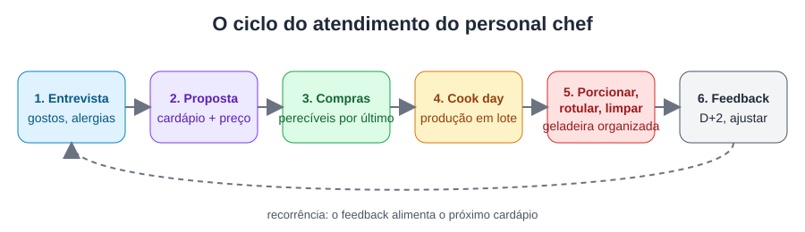

# Aula 1.1 — O que faz (e o que não faz) um personal chef

**Duração estimada:** 10 min · **Formato:** vídeo + texto

## Objetivos
Ao final desta aula, você será capaz de:
- **Diferenciar** personal chef, private chef, buffet/catering e marmitaria.
- **Descrever** as tarefas de um ciclo de atendimento de personal chef.

## Gancho de abertura
"Você cozinha muito bem. Seus amigos dizem que você deveria 'vender comida'. Mas vender
marmita, abrir um buffet e ser personal chef são negócios completamente diferentes — com
clientes, preços e riscos diferentes. Hoje você vai descobrir qual deles é o seu."

## Conteúdo

### 1. Definição
O personal chef é um profissional **autônomo** que atende **vários clientes**, planejando
cardápios personalizados e cozinhando — geralmente na casa do cliente — refeições para a
semana ou para ocasiões específicas [F23]. A CIA (Culinary Institute of America) resume: o
personal chef **administra o próprio negócio**, personaliza cardápios e gerencia o
relacionamento com clientes [F08].

### 2. Comparativo

| | Personal chef | Private chef | Buffet / catering | Marmitaria / delivery |
|---|---|---|---|---|
| Vínculo | Autônomo, vários clientes | Empregado de 1 família/pessoa | Empresa | Empresa/MEI |
| Onde cozinha | Casa do cliente (ou cozinha própria licenciada) | Casa do empregador | Cozinha industrial | Cozinha própria |
| Personalização | Alta (por cliente) | Total | Baixa/média (cardápio de evento) | Baixa (cardápio fixo) |
| Remuneração | Por serviço/pacote | Salário | Por evento/convidado | Por unidade |
| Exemplo | Refeições da semana de uma família | Chef fixo de uma residência | Casamento de 200 pessoas | 10 marmitas fitness |

Fontes: Take a Chef, Tasting Table, Zippia [F23]. Nos EUA, pesquisa citada pela Zippia
aponta média anual de US$ 51.657 para private chef e US$ 47.681 para personal chef.

### 3. O ciclo de atendimento
1. **Contato e entrevista** (gostos, restrições, rotina, orçamento)
2. **Proposta** de cardápio e preço
3. **Compras** dos ingredientes
4. **Cook day**: produção na casa do cliente, porcionamento, rotulagem
5. **Limpeza** da cozinha
6. **Feedback** e ajuste do próximo cardápio

### 4. O que o personal chef NÃO faz
- **Não prescreve dieta** — isso é atividade do nutricionista (Lei 8.234/1991
  **[a verificar]**). Você *executa* um plano alimentar prescrito ou faz cardápios saudáveis
  gerais (Aula 4.2).
- Não é empregado doméstico: tarefas fora do escopo (lavar roupa, cuidar de crianças)
  descaracterizam o serviço — deixe isso claro no contrato (Aula 5.3).
- Não é profissão regulamentada no Brasil: não há registro obrigatório [F22], mas as
  **normas sanitárias** valem para você (Módulo 3).

> **Erro comum:** chamar de "personal chef" o serviço de marmita congelada feito na
> própria casa e vendido a desconhecidos. Isso é comércio de alimentos e tem exigências
> sanitárias próprias de licenciamento (Aula 5.1).

## Roteiro de gravação

| Tempo | Fala (resumo) | Tela / imagem |
|---|---|---|
| 0:00 | Gancho: "vender comida" são 4 negócios diferentes | Chef em close, cozinha residencial |
| 0:45 | Definição de personal chef [F08, F23] | Texto na tela com a definição |
| 2:00 | Tabela comparativa, linha a linha | Tabela animada (4 colunas) |
| 5:00 | O ciclo de atendimento em 6 passos | Infográfico `fluxo-cook-day.svg` |
| 7:30 | O que NÃO faz (nutrição, doméstica, regulamentação) | Ícones de "proibido" |
| 9:00 | Chamada para a prática | Slide com o exercício |

**Imagem sugerida (para gerar ou fotografar):** "chef de dólmã branco organizando potes
rotulados em geladeira de cozinha residencial, luz natural, estilo editorial".

## Prática (20 min)
**Exercício — Classifique os casos:** para cada situação, diga qual modelo é e por quê.
1. Ana cozinha às segundas na casa de 3 famílias diferentes, deixando 5 jantares em cada.
2. Bruno trabalha 6 dias por semana, com carteira assinada, na casa de um empresário.
3. Carla prepara 300 salgados por semana para festas.
4. Diego vende 60 marmitas por semana pelo Instagram, feitas na cozinha dele.

**Resultado esperado:** 1 = personal chef; 2 = private chef; 3 = catering/buffet;
4 = marmitaria/delivery (exige licenciamento de produção própria).

## Quiz de fixação
1. A principal diferença entre personal chef e private chef é:
   a) O tipo de culinária b) O vínculo: autônomo com vários clientes × empregado de um
   empregador c) O preço dos ingredientes d) O uso de dólmã
   **Gabarito: b** — a culinária e o uniforme podem ser iguais; o que muda é o vínculo e o
   número de clientes [F23]. O preço dos ingredientes não define o modelo.

2. Qual etapa vem imediatamente ANTES do cook day?
   a) Feedback b) Limpeza c) Compras d) Contrato de trabalho
   **Gabarito: c** — os ingredientes precisam ser comprados antes da produção. Feedback e
   limpeza vêm depois; contrato de trabalho (CLT) não se aplica ao autônomo.

3. Um cliente pede que você "monte a dieta para ele emagrecer 10 kg". O correto é:
   a) Montar a dieta b) Recusar o cliente c) Pedir o plano prescrito por um nutricionista e
   executá-lo d) Copiar uma dieta da internet
   **Gabarito: c** — prescrição dietética é atividade do nutricionista; você pode executar
   o plano e propor preparações. Recusar o cliente é desnecessário; (a) e (d) extrapolam sua
   atuação.

4. Verdadeiro ou falso: personal chef é profissão regulamentada no Brasil, com registro
   obrigatório em conselho.
   **Gabarito: Falso** — não há regulamentação nem registro obrigatório [F22]; porém as
   normas sanitárias e fiscais se aplicam.

## Resumo
- Personal chef = autônomo, vários clientes, cardápio personalizado, geralmente na casa do cliente.
- Private chef = empregado de uma família.
- Ciclo: entrevista → proposta → compras → cook day → limpeza → feedback.
- Você não prescreve dietas e não é empregado doméstico.

## Para ir além
- Take a Chef — diferenças entre private e personal chef: https://www.takeachef.com/blog/private-chef-vs-personal-chef-differences
- CIA — How to become a personal chef: https://www.ciachef.edu/blog/how-to-become-a-personal-chef/
- **Vídeos de referência (buscar no YouTube):** "day in the life personal chef",
  "um dia como personal chef", "cook day personal chef".

## Referências
- [F08] Culinary Institute of America. How to become a personal chef. https://www.ciachef.edu/blog/how-to-become-a-personal-chef/
- [F22] Educa Mais Brasil. O que é um personal chef. https://www.educamaisbrasil.com.br/cursos-e-faculdades/gastronomia/noticias/o-que-e-um-personal-chef-e-o-que-faz-o-profissional
- [F23] Take a Chef; Tasting Table; Zippia (ver `pesquisa/fontes.md`).
