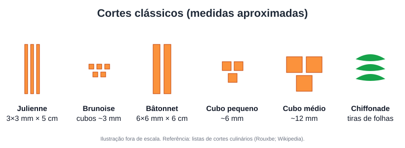

# Aula 2.2 — Facas e cortes clássicos

**Duração estimada:** 15 min · **Formato:** vídeo demonstrativo (close nas mãos)

## Objetivos
- **Executar** os cortes clássicos com medidas padronizadas.
- **Aplicar** técnicas seguras de empunhadura e afiação.

## Gancho de abertura
"Cortes uniformes não são frescura: pedaços do mesmo tamanho cozinham no mesmo tempo. Num
cook day com 6 receitas, isso é a diferença entre terminar em 4 ou em 6 horas."

## Conteúdo

### 1. Segurança e empunhadura
- Pegada "em pinça": polegar e indicador na lâmina, junto ao cabo.
- Mão-guia em "garra": pontas dos dedos dobradas, nós dos dedos guiando a lâmina.
- Tábua firme (pano úmido embaixo). Faca afiada é mais segura que faca cega.
- Chaira **alinha** o fio; pedra **afia**.

### 2. Cortes clássicos

| Corte | Medidas aproximadas | Uso típico |
|---|---|---|
| Julienne | ~3 mm × 3 mm × 5 cm (fina: 2 × 2 mm × 3–5 cm) | Saladas, refogados rápidos |
| Brunoise | Cubos de ~3 mm (vem do julienne) | Molhos, guarnições |
| Bâtonnet | ~6 mm × 6 mm × 6 cm | Legumes salteados, palitos |
| Cubos pequenos | ~6 mm | Arroz, recheios |
| Cubos médios | ~12 mm | Ensopados |
| Chiffonade | Tiras finas de folhas enroladas | Ervas, folhas |

Medidas conforme listas de referência de cortes culinários [F26, F10]. **Brunoise:** junte
as tiras de julienne, gire 90° e corte em cubos de 3 mm [F26].

### 3. Produtividade
- Corte **todos os legumes de uma vez**, separando por receita (Aula 2.1).
- Guarde aparas para caldos (aproveitamento integral reduz custo).

## Roteiro de gravação

| Tempo | Fala | Tela |
|---|---|---|
| 0:00 | Gancho | Close de cortes rápidos |
| 1:00 | Empunhadura e mão em garra | Câmera lateral |
| 3:00 | Chaira × pedra | Demonstração |
| 5:00 | Julienne → brunoise com cenoura | Câmera de cima + régua |
| 9:00 | Bâtonnet e cubos com batata | Câmera de cima |
| 12:00 | Chiffonade com manjericão | Close |
| 13:30 | Produtividade e aparas | Bancada |
| 14:30 | Prática | Slide |

**Imagem de referência:** foto de brunoise de cenoura no Wikimedia Commons (arquivo
"Karotten_brunoise.jpg" — confira a licença antes de usar) e o infográfico do curso.

## Prática (20 min)
Com 2 cenouras, 2 batatas e 1 cebola: faça julienne, brunoise, bâtonnet, cubos pequenos e
médios. Meça 5 peças de cada com régua e fotografe ao lado da régua.
**Resultado esperado:** variação máxima de ±1 mm nos cortes finos.

## Quiz de fixação
1. A brunoise é obtida a partir de:
   a) Bâtonnet b) Julienne c) Chiffonade d) Cubos médios
   **Gabarito: b** [F26].
2. A chaira serve para:
   a) Afiar a faca removendo metal b) Alinhar o fio c) Limpar a lâmina d) Cortar ossos
   **Gabarito: b** — quem afia (remove metal) é a pedra.
3. Por que cortes uniformes importam no cook day?
   **Gabarito:** cocção uniforme, padrão visual e previsibilidade do tempo.
4. Qual a posição correta da mão-guia?
   **Gabarito:** em garra, pontas dos dedos dobradas para dentro.

## Resumo
- Segurança: faca afiada, tábua firme, mão em garra.
- 6 cortes básicos com medidas padronizadas.
- Corte em bloco e aproveite aparas.

## Referências
- [F10] Rouxbe — Types of Knife Cuts. https://rouxbe.com/tips-techniques/495
- [F26] List of culinary knife cuts. https://en.wikipedia-on-ipfs.org/wiki/List_of_culinary_knife_cuts
