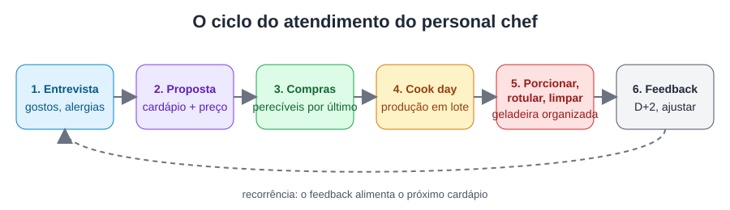

# Aula 2.4 — Produção em lote, porcionamento e reaquecimento

**Tempo de leitura:** 12 min · **Formato:** leitura + prática

## Objetivos
- **Produzir** 4–6 receitas em lote em até 4 h.
- **Padronizar** porções por peso e redigir instruções de reaquecimento.

## Gancho de abertura
"Seu cliente abre a geladeira na quarta-feira: os potes são iguais, a etiqueta diz o que é,
até quando vale e como aquecer. Isso é profissionalismo — e é o que faz ele renovar."

## Conteúdo

### 1. Lógica do lote
- Agrupe tarefas iguais: **todos os cortes**, depois **todos os fornos**, depois **todas as
  panelas**.
- Use o forno em capacidade máxima (2 assadeiras ao mesmo tempo).
- Uma base, várias receitas: o mesmo refogado vira molho de tomate e base de feijão.

### 2. Porcionamento padronizado
- **Pese** cada porção (balança). Referências comuns em meal prep: proteína 100–150 g
  cozida, carboidrato 100–150 g, legumes 80–120 g — **ajuste ao plano do cliente ou do
  nutricionista dele**.
- Mesma embalagem, mesma posição dos itens = padrão visual.

### 3. Resfriamento e guarda
Resfrie rápido (banho de gelo, porções rasas) antes de fechar e guardar — tempos e
temperaturas na Aula 3.1. Nunca coloque panela grande quente fechada na geladeira.

### 4. Instruções de reaquecimento (no rótulo ou em cartão)
- Micro-ondas: tampa entreaberta, 2–3 min, mexer na metade.
- Forno: 180 °C por 10–15 min, coberto.
- Reaquecer até ficar bem quente no centro (no mínimo 70 °C é a referência de cocção da
  RDC 216 [F11]).

## Imagem da aula
**Imagem sugerida:** "potes de vidro idênticos com refeições porcionadas e etiquetas,
alinhados em geladeira".

## Prática (20 min + produção)
**Teste de produção cronometrado:** produza 3 receitas, 10 porções no total. Registre o
tempo de cada etapa, o peso de cada porção e as instruções de reaquecimento. Calcule seu
tempo total e onde perdeu tempo.

## Quiz de fixação
1. Num lote, a ordem mais eficiente é:
   a) Fazer receita por receita do início ao fim b) Agrupar tarefas semelhantes
   c) Começar pela limpeza d) Começar pela sobremesa
   **Gabarito: b** — agrupar reduz trocas de utensílio e tempo ocioso.
2. Por que pesar as porções?
   **Gabarito:** padrão, controle de custo e respeito ao plano alimentar do cliente.
3. O que nunca fazer no resfriamento?
   **Gabarito:** guardar panela grande quente e tampada na geladeira (resfriamento lento,
   risco microbiológico e aquecimento da geladeira).

## Resumo
- Agrupe tarefas; use o forno cheio; uma base, várias receitas.
- Pese porções e padronize embalagens.
- Resfrie rápido e entregue instruções de reaquecimento.

## Referências
- [F11] RDC 216/2004.
- [F30] Chef Shelley — cook days. https://chef-shelley.kit.com/posts/newsletter-3
