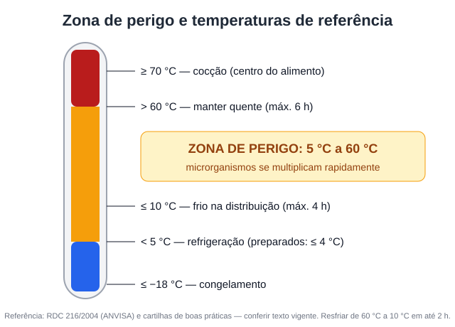

# Aula 3.1 — Perigos, zona de perigo e controle de temperatura

**Duração estimada:** 12 min · **Formato:** vídeo + infográfico

## Objetivos
- **Identificar** os perigos biológicos, químicos e físicos nos alimentos.
- **Aplicar** os limites de temperatura de cocção, manutenção, resfriamento e descongelamento.

## Gancho de abertura
"Uma intoxicação alimentar acaba com a reputação de um personal chef em uma semana. E quase
sempre ela nasce de um único erro: **temperatura**."

## Conteúdo

### 1. Tipos de perigo
- **Biológicos:** bactérias, vírus, parasitas (o mais comum).
- **Químicos:** resíduos de produtos de limpeza, agrotóxicos, alergênicos.
- **Físicos:** cabelo, fragmentos de vidro, ossos, adornos.

### 2. A zona de perigo
Entre **5 °C e 60 °C** os microrganismos se multiplicam rapidamente [F11, cartilha].

### 3. Temperaturas de referência (conferir no texto da RDC 216)

| Etapa | Parâmetro | Fonte |
|---|---|---|
| Cocção | Centro do alimento ≥ 70 °C (ou combinação tempo/temperatura equivalente) | RDC 216, item 4.8 [F11] **[conferir]** |
| Manutenção quente | > 60 °C por no máximo 6 h | Materiais que citam a RDC 216 [F11] |
| Manutenção fria (distribuição) | ≤ 10 °C por no máximo 4 h | Idem |
| Resfriamento | De 60 °C para 10 °C em até 2 h; depois guardar < 5 °C ou congelar | Prática usual citada em materiais técnicos **[conferir redação exata]** |
| Guarda refrigerada de preparado | A 4 °C ou menos, consumo em até 5 dias | RDC 216 **[conferir item]** |
| Descongelamento | Sob refrigeração (< 5 °C) ou água corrente fria, embalado, máx. 4 h; **nunca** em temperatura ambiente | COVISA-SP, UDESC [F12] |

### 4. Na prática do personal chef
- Use o **termômetro** (kit, Aula 2.1): meça o centro das carnes e o resfriamento.
- Confira a temperatura da geladeira do cliente na chegada (termômetro de geladeira).
- Se a geladeira do cliente estiver acima de 5 °C, **avise por escrito** e reduza a
  validade das refeições.

## Roteiro de gravação

| Tempo | Fala | Tela |
|---|---|---|
| 0:00 | Gancho | Texto: "1 erro = fim da reputação" |
| 0:45 | 3 tipos de perigo | Ícones |
| 2:30 | Zona de perigo | Infográfico `zona-de-perigo.svg` |
| 4:30 | Tabela de temperaturas | Tabela animada |
| 8:00 | Demonstração do termômetro | Close em frango assado |
| 10:30 | Geladeira do cliente | Termômetro de geladeira |
| 11:30 | Prática | Slide |

## Prática (20 min)
Com um termômetro: meça (1) o centro de uma carne assada, (2) a temperatura da sua
geladeira em 3 pontos, (3) cronometre o resfriamento de 1 litro de caldo em panela × em
recipiente raso com banho de gelo. Registre e compare.

## Quiz de fixação
1. A zona de perigo é aproximadamente:
   a) 0–20 °C b) 5–60 °C c) 60–100 °C d) −18–0 °C
   **Gabarito: b** [F11].
2. A forma correta de descongelar um frango é:
   a) Na pia, em temperatura ambiente b) Na geladeira c) Ao sol d) Em água morna
   **Gabarito: b** [F12] — temperatura ambiente e água morna deixam a superfície na zona de perigo.
3. Temperatura mínima de referência no centro do alimento na cocção:
   **Gabarito:** 70 °C [F11].
4. Um caldo de 10 litros precisa ser resfriado rápido. O que fazer?
   **Gabarito:** dividir em recipientes rasos, banho de gelo, mexer; só então refrigerar.

## Resumo
- Zona de perigo: 5–60 °C.
- Cocção ≥ 70 °C no centro; resfriamento rápido; descongelar na geladeira.
- Termômetro é obrigatório no seu kit.

## Referências
- [F11] RDC 216/2004 e Cartilha (Prefeitura do Rio). https://vigilanciasanitaria.prefeitura.rio/wp-content/uploads/sites/84/2023/06/CartilhaBoasPraticas_Livreto.pdf
- [F12] COVISA-SP. https://www.prefeitura.sp.gov.br/cidade/secretarias/upload/saude/cuidados_minimos_manipulacao_alimentos_covisa.pdf ; UDESC.
