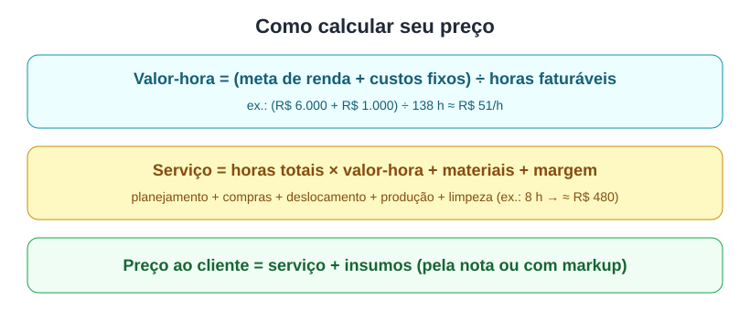

# Aula 5.2 — Precificação: quanto cobrar

**Tempo de leitura:** 15 min · **Formato:** leitura + prática

## Objetivos
- **Calcular** seu valor-hora a partir de meta de renda, custos e horas faturáveis.
- **Precificar** um pacote semanal e um evento, separando serviço e insumos.

## Gancho de abertura
"O erro nº 1 do personal chef iniciante: cobrar só as 4 horas de fogão. E as compras, o
planejamento, o deslocamento, a limpeza? Você está trabalhando de graça metade do tempo."

## Conteúdo

### 1. Estrutura mais comum de preço
**Taxa de serviço** (por pacote/nº de refeições ou por hora) **+ insumos** (mercado),
cobrados à parte — com reembolso pelo valor da nota ou com acréscimo (markup) de 10–30%
citado em guias de preço [F24]. No Brasil também é comum o pacote semanal ou a visita
mensal [F16].

### 2. Passo 1 — Seu valor-hora

```
Valor-hora = (Meta de renda líquida mensal + Custos fixos mensais) ÷ Horas faturáveis no mês
```
Exemplo:
- Meta líquida: R$ 6.000
- Custos fixos: R$ 1.000 (DAS, celular, transporte, reposição do kit, marketing)
- Horas faturáveis: 4 clientes/semana × 8 h × 4,3 semanas ≈ 138 h
- **Valor-hora ≈ R$ 51**

Referência de mercado (valor-hora estimado de autônomos em 2026): SP R$ 34–108; BH R$ 28–88
[F16].

### 3. Passo 2 — Horas reais de um cook day
| Etapa | Horas |
|---|---|
| Planejamento/cardápio/comunicação | 1,0 |
| Compras | 1,5 |
| Deslocamento | 1,0 |
| Produção | 4,0 |
| Limpeza e organização | 0,5 |
| **Total** | **8,0** |

### 4. Passo 3 — Preço do pacote
```
Serviço = Horas totais × Valor-hora + Materiais (embalagens, etiquetas) + Margem de segurança
```
Exemplo: 8 h × R$ 51 = R$ 408 + R$ 30 materiais + 10% margem ≈ **R$ 480** por cook day
(5 jantares para 3 pessoas = 15 porções → ~R$ 32/porção de serviço) **+ mercado**.



### 5. Eventos e jantares
Preço por pessoa = (insumos + horas da equipe × valor-hora + materiais + deslocamento +
margem) ÷ nº de convidados. Referências: R$ 120–450 por pessoa em jantares íntimos
[F17, F18]; R$ 800–3.000 por evento pequeno [F18].

### 6. Regras de ouro
- Nunca inclua mercado "estimado" no preço fixo sem margem — preços variam.
- Cobre **sinal** (ex.: 50%) para eventos e reservar a data.
- Reavalie preços a cada 6 meses.
- Não dispute por preço: dispute por valor (Módulo 6).

## Prática (20 min)
Use `extras/modelo-planilha-precificacao.md` para calcular: (1) seu valor-hora;
(2) o preço do pacote da Família Lima (Módulo 4); (3) o preço por pessoa de um jantar de
4 tempos para 6 pessoas.

## Quiz de fixação
1. Meta R$ 4.000, custos R$ 800, 120 h faturáveis. Valor-hora?
   a) R$ 33,33 b) R$ 40 c) R$ 26,67 d) R$ 50
   **Gabarito: b** — (4.000 + 800) ÷ 120 = R$ 40.
2. Estrutura de preço mais comum citada nas fontes:
   **Gabarito:** taxa de serviço + insumos à parte (no custo ou com markup) [F24].
3. Por que cobrar sinal em eventos?
   **Gabarito:** garante a data e cobre compras antecipadas em caso de cancelamento.
4. Quais etapas, além da produção, entram nas horas do cook day?
   **Gabarito:** planejamento, compras, deslocamento, limpeza.

## Resumo
- Valor-hora = (meta + custos) ÷ horas faturáveis.
- Cobre todas as horas, não só as de fogão.
- Serviço + insumos separados; sinal para eventos.

## Referências
- [F16] FreelaSemCrise. https://www.freelasemcrise.com.br/calculadoras/preco/personal-chef
- [F17] Catraca Livre (2026). [F18] Revista Oeste (2026).
- [F24] The Pricer; Chefs for Seniors.
