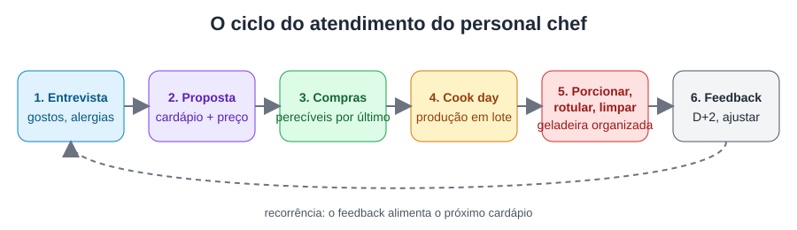

# Aula 5.4 — O cook day de ponta a ponta

**Tempo de leitura:** 15 min · **Formato:** leitura + prática

## Objetivos
- **Executar** um cook day completo seguindo checklist, dentro do tempo planejado.
- **Avaliar** o desempenho do cook day com indicadores simples.

## Gancho de abertura
"Personal chefs relatam que o segredo do cook day não está no fogão — está na véspera e nos
últimos 30 minutos" [F30]. Vamos acompanhar um dia completo."

## Conteúdo

### 1. Linha do tempo

**D-3 a D-2:** enviar cardápio para aprovação; confirmar data e restrições.
**D-1:** fichas técnicas impressas; lista de compras; kit conferido; compras de não
perecíveis.
**Dia D:**
| Hora | Ação |
|---|---|
| 07:30 | Compras de perecíveis (bolsa térmica) |
| 08:30 | Chegada, protocolo de chegada (Aula 3.2), termômetro na geladeira |
| 08:45 | Montar estação, pré-aquecer forno, iniciar itens longos |
| 09:00–12:00 | Produção em lote (Aula 2.4) |
| 12:00–12:30 | Resfriamento, porcionamento, rotulagem |
| 12:30–13:00 | Limpeza, organização da geladeira, fotos, bilhete ao cliente |
| 13:00 | Saída; envio de mensagem com resumo + instruções |
**D+2:** pedido de feedback (3 perguntas).

### 2. Bilhete/cartão ao cliente
Lista do que foi preparado, ordem de consumo sugerida, validades, reaquecimento e
"guarde os potes para a próxima visita".

### 3. Indicadores do cook day
- Tempo planejado × real
- Custo de mercado estimado × real
- Desperdício (o que sobrou/foi descartado)
- Nota do cliente (1–5) e comentário

### 4. Imprevistos comuns e respostas
| Imprevisto | Resposta |
|---|---|
| Item em falta no mercado | Substituto previsto na ficha técnica; avisar cliente |
| Equipamento do cliente quebrado | Kit próprio; ajustar técnica; registrar |
| Atraso | Avisar antes; priorizar pratos de maior validade |
| Cliente presente e conversando muito | Simpatia + limites ("vou terminar esta etapa e já te mostro") |

## Prática (20 min + cook day)
Faça um cook day completo (para você, família ou cliente-teste) com o
`extras/checklist-cook-day.md` e registre os 4 indicadores.

## Quiz de fixação
1. Quando comprar os perecíveis?
   a) Uma semana antes b) No dia, por último, e ir direto ao cliente c) Na véspera à noite
   e deixar no carro d) Tanto faz
   **Gabarito: b** — reduz tempo fora da refrigeração.
2. Cite 2 indicadores de desempenho do cook day.
   **Gabarito:** tempo planejado × real; custo estimado × real; desperdício; nota do cliente.
3. Qual o objetivo do bilhete ao cliente?
   **Gabarito:** orientar consumo, validade e reaquecimento, reforçando o valor percebido.

## Resumo
- O cook day começa em D-3 e termina em D+2.
- Checklist + indicadores = melhoria contínua.
- Antecipe imprevistos.

## Referências
- [F30] Chef Shelley; Chefpreneur Podcast — A day in the life of a personal chef.
- [F11] RDC 216/2004.
